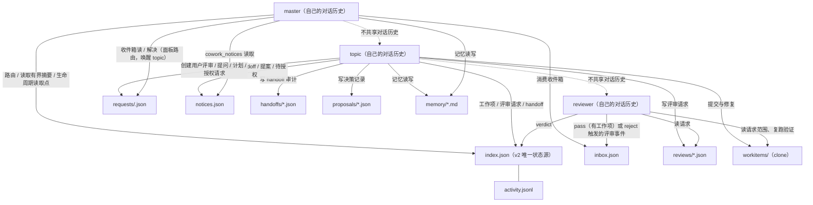
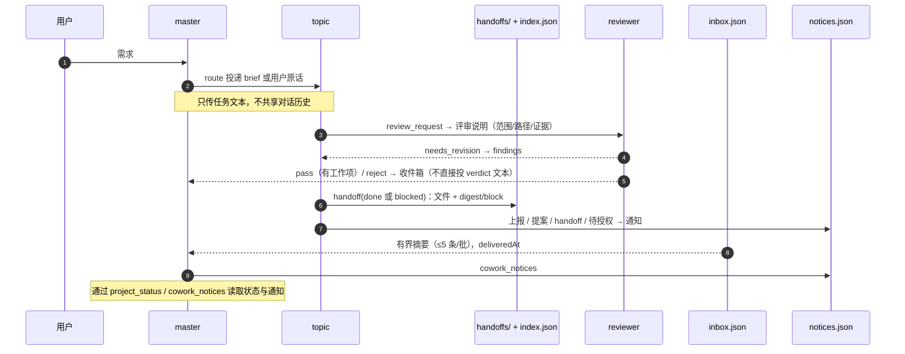

# 项目上下文：master、主题会话与磁盘共享面

本文说明 master、topic 与 reviewer 如何共享项目上下文。只写当前行为与入口，不复制规则：记忆预算与截断见 [PLAN.md](PLAN.md) §5.5，路由判定见 [routing.md](routing.md)。

## 1. 共享面

项目状态只通过仓库内 `.dsh-cowork/` 的磁盘产物共享；对话历史彼此独立，master、topic、reviewer 看不到对方的聊天。

| 文件 | 内容 | 权威定义 |
|---|---|---|
| `index.json` | v2 项目索引：master、主题、工作项、路由目标 | [ProjectIndexV2](../src/store/schema.ts#L194) |
| `activity.jsonl` | 状态、路由、评审、合并、主题上报、决策提案、待授权、归档与错误的事件流（证据，不是状态源） | [ActivityEvent](../src/store/schema.ts#L211) |
| `inbox.json` | master 必须决定的事；投递后写 `deliveredAt` | [InboxItem](../src/store/schema.ts#L232) |
| `requests/<requestId>.json` | 用户请求记录：四类请求、左右消息、状态与投递错误 | [RequestRecordV1](../src/panel/inbox-contract.ts#L265) |
| `handoffs/` | topic 的 handoff 审计文件 | [buildHandoffRecord](../src/domains/topic/handoff.ts#L214) |
| `proposals/` | topic 的决策记录文件 | [DecisionProposalV1](../src/tools/topic.ts#L443) |
| `notices.json` | 主题通知账本：每条通知送到哪个会话、是否送达 | [NoticeLedgerV1](../src/domains/notices/notices.ts#L95) |
| `reviews/` | 每次评审请求的 pending/verdict 记录 | [ReviewRequestRecord](../src/domains/review/review-request.ts#L121) |
| `workitems/` | 隔离工作项 clone 与 `cowork/<workItemId>` 分支 | [checkout.ts](../src/domains/isolation/checkout.ts#L45-L58) |
| `memory/` | `constraints/decisions/facts` 三份项目记忆 | [memory.ts](../src/domains/memory/memory.ts) |
| `.write.lock` | 上述写入共用的项目锁 | [store.ts](../src/store/project-store.ts#L338) |

## 2. 记忆注入

`cowork:memory` 是 agent 作用域的 system prompt 段落，`order=900`（[memory-prompt.ts](../src/platform/memory-prompt.ts#L19)）。注册条件是 preset 为 `cowork-master` 或 `cowork-topic`，且会话 cwd 向上能找到 `.dsh-cowork/index.json`；reviewer 不注入（[COWORK_MEMORY_PRESETS](../src/platform/memory-prompt.ts#L28)、[注册点](../src/platform/memory-prompt.ts#L93-L145)）。

- 记忆是**拉取式快照**：写入不推送；下一次 prompt assembly 才重新读取。按 agent 的 digest 缓存决定是否重渲染。
- 渲染顺序、整条拼接与截断的实现在 [renderMemoryBlock](../src/domains/memory/memory.ts#L434)；预算与截断规则以 [PLAN.md](PLAN.md) §5.5 为准。
- 注入块之外的旧条目不会被自动拼入，用 `cowork_memory_search` 检索（[searchMemory](../src/domains/memory/memory.ts#L477)）。
- 记忆按仓库根渲染；隔离工作项里的 clone 不改变注入来源。

## 3. 上下文的上行与下行

**下行（master / 插件 → topic）**

- 新建主题：`cowork_route` 用 `brief` 作为第一条消息，未给时用 [buildThreadBrief](../src/platform/tool-model.ts#L220) 生成（携带主题 id、标题、意图、工作区与 handoff 义务，不粘贴完整仓库）；`cowork_topic_create` 只投递显式给出的 brief。
- 复用主题：把用户原话（与可选 brief）直接投给主题会话。
- 评审退回：`needs_revision` / `reject` 时把 findings 投回主题（[buildRevisionMessage](../src/domains/review/review-request.ts#L1211)、[buildRejectMessage](../src/domains/review/review-request.ts#L1220)），不唤醒 master。

**下行（topic → reviewer）**

- `cowork_review_request` 新建 reviewer 并投递 [buildReviewBrief](../src/domains/review/review-request.ts#L1114) 生成的评审说明：`requestId`、范围、路径、分支、改动文件、验证要求、上一轮请求与 findings。reviewer 自己读代码、复跑验证，不依赖主题的自述。

**上行（topic / reviewer → master）**

- `cowork_handoff(done)`：写审计文件，更新主题 `digest`（摘要，≤200 字）与 `lastDeliveryConfirmedAt`，写一条 `topic-reported` 事件和对应通知；**不 prompt master**。
- `cowork_handoff(blocked)`：置 `blocked` 标记并记住阻塞前的状态，写一条 `topic-reported` 事件和对应通知；不写收件箱，不 prompt master。
- `cowork_topic_report` / `cowork_decision_propose` / `cowork_authorization_request`：写活动和通知账本；`authorization_request` 会把主题置为待授权阻塞；都不唤醒 master。
- 评审 `pass`（有工作项）：写 `merge-needed` 收件箱，master 被唤醒后决定是否合并；`reject`：主题置 blocked，写 `review-reject` 收件箱。
- 收件箱仍是唯一会启动 master 一轮对话的推送：多条待办合并成一批（≤5 条），投递成功写 `deliveredAt`，失败保留并由 `cowork_project_status` 重放（[deliverInbox](../src/platform/tool-runtime.ts#L178)、[inbox.ts](../src/store/inbox.ts#L17-L30)）。
- master 不接收完整 handoff、评审请求或 findings 文本；它读 `cowork_project_status` / `cowork_topic_list` 的有界摘要、收件箱、活动尾部，以及 `cowork_notices` 的通知摘要。

完整的决策记录与会话交接流程见 [decision-and-handoff.md](decision-and-handoff.md)。

## 4. 隔离矩阵

隔离方式与工具面的来源：[presets.ts](../src/platform/presets.ts#L121-L166) 与 [PLAN-V0.2 §4.5/§5.5](PLAN-V0.2.md#45-会话与隔离)。

| 会话 | 工作目录与可见代码 | 写权限 | `cowork:memory` | 与其他会话共享 |
|---|---|---|---|---|
| master | 主仓库 | 无 `fs`/`bash`/搜索；通过 cowork 工具、ask-user/todo 与面板行动 | 是 | 索引、收件箱、通知账本、活动尾部、有界主题摘要 |
| topic | 主仓库（默认） | `fs`/`bash`/搜索；创建并提交工作项 | 是 | 索引、记忆、handoff/review 文件；自己的对话 |
| 工作项 | `<repo>/.dsh-cowork/workitems/<id>` 的 clone，分支 `cowork/<id>` | 只写自己的 clone 并提交 | 由所属 topic 的注入覆盖（clone 不是独立会话） | 已提交代码 + 索引 + 记忆；看不到主仓未提交改动与 `.dsh-cowork` |
| reviewer | 主仓库；按请求读取工作项 clone | 无 `fs`；`bash` 与文件搜索可用，实际只读边界见 [KI-15](KNOWN_ISSUES.md) | 否 | 请求范围、索引、仓库；对话历史独立；verdict 后归档 |

## 5. 三个边界

- **记忆是快照，不是消息**：写入不会通知已存在的会话；下一次 prompt assembly 才生效。
- **工作项 clone 只含已提交内容**：需要主仓未提交改动或本地依赖时，必须在 clone 内自行处理；隔离成本与读边界见 [KI-1](KNOWN_ISSUES.md)。
- **reviewer 的只读不是沙箱**：工具面无 `fs`，但 `bash` 仍可写；只读性靠 preset 与 protocol，重要评审仍应由人复核（[KI-15](KNOWN_ISSUES.md)）。
