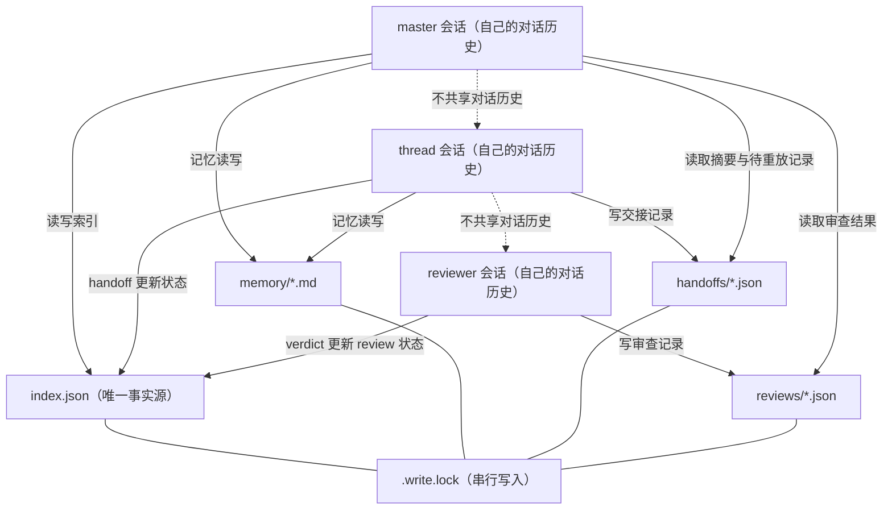
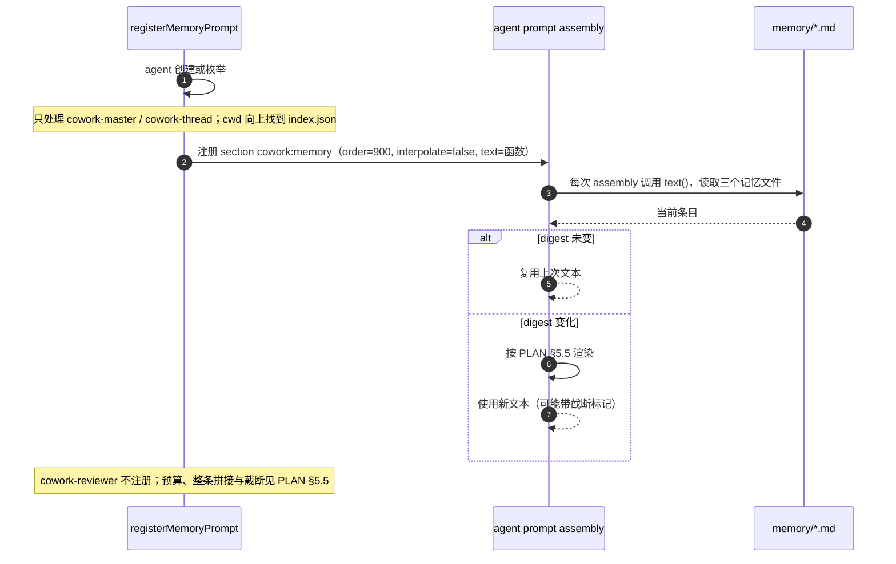
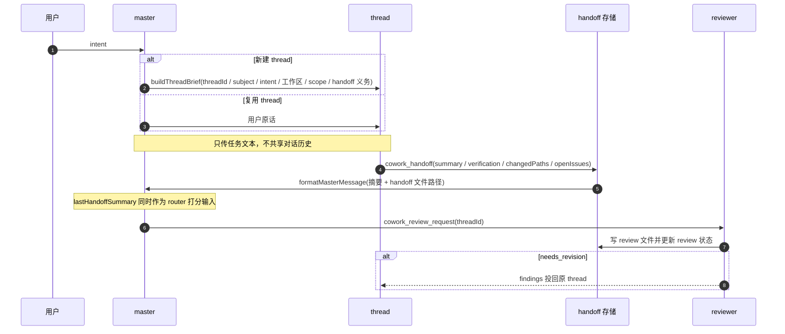

# 项目上下文：master、thread 与共享磁盘面

本文说明 master 与 thread 如何管理、共享项目上下文。只讲当前行为与入口，不复制规则：记忆预算与截断规则见 [PLAN.md](PLAN.md) §5.5，路由判定见 [routing.md](routing.md)。

## 1. 上下文共享面

项目上下文与状态类共享面只有仓库内 `.dsh-cowork/` 的磁盘产物。代码另有共享通道：非隔离 thread 直接写主仓库工作区，isolated thread 经 clone 与 `cowork/<threadId>` 分支在 review 后由 master 合并（[PLAN.md](PLAN.md) §5.6–§5.7、[routing.md](routing.md) §3）。对话历史各自独立，master、thread、reviewer 互相看不到对方的聊天。

- `index.json`：项目索引，是 `masterSessionId`、thread 状态、`checkoutPath` 与 review 状态的唯一事实源；字段定义见 [src/store.ts](../src/store.ts#L58-L99)。
- `memory/{constraints,decisions,facts}.md`：项目记忆。
- `handoffs/<threadId>-<stamp>.json`：thread 的交接记录。
- `reviews/<threadId>-<stamp>.json`：reviewer 的审查记录。
- `.write.lock`：上述写入共用同一把项目锁；存储层说明见 [src/store.ts](../src/store.ts#L1-L17)，记忆写入复用该锁见 [src/tools.ts](../src/tools.ts#L143-L150)。

## 2. 记忆注入

`cowork:memory` 是 agent 作用域的 system prompt 段落。`order=900` 是源码常量快照，见 [src/memory-prompt.ts](../src/memory-prompt.ts#L14-L22)；`interpolate:false` 在 section 注册调用里内联，见 [src/memory-prompt.ts](../src/memory-prompt.ts#L173-L178)。注册条件、`text` 为函数以及按 agent 的 digest 缓存见 [src/memory-prompt.ts](../src/memory-prompt.ts#L128-L178)。只有 preset 为 `cowork-master` / `cowork-thread` 且 cwd 向上能找到 `.dsh-cowork/index.json` 的 agent 会注册；reviewer 不注入。

渲染顺序与整条截断的当前实现见 [src/memory.ts](../src/memory.ts#L434-L466)。写入后不会推送；下一次 assembly 重新求值时才会读到新记忆。

## 3. handoff 的上下行

下行有三个触发：新建 thread 时，[buildThreadBrief](../src/tool-model.ts#L178-L203) 携带 threadId、subject、intent、工作区、scope 与 handoff 义务；复用 thread 时投递用户原话；`needs_revision` 时把 findings 投回原 thread。新建与复用的判定及 review 闭环见 [routing.md](routing.md) §2–§3。

上行只有 `cowork_handoff`：结构化记录（summary、verification、changedPaths、openIssues）写入 handoff 文件，再经 [formatMasterMessage](../src/handoff.ts#L240-L265) 投递给 master；写入与投递顺序见 [src/handoff.ts](../src/handoff.ts#L344-L360)。最新 handoff 摘要同时是 router 的打分输入，见 [src/router.ts](../src/router.ts#L179-L209)。

## 4. 四类会话隔离矩阵

隔离方式、clone 内容与 reviewer 工具面的来源：[PLAN.md](PLAN.md) §5.6–§5.7、[M2_PROBE_RESULT.md](archived/M2_PROBE_RESULT.md) §5、[src/presets.ts](../src/presets.ts#L109-L122)。

| 会话 | 工作目录与可见代码 | 写权限 | `cowork:memory` | 与其他会话共享 |
|---|---|---|---|---|
| master | 主仓库全部工作区 | 按 master 角色操作；实现由 thread 拥有，见 [persona](../src/presets.ts#L28-L39) | 是 | 索引、记忆、handoff 与 review 文件 |
| 非隔离 thread | 主仓库工作区 | 共享写主仓库 | 是 | 全部磁盘产物 |
| isolated thread | `<repo>/.dsh-cowork/threads/<threadId>` 的本地 clone；仅已提交文件，无 `node_modules`、`.dsh-cowork` | 只写自己的 clone，并提交到 `cowork/<threadId>` | 是；宿主按仓库根注入，不受 clone 内容影响 | 已提交代码 + 记忆 + 索引（隔离边界） |
| reviewer | 主仓库；由 review request 创建 | 无 `tool-fs`（没有 read/write/edit）；`bash` 与文件搜索可用，实际只读边界见 [KI-15](KNOWN_ISSUES.md) | 否 | 可读主仓库、索引、handoff 与 review；对话历史独立 |

## 5. 三个边界

- **记忆是拉取式快照**：写入不会通知或推送到已存在的会话；下一次 prompt assembly 才重新读取。实现入口见 [src/memory-prompt.ts](../src/memory-prompt.ts#L153-L169)。
- **超预算条目只能检索回来**：注入块之外的记忆不会再被自动拼入，需用 `cowork_memory_search` 找回；预算规则见 [PLAN.md](PLAN.md) §5.5，检索实现见 [src/memory.ts](../src/memory.ts#L477-L490)。
- **isolated thread 的共享退化**：它只能看到已提交代码，加上记忆与索引；clone 位于仓库内，所以 cwd 向上仍能命中索引，记忆由宿主侧按仓库根渲染。见 [M2_PROBE_RESULT.md](archived/M2_PROBE_RESULT.md) §5 与 [src/store.ts](../src/store.ts#L1030-L1058)。
