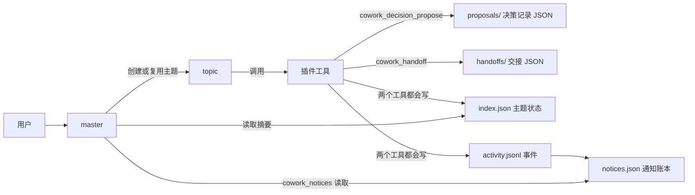
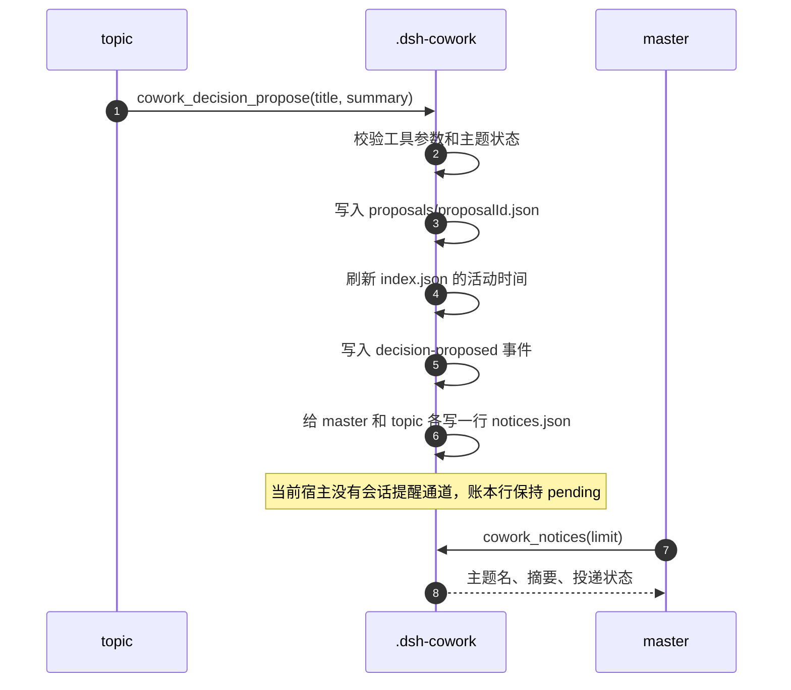
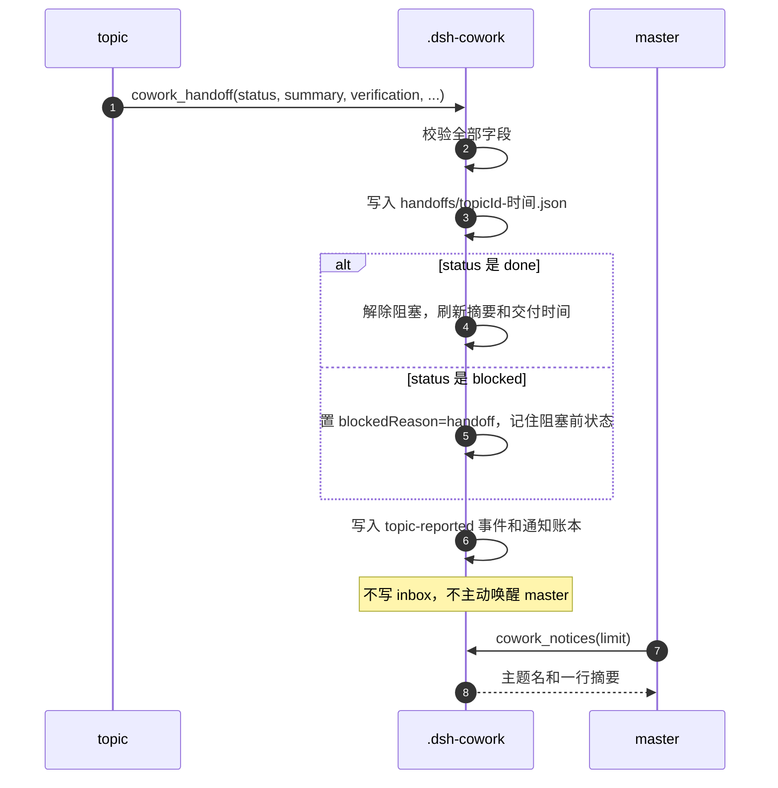
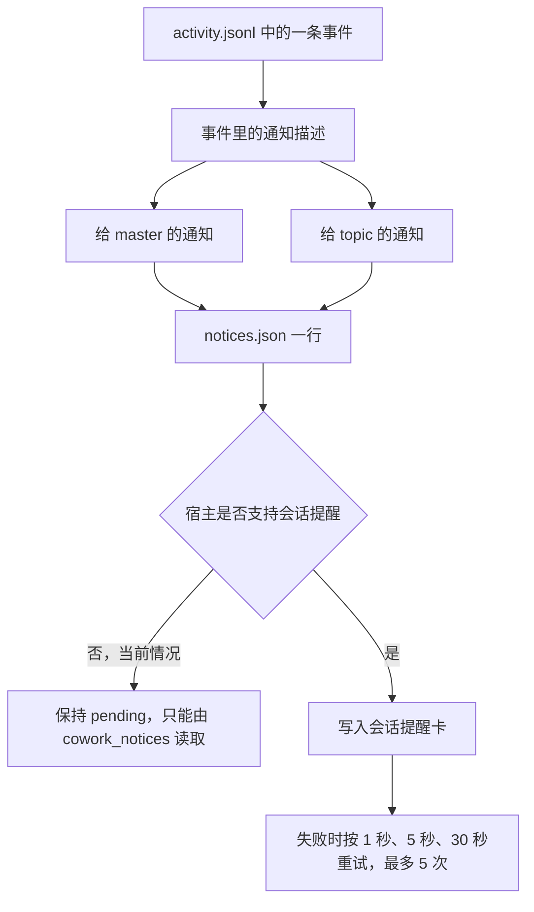

# 决策记录与会话交接（主题页 v2）

本文说明主题页 v2 中两件事的当前实现和使用方法：

- 主题会话如何记录一个决策，对应工具 `cowork_decision_propose`；
- 主题会话结束时，如何把结果交接给 master，对应工具 `cowork_handoff`。

文中的 **master** 指项目主会话，**topic** 指主题会话。两者各有自己的对话历史，只通过仓库里的 `.dsh-cowork/` 文件交换状态。工作项页面和会话提醒卡不在本文范围内。

最短路径：topic 用 `cowork_decision_propose` 留下决策记录，用 `cowork_handoff` 交接结果；两者都写文件、写活动事件、写通知账本；master 用 `cowork_notices` 读摘要，人直接打开 JSON 文件看完整内容。

## 1. 两个动作分别解决什么问题

| 想留下什么 | 使用的工具 | 产生的主要结果 |
|---|---|---|
| 一个需要用户或 master 知道的选择 | `cowork_decision_propose` | 一个决策记录 JSON、一条 `decision-proposed` 事件、每个目标一条通知 |
| 主题做完了，或主题卡住了 | `cowork_handoff` | 一个交接 JSON、主题摘要或阻塞状态的变化、一条 `topic-reported` 事件、每个目标一条通知 |

两个工具都只能由 topic 调用，都不会自动归档主题。它们也都不写入 `inbox.json`，不会主动唤醒 master 的对话。

## 2. 状态和文件放在哪里

一个仓库对应一份 `.dsh-cowork/` 数据。两个功能涉及的文件如下：



| 文件 | 谁写 | 谁读 | 内容 |
|---|---|---|---|
| `index.json` | 插件 | master、topic、面板 | 主题状态、摘要、阻塞原因、待授权、最后一次确认交付的时间 |
| `proposals/<proposalId>.json` | 插件 | 人和审计 | 一条决策记录的完整内容 |
| `handoffs/<topicId>-<时间>.json` | 插件 | 人和审计 | 一次交接的完整内容 |
| `activity.jsonl` | 插件 | 面板、`cowork_notices`、审计 | 追加式事件流；事件里带一段有长度上限的通知描述 |
| `notices.json` | 插件 | `cowork_notices` | 每条通知送到 master 或 topic 的投递状态 |
| `inbox.json` | 插件 | master | 只保留合并、评审退回、跨主题冲突等旧事件；这两个功能不写它 |

`index.json` 是主题状态的唯一来源。`notices.json` 是通知账本：它不保存通知正文，只保存每条通知送到哪个会话、有没有送到。`activity.jsonl` 和 `notices.json` 用来记录发生过什么、通知有没有送到，不反过来决定主题状态。

## 3. 决策记录

### 3.1 记录是什么

topic 在做一个属于用户或 master 的决定之前，调用 `cowork_decision_propose`，把标题和一段说明写成 JSON，并生成一条通知。它只是记录，不是审批：

- 主题不会因为记录决策而暂停或阻塞，也不会进入阻塞分组；
- 摘要不会因此更新；
- 主题的活动时间会刷新，原本空闲的主题会回到运行中。

代码和文件名使用 `proposal`；本文把这个动作产生的记录称为决策记录，把对应文件称为提案文件。

文件路径是 `.dsh-cowork/proposals/<proposalId>.json`，`proposalId` 是 UUID。文件内容如下：

```json
{
  "version": 1,
  "proposalId": "0f4c1a2e-6b1d-4c3a-9e2f-1a2b3c4d5e6f",
  "topicId": "session-abc123",
  "title": "通知写入哪个文件",
  "summary": "方案 A 复用 activity 行；方案 B 新建 notices.json。建议 B，因为投递状态和事件正文是两类数据。",
  "status": "open",
  "createdAt": "2026-11-10T12:00:00.000Z"
}
```

字段限制：

- `title` 最多 200 个字符；
- `summary` 最多 2000 个字符；
- `status` 目前固定为 `open`，没有修改或关闭提案的工具；
- 通知正文有 200 个字符上限，完整说明在文件里。

### 3.2 一次调用做什么



按顺序说明：

1. **校验。** 调用者必须是 topic；主题必须存在且没有归档；`title` 和 `summary` 必须是非空字符串，并且不超过长度上限。
2. **写提案文件。** 插件在项目锁内把记录写成 `<repo>/.dsh-cowork/proposals/<proposalId>.json`。写失败返回 `topic/proposal-write-failed`，不会继续改主题状态。
3. **刷新活动时间。** 主题的 `lastActiveAt` 和 `updatedAt` 更新，空闲主题回到运行中。摘要、阻塞原因、待授权都不变。
4. **写事件。** 活动流新增一条 `decision-proposed` 事件，`details` 里带 `proposalId`、`proposalPath`、提案标题、摘要和一段通知描述。
5. **写通知账本。** 按 master 和 topic 两个目标各写一行，记下通知编号、目标和投递状态。返回的 `noticed: true` 表示事件已经写进活动流；账本写入失败不会让工具失败，也不会回滚主题状态。
6. **返回结果。** topic 会拿到提案对象、文件路径、主题视图和 `noticed`。

### 3.3 怎么使用

topic 调用示例：

```text
cowork_decision_propose({
  title: "是否把通知存到 notices.json",
  summary: "A 复用 activity 行；B 新建账本。建议 B：投递状态与事件正文分开，读取时不用扫活动流。"
})
```

返回结果中与后续操作有关的是：

- `proposal`：刚写入的记录；
- `filePath`：相对仓库根的文件路径；
- `topic`：更新后的主题摘要、状态、活动时间；
- `noticed`：事件是否已经写入活动流。

用户侧的操作方式：

- 在 topic 会话里直接说“把这个选择记成决策记录”，topic 会调用上面的工具；
- 查看完整内容时，打开 `filePath` 指向的 JSON 文件；
- 在 master 会话里说“读一下最近的主题通知”，master 会调用 `cowork_notices`，看到主题名、摘要和投递状态；提案通知还带 `proposalId` 和 `proposalPath`；
- 主题页不显示决策记录，当前也没有列出全部提案的工具。要找到某条提案，可以用 `cowork_notices` 返回的 `proposalPath` 直接打开文件，也可以按 `topicId` 搜索 `.dsh-cowork/proposals/` 下的 JSON。

`cowork_notices` 返回的 `title` 是固定文案“决策提案”，不带提案自己的标题；通知正文是“主题名 + 提案摘要”。提案自己的标题和完整内容在 `proposalPath` 指向的文件里。

### 3.4 边界

- **只有 topic 能调用。** master 调用会被拒绝。
- **已归档的主题不能记录。** 工具会返回主题不存在或已归档的错误。
- **记录不等于同意。** 提案不会阻塞主题，也不会生成允许或拒绝按钮；需要用户先做决定才能继续时，这是另一个流程。
- **没有修改和关闭。** 目前没有更新提案内容、标记已采纳或关闭提案的工具。
- **摘要不会自动更新。** 主题卡上的摘要由 `cowork_topic_report` 或 `cowork_handoff` 更新，`cowork_decision_propose` 只刷新活动时间。
- **通知可能一直停在 pending。** 当前宿主没有会话提醒通道，账本只记录“尚未送达”，不表示失败。

## 4. 会话交接

### 4.1 两种结果

`cowork_handoff` 只接受两个状态：`done` 和 `blocked`。

| 状态 | 主题状态变化 | 活动事件摘要 | 文件 |
|---|---|---|---|
| `done` | 解除阻塞，刷新为运行中；摘要取交接摘要的前 200 个字符；记录最后一次确认交付的时间；不归档 | “topic reported progress: …” | 完整交接收录写入 `handoffs/` |
| `blocked` | 标记为 `blockedReason = handoff`；记住阻塞前的状态；摘要取交接摘要的前 200 个字符；清空待授权 | “topic blocked: …” | 完整交接收录写入 `handoffs/` |

两者共同的行为：

- 在 `handoffs/` 下写一个完整的 JSON 文件；
- 写一条 `topic-reported` 事件；
- 给 master 和 topic 各写一行通知账本；
- 不写 `inbox.json`；
- 不主动向 master 的对话发消息；
- 不自动归档主题。

### 4.2 交接文件的内容

文件路径是 `<repo>/.dsh-cowork/handoffs/<topicId>-<UTC 时间>.json`。内容如下：

```json
{
  "version": 1,
  "threadId": "session-abc123",
  "masterSessionId": "session-master",
  "status": "done",
  "subject": "主题标题",
  "summary": "这次完成的是一段可读的说明，不是文件清单。",
  "decisions": ["需要 master 知道的选择"],
  "changedPaths": ["src/topic-tools.ts"],
  "artifacts": ["docs/decision-and-handoff.md"],
  "verification": [
    {
      "command": "npm test",
      "exitCode": 0,
      "evidence": "全部通过"
    }
  ],
  "openIssues": ["还没有处理的部分"],
  "nextStep": "下一步建议",
  "createdAt": "2026-11-10T12:00:00.000Z",
  "deliveredAt": null
}
```

说明：

- `threadId` 是旧字段名，值就是当前 topic 的 `topicId`；
- `verification` 必填且不能为空，每一行需要 `command`、`exitCode`、`evidence` 三个字段；
- 除 `summary` 和 `verification` 外，其余交接内容按需要填写；
- `deliveredAt` 在这个文件里始终是 `null`。这个文件是审计记录，投递状态在 `notices.json` 里；
- 文件保存完整摘要；主题摘要取前 200 个字符，通知正文也有 200 个字符上限。

### 4.3 一次调用做什么



按顺序说明：

1. **校验。** 调用者必须是 topic；主题必须存在且没有归档；`status` 只能是 `blocked` 或 `done`；`summary` 不能为空；`verification` 必须是非空数组，每一行字段齐全。
2. **写交接文件。** 先写审计文件，再改主题状态。这样即使后面的索引写入失败，这次交接的内容也不会丢。
3. **改主题状态。** `done` 会解除阻塞、刷新活动时间、更新摘要、写入最后一次确认交付的时间；`blocked` 会置为 handoff 阻塞，并记住阻塞前的状态，用于解除后恢复。
4. **写事件和账本。** 生成一条 `topic-reported` 事件，`kind` 为 `progress` 或 `blocked`；账本给两个目标各写一行。投递失败不会回滚主题状态，也不会让工具失败。
5. **返回结果。** topic 拿到状态、主题视图、事件是否写入的标记。

### 4.4 怎么使用

完成工作后：

```text
cowork_handoff({
  status: "done",
  summary: "主题页 v2 的后端状态和通知账本已经完成，测试全部通过。",
  verification: [
    { command: "npm test", exitCode: 0, evidence: "全部通过" }
  ],
  changedPaths: ["src/topic-tools.ts", "src/notices.ts"],
  decisions: ["通知按事件一一对应写入账本"],
  openIssues: ["会话提醒卡等宿主提供通道后再补"]
})
```

需要用户输入时：

```text
cowork_handoff({
  status: "blocked",
  summary: "需要确认是否允许修改索引版本号，确认后才能继续迁移。",
  verification: [
    { command: "npm run typecheck", exitCode: 0, evidence: "通过" }
  ],
  nextStep: "等待用户确认后继续"
})
```

用户侧的操作方式：

- 主题做完后，topic 调用 `done`；主题仍在运行中，摘要更新，等待用户归档或 master 验收；
- 主题卡住时，topic 调用 `blocked`；主题进入“阻塞”分组，标记为等待 master 或用户处理；
- 用户回答后，topic 继续工作；之后再调用一次 `done` 会解除这个阻塞，并把主题刷新为运行中；
- master 用 `cowork_notices` 读取最近通知，用 `cowork_project_status` 或 `cowork_topic_list` 查看主题摘要和状态；
- 完整交接内容由人打开 `handoffs/` 下的 JSON 文件查看。目前没有让 master 读取完整交接文件的工具，master 只拿有上限的摘要；
- 真正结束主题时，用户从主题卡菜单归档。归档是另一个动作，不由 `cowork_handoff` 完成。

### 4.5 与上报的区别

| 工具 | 适合什么时候用 | 会阻塞主题吗 | 必填内容 | 对主题摘要的影响 |
|---|---|---|---|---|
| `cowork_topic_report` | 工作中途的进度或临时阻塞 | `kind = blocked` 时会 | 一行摘要 | 更新摘要 |
| `cowork_handoff` | 主题完成或需要正式交接时 | `blocked` 时会 | 状态、摘要、非空的验证记录 | 更新摘要；`done` 还会记录交付时间 |
| `cowork_decision_propose` | 需要留下一个决策记录时 | 不会 | 标题、摘要 | 不更新摘要，只刷新活动时间 |

`cowork_topic_report` 和 `cowork_handoff` 都写 `topic-reported` 事件，都按 master 和 topic 各生成一条通知。区别在于 handoff 带完整的交接字段，`done` 会解除阻塞并写入交付确认；report 更适合过程更新。

### 4.6 边界

- **只有 topic 能调用。** master 调用会被拒绝。
- **已归档的主题不能交接。** 工具会返回主题不存在或已归档的错误。
- **不唤醒 master。** 交接只写事件和账本，master 下一次调用 `cowork_notices` 才能看到。
- **不自动归档。** `done` 不会把主题变成已解决；归档由用户在主题卡菜单执行。
- **不合并代码。** 交接只记录结果和验证，不执行 `cowork_checkout_merge`。
- **阻塞会清掉待授权。** 一个主题不能同时因为待授权和 handoff 两个原因阻塞；`blocked` 交接会清空待授权，`done` 交接也会通过解除阻塞清空它。
- **通知失败不影响交接。** 活动流或账本写入失败只影响可见性，不会回滚已经写好的主题状态和交接文件。
- **交接文件不是投递凭证。** `deliveredAt` 始终为 `null`，不要用它判断 master 是否已经看到。

## 5. 两者共用的通知账本

决策记录和会话交接都不直接把消息发到 master 的对话里。它们走同一条通知路径。当前宿主没有在会话里插入提醒卡的接口，文中称为“没有会话提醒通道”。



规则：

- 一条事件对每个目标只生成一条通知，不合并、不批量；
- 这两个功能产生的通知，编号就是事件编号，同一条事件重放不会多出一行；
- 账本状态有 `pending`、`delivered`、`failed`、`void` 四种，另有尝试次数和最后一次错误；
- 账本最多保留 200 行，超出时按更新时间删掉最旧的；
- 当前宿主没有会话提醒通道，插件用一个空实现代替投递，这两个功能产生的通知行保持 `pending`（归档时被撤回的待授权通知会置 `void`）。这不表示通知丢了，只表示还没有送到会话；
- master 用 `cowork_notices` 读取账本。该工具只读、仅 master 可用，默认返回 20 条，最多 100 条，可以按 `topicId` 过滤；
- 宿主以后提供会话提醒通道时，只需要替换投递实现和会话里的渲染器，决策记录与会话交接的工具和文件格式不用改。

## 6. 从用户视角走一遍

1. 用户把需求交给 master，master 用 `cowork_route` 新建或复用一个 topic。
2. topic 工作时，如果遇到需要用户或 master 知道的选择，调用 `cowork_decision_propose`，留下一条提案。
3. topic 继续工作，不会因为提案停下来。
4. 工作完成或卡住时，topic 调用 `cowork_handoff`，写交接文件并更新主题摘要或阻塞状态。
5. master 用 `cowork_notices` 读取最近通知，用 `cowork_project_status` 或 `cowork_topic_list` 查看主题状态。
6. 用户查看主题页，看到主题在“运行中”或“阻塞”分组；需要看完整记录时打开 `proposals/` 或 `handoffs/` 下的 JSON 文件。
7. 主题真正结束后，用户从主题卡菜单归档；已解决的主题可以用同一菜单恢复。

## 7. 代码位置

| 部分 | 文件 | 入口 |
|---|---|---|
| 工具注册与参数 | [src/topic-tools.ts](../src/topic-tools.ts#L716-L818) | `cowork_handoff`、`cowork_decision_propose`、`cowork_notices` |
| 决策记录写入 | [src/topic-tools.ts](../src/topic-tools.ts#L453-L525) | `proposeDecision` |
| 交接校验与记录格式 | [src/handoff.ts](../src/handoff.ts#L156-L235) | `validateHandoff`、`buildHandoffRecord` |
| 交接文件写入 | [src/store.ts](../src/store.ts#L842-L863) | `writeHandoff` |
| 主题状态变化 | [src/topic.ts](../src/topic.ts#L88-L173) | `noteTopicActivity`、`blockTopic`、`unblockTopic` |
| 事件构造 | [src/activity.ts](../src/activity.ts#L131-L188) | `topicReportedActivity`、`decisionProposedActivity` |
| 通知模型与账本 | [src/notices.ts](../src/notices.ts#L242-L482) | `noticeFor`、`recordNoticesForEvent` |
| 投递调度 | [src/notices.ts](../src/notices.ts#L631-L724) | `TopicNoticeDispatcher` |
| master 读取通知 | [src/topic-tools.ts](../src/topic-tools.ts#L577-L611) | `listNotices` |
| 插件装配 | [src/index.ts](../src/index.ts#L890-L907) | 当前使用 `NoopTopicNoticePort` |
| 测试 | [tests/topic-tools.test.mjs](../tests/topic-tools.test.mjs#L346-L675)、[tests/handoff.test.mjs](../tests/handoff.test.mjs)、[tests/notices.test.mjs](../tests/notices.test.mjs) | 工具、交接格式和通知账本 |

更完整的设计取舍记录在仓库内的 `.agents/notes/implemented/feature/2026-11-10-topic-page-backend.md` 和 `2026-11-10-topic-page-frontend.md`，本文不展开。

## 8. 当前限制

- **会话里看不到提醒卡。** 当前宿主没有会话提醒通道，主会话和主题会话都不会出现分配、上报、提案或交接卡片；`notices.json` 保持 `pending`，master 只能通过 `cowork_notices` 读取。
- **主题页不显示决策记录。** 主题卡只显示主题名和摘要；决策记录的查看页在工作项页面，目前还没有实现。
- **没有列出全部提案的工具。** 提案写入后，`cowork_notices` 的提案通知带 `proposalId` 和 `proposalPath`，可以据此打开文件；要一次列出所有提案，需要按 `topicId` 搜索 `proposals/` 下的文件。
- **提案没有后续动作。** 目前不能修改、采纳或关闭提案，`status` 始终是 `open`。
- **master 读不到完整交接。** master 通过通知拿到主题名和摘要；完整字段保存在 `handoffs/` 文件里，由人直接打开。没有让 master 读取完整交接文件的工具。
- **交接不会唤醒 master。** 这是有意的：交接不启动 master 的一轮对话。master 需要主动调用 `cowork_notices`，否则会晚一步看到。
- **交接不等于归档。** `done` 之后主题仍在运行中，需要用户从菜单归档；归档会同时归档宿主主题会话，并给 master 写一条归档通知。
