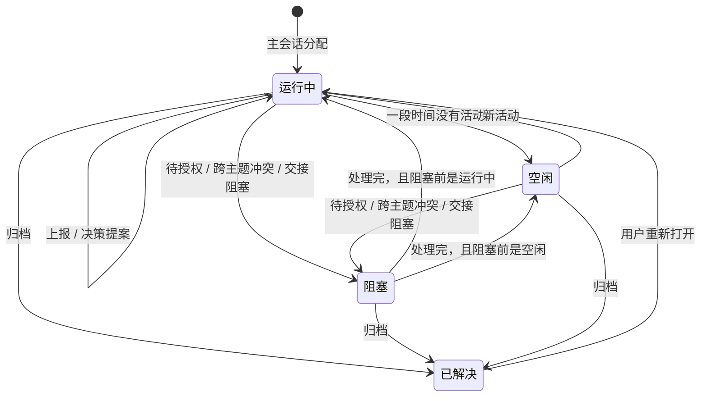

# Cowork 右侧栏主题页设计（v2）

Status: draft v2（2026-11-10 修订；implementation not started）

## 背景

v1 的主题页是列表：需要你处理入口、四个生命周期分组、主题卡。之后确定了主题会话模型：主会话把需求分配给主题会话；主题会话负责决策记录和跨主题交接。

本次按新的事实调整：主题页只生成并上报决策记录，不展示决策记录；分配、上报、决策提案、待授权在会话记录里出现；归档只在主会话留一条消息。

## 本次修订

1. 主题页不展示决策记录，也不展示审查状态。决策记录由主题会话生成并上报；查看和提意见在工作项，资料进 Artifact 工作室，这两处不在本设计内。
2. 分配、上报、决策提案、待授权都显示提醒卡片：主会话一条消息，主题会话一张提醒卡，事件与消息 1:1。
3. 实时、不阻塞：事件发生即写入，不等待主会话处理；主题继续执行。
4. 归档后主会话只显示“xx主题已归档”，没有其他交互；主题移入已解决。
5. 主题列表按事件更新状态；顶部“需要你处理”只统计待授权。

## 设计目标

- 在 378px 宽度内快速看清主题、生命周期和待处理标记。
- 只回答“有哪些主题、现在什么状态、要处理就去哪里”，不复制会话记录和决策记录。
- 提醒在发生的地方显示：主会话和主题会话各有一份，主题页不做第二份队列。

## 页面结构

```text
右侧栏
└─ 主题
   ├─ 需要你处理（只统计待授权）
   ├─ 阻塞（数量）
   │  └─ 主题卡
   ├─ 运行中（数量）
   │  └─ 主题卡
   ├─ 空闲（数量）
   │  └─ 主题卡
   └─ 已解决（数量，默认折叠）
```

点击主题卡进入主题会话；已解决分组展开后可以重新打开。

## 主题卡字段

| 字段 | 用途 |
|---|---|
| 主题名 | 主要识别信息 |
| 生命周期 | 阻塞 / 运行中 / 空闲 / 已解决 |
| 待授权标记 | 有权限等待用户时出现；红色 |
| 更新时间 | 相对时间 |
| 一行摘要 | 最近一次事件或状态变化，不写决策记录标题和审查状态 |
| 工作项数 | 规模提示 |

不进入列表：决策记录内容、审查状态、topic id、session id、cwd、scope、ownedPaths、aliases。

与 v1 的差异：移除审查状态（待审核 / 审查中 / 通过 / 需修改）。这些信息属于决策记录，决策记录不在主题页展示。

## 事件与记录

| 事件 | 主会话记录 | 主题会话提醒 | 主题列表 | 主题状态 |
|---|---|---|---|---|
| 分配 | 1 条消息 | 1 张提醒卡 | 新建卡片，进入运行中 | — → 运行中 |
| 上报 | 每事件 1 条 | 每事件 1 张 | 摘要更新 | 不变 |
| 决策提案 | 1 条消息 | 1 张提醒卡 | 摘要更新 | 不变 |
| 待授权 | 1 条消息 | 1 张提醒卡 | 移入阻塞，加待授权标记 | 运行中 / 空闲 → 阻塞 |
| 归档 | 1 条消息 | 无 | 移入已解决 | → 已解决 |

规则：

- 1 个事件打印 1 条主会话消息和 1 张主题会话提醒卡，不合并、不批量。
- 同一事件只打印一次；状态变化更新原消息，不新增消息。
- 实时写入，不等待主会话当前轮次结束；主题不因为上报暂停。
- 主会话消息只放摘要，不放完整对话和敏感字段。

## 状态与转化



| 现在 | 事件 | 之后 | 说明 |
|---|---|---|---|
| — | 主会话分配 | 运行中 | 新建主题卡 |
| 运行中 | 一段时间没有活动 | 空闲 | 阈值待定 |
| 空闲 | 新活动 | 运行中 | 用户回来或主题继续 |
| 运行中 / 空闲 | 待授权、跨主题冲突、交接阻塞 | 阻塞 | 待授权是标记，不是分组 |
| 阻塞 | 问题处理完 | 回到阻塞前的状态 | 运行中或空闲 |
| 运行中 / 阻塞 / 空闲 | 归档 | 已解决 | 主会话只留一条归档消息 |
| 已解决 | 用户重新打开 | 运行中 | 沿用现有重新打开规则 |

待授权按“阻塞 + 待授权标记”处理：标记出现在卡片上，数量进入顶部“需要你处理”。这一条是当前设计的选择，不是讨论记录里已有的事实。

## 会话提醒卡

| 类型 | 主会话 | 主题会话 | 操作 |
|---|---|---|---|
| 分配 | 1 条消息 | 1 张提醒卡 | 无。本版隐藏接受、退回按钮 |
| 上报 | 1 条消息 | 1 张提醒卡 | 无 |
| 决策提案 | 1 条消息 | 1 张提醒卡 | 去工作项查看（导航，不在本设计内） |
| 待授权 | 1 条消息 | 1 张提醒卡 | 主会话：去主题会话处理；主题会话：允许 / 拒绝 |
| 归档 | 1 条消息 | 无 | 无 |

每张卡包含：类型、一行摘要、事件序号、时间、来源或同步标记。主会话记录里的事件卡还带“已写入主会话记录”；主题会话的卡带“已同步主会话”。

## 交互规则

- 点“需要你处理”定位到主题会话的待授权提醒；它是入口，不是队列。
- 分配、上报不可交互，只作为记录；主题会话不显示接受、退回。
- 决策提案只上报，不在主题页展示；点“去工作项查看”离开主题页。
- 待授权在主题会话处理；处理完主题回到阻塞前的状态，主会话记录不新增消息。
- 归档后主会话只显示“xx主题已归档”；主题移入已解决，未处理的待授权提醒失效。
- 列表里的决策记录和审查状态不出现；主题卡摘要是状态描述，不是记录内容。

## 与 v1 的差异

- 移除主题卡的审查状态。
- 主会话的“一行提醒”改为按事件 1:1 的消息和提醒卡。
- 主题列表增加待授权引起的阻塞状态转化。
- 主题页不再承载决策记录相关内容。

## 分步演示

- [交互设计稿 HTML](../../discussion/topic-demo-v2.html)（样式在 [topic-demo-v2.css](../../discussion/topic-demo-v2.css)）
- [主会话与列表截图](../../discussion/topic-demo-v2.png)
- [状态与规则截图](../../discussion/topic-demo-v2-overview.png)

设计稿按六步展示，可以点顶部步骤切换，也可以在主会话和主题会话之间切换：

1. 总览：事件、记录和状态的对应关系。
2. 分配：主会话 1 条消息，主题会话 1 张提醒卡，列表新增运行中卡片。
3. 上报：两个事件打印两条消息、两张提醒卡；实时，不阻塞。
4. 决策提案：只生成并上报，主题页不展示记录。
5. 待授权：主题移入阻塞；切到主题会话点允许或拒绝，列表回到运行中。
6. 归档：主会话只留一条“已归档”消息，列表移入已解决。

直接看某一步：`topic-demo-v2.html?step=4&view=topic`。

## 范围外

- 工作项里的决策记录查看和提意见。
- Artifact 工作室里的决策提案资料。
- 审查、评审、CI 相关功能。
- 归档入口的位置和具体操作。
- 跨主题冲突的对比和裁决界面。
- 空闲判定阈值的最终数值。

## 未决问题

- 待授权是否让主题进入阻塞？当前设计：是；如果主题可以同时做其他工作，则只加标记、不移动分组。
- 决策提案是否阻塞主题？当前设计：不阻塞，审核在工作项里进行。
- 用户拒绝授权后，主题是否继续？当前设计：继续，并改用用户提供的内容。
- “需要你处理”是否也统计待查看的决策提案？当前只统计待授权。
- 归档入口放在哪里：主题卡菜单、主会话，还是主题会话。
