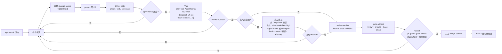

# GitHub PR 门禁与 Review 流程设计

Status: draft（implementation in progress，2026-11-15；`pr-gate` + `gate-artifact` + `heavy` workflow added）

本文件定义从 `agent/<topic>` 到 `main` 的目标交付流程。为什么这样选、放弃了什么，见[决策记录](../../../.agents/notes/proposed/process/2026-11-15-github-pr-gate-flow.md)。当前已加入 `.github/workflows/ci.yml`、`.github/workflows/gate-artifact.yml` 与 `.node-version`，并启用 `main-pr-gate` ruleset；heavy lane 和最终 merge 设置仍待收口。

## 目标与边界

目标：把本地检查、GitHub Actions、独立 review、证据冻结和人工 merge 串成一条可回退的流程，让“检查通过”和“review 通过”都绑定同一个 HEAD。

边界：

- 不引入第二个 GitHub 账号，不配置 required approvals；review 是程序性约束，不是 GitHub 强制审批。
- 不引入 auto-merge、merge queue 或 stacked PR；合并保持人工。
- 不改变单工作流分支、Conventional Commits 和现有 PR 描述技能的所有权。
- 不把 Codex 或 DSH Desktop 作为第二意见兜底；第二意见只使用当前 DSH web 会话可路由的非 DeepSeek 模型。模型确定前以 `deepseek-flash` high 档占位接线，正式启用前必须替换。
- Issue 策略 v1 不强制引用 Issue；只校验 PR 标题和正文结构。

## 流程



### 节点说明

| 节点 | 机制 |
|---|---|
| 本地检查 | `change-scope` 固定范围；按 [tools/workflow.json](../../../tools/workflow.json) 选择受影响检查；GitHub-hosted CI 负责 check/test/coverage，typecheck/build 与 host/browser 在 heavy lane |
| PR Gate | `.github/workflows/ci.yml` 的 `pr-gate` job；单稳定检查 `CI / pr-gate` |
| 主审 | DSH web AgentTeams reviewer；`deepseek-v4-pro`；fresh context；只读 |
| 第二意见 | 仅高风险；当前 DSH web 的 AgentTeams member 或 subagent；非 DeepSeek 模型（占位 `deepseek-flash` high）；advisory |
| 证据冻结 | `gate-artifact`；校验 review、CI、base 和工作区身份 |
| 强制层 | repository ruleset 要求两个检查、对话解决、分支最新、禁止 force/delete |
| 合并 | 人工 merge commit；关闭 auto-merge；合并后自动删分支 |

## 1. 本地阶段

从 `main` 拉一个 `agent/<topic>` 分支，按 Conventional Commits 小步提交。推送前：

```sh
npm run change-scope -- --base <verified-base>
```

范围以该报告的 committed、staged、unstaged、untracked 四组路径为准，不猜 base。按 [tools/workflow.json](../../../tools/workflow.json) 选择最小证据；不要默认重复全量测试。

本地 review 与 CI 不是串行两轮：

1. reviewer 先用 `change-scope` 对 diff 做语义和正确性 review；
2. GitHub-hosted CI 在同一个 HEAD 上产出 test、coverage 证据；typecheck/build 由 heavy lane 补充；
3. 最终 `verdict=pass` 必须在 CI 绿后、对同一个 HEAD 给出，并同时核对 diff 与 CI 结果。

`lib/` 是本地构建产物；`test:host-smoke` 前先 `npm run build`，并设置 `DSH_HOST_SMOKE_STRICT=1`，缺 `dsh` 时失败而不是 skip。

## 2. PR Gate

目标文件：`.github/workflows/ci.yml`，workflow 名 `CI`，job 名 `pr-gate`。

- 触发：`pull_request`，目标 `main`；
- 权限：`contents: read`，不接收 secret；
- 并发：同 PR 新 push 取消旧 run；
- checkout：PR head，`fetch-depth: 0`；
- 运行时：新增 `.node-version` 固定 Node 版本；
- 步骤：`npm ci`，然后依次执行：

```sh
npm run check
npm test
npm run test:coverage
```

`typecheck` 和 `build` 需要 DSH source checkout 与已安装 app 的 runtime 包，GitHub-hosted runner 不具备；它们属于 heavy lane，不能在这里伪装成通过。

任一步非零即失败；job 本身是唯一 required check `pr-gate`（workflow 名 `CI`，GitHub UI 可能显示为 `CI / pr-gate`），不把矩阵腿逐个写进 ruleset。成功后上传 `review-context.json`，记录 `baseSha`、`headSha`、`diff.sha256` 和 `scope`，供 review 与 `gate-artifact` 使用。

核心 CI 跑在当前仓库的 GitHub Actions 标准 runner 上；仓库是 public 且 Actions 已开启，不需要额外购买 larger runner。`npm test` 与 `npm run test:coverage` 目前会重复执行测试；P1 先按流程全跑，测量后再决定是否合并为一次运行，不能删除 coverage 门。

## 3. Review

### 主审

- 载体：当前 DSH web 会话的 AgentTeams reviewer；fresh context；只读 tool policy；
- 模型：`deepseek-v4-pro`；
- 顺序：先 `change-scope`，再读需求、diff、调用方、测试和 CI 证据；
- 实现者不得担任主审，主审不继承实现者的对话和结论；
- finding 格式：`path:line + 严重度 + 影响 + requiredFix`；
- 输出 `review-verdict`，至少包含 `baseSha`、`headSha`、`diffSha256`、`verdict`、`findings`；
- 新 commit 后旧 verdict 失效，只对 delta 重审，最多 2–3 轮。

### 第二意见

只在高风险变更上启用，例如认证/授权、持久化或迁移、公共 API/tool schema、review/merge 流程、发布/打包、安全边界。

- 载体：当前 DSH web 会话的 AgentTeams member 或 `subagent`；fresh context；只读 tool policy；
- 模型：目标是非 DeepSeek 模型，例如 Kimi 2.7、Qwen 3.8、GLM 5.3；用户确定前用 `deepseek-flash` high 档占位，只用于接线，不满足最终的非 DeepSeek 独立性目标；实际 model id 先用 `list_subagent_models` 核实；
- 输出与主审相同的 head/base/diff 绑定字段，并标记 `advisory: true`；
- 它不进入 required checks，只作为高风险变更的附加证据；
- 无法路由非 DeepSeek 模型时记录 `not run`，不能默认通过；
- 不使用 Codex 或 DSH Desktop 兜底。

### GitHub 侧

单人账号不配置 required approvals；GitHub 原生 approval 不是硬门禁。review 的独立性由 AgentTeams 的 fresh context、独立 reviewer 和 `review-verdict` 保证，属于程序性约束。最终人工 merge 仍由人负责。

## 4. Gate artifact

目标文件：`.github/workflows/gate-artifact.yml`，workflow 名 `Policy`，job 名 `gate-artifact`。

- 触发：`pull_request_review` submitted/dismissed；正常评论 review 中没有 marker 时跳过，`changes_requested` 或 dismissed 时运行并失败；
- 权限：`contents: read`、`pull-requests: write`、`checks: read`；
- 运行受信任的 base 分支脚本；PR head 只作为 git 数据 fetch，不执行 PR 代码；
- review marker：

```text
<!-- review-verdict:v1 head=<40-char head> verdict=pass reviewer=agentteam model=<model> -->
```

- 校验：
  1. review 的 `commit_id` 等于当前 PR head，state 是 `approved` 或 `commented`；
  2. marker 的 head 等于当前 PR head，verdict 是 `pass`；
  3. `pr-gate` 在同一 head 上成功；
  4. 当前 `origin/main` 是 PR head 的祖先；
  5. 临时 worktree 的 `git status --porcelain` 为空；
  6. PR 标题符合 Conventional Commits，正文包含 `pr-description` 要求的段落；
- 生成 `gate-artifact.json` 与 `review-verdict.json`，更新 sticky PR comment，job 本身作为 `gate-artifact` check。

新 commit、base 前进、review 失效或工作区不干净都会让该 check 失效或失败，流程回到提交/CI/review。

## 5. Ruleset 与合并

`main` 使用 repository ruleset：

| 设置 | 值 |
|---|---|
| Require pull request | on |
| Required checks | `pr-gate`、`gate-artifact`（workflow 前缀不进入 ruleset context） |
| Required approvals | 0（单人项目，review 为程序性约束） |
| Require conversation resolution | on |
| Require branches up to date | on |
| Block force push / deletion | on |
| Bypass actors | 空 |

仓库设置：

- merge commit only；
- `allow_auto_merge=false`；
- `delete_branch_on_merge=true`；
- `allow_update_branch=true`。

不启用 required linear history，因为历史使用 merge commit。

## 6. Heavy lane

`npm run typecheck`、`npm run build`、`test:host-smoke`、`test:browser`、`test:coverage:layered` 依赖本机 DSH source/app 或 Chromium，不能直接放进 GitHub-hosted runner 的核心命令。

- 默认不在 GitHub-hosted runner 上跑。目标文件 `.github/workflows/heavy.yml`，workflow 名 `Heavy`，job 名 `heavy-gate`；第一阶段只通过 `workflow_dispatch` 由有写权限的人手动启动，使用 `runs-on: [self-hosted, heavy]`；核心 `pr-gate` 仍跑 GitHub-hosted。第二台机器作为可选扩容/兜底，不作为第一阶段前提。
- 本机准备 Node、`dsh`/DSH Desktop、Chromium；使用专用 workspace，每次 `npm ci`，安装 Chromium，依次运行 `npm run typecheck`、`npm run build`、`DSH_HOST_SMOKE_STRICT=1 npm run test:host-smoke`，最后运行 `npm run test:coverage:layered -- --base <verified-base>`（其中包含 browser lane）；heavy job 并发设为 1。
- 第一阶段不接 `pull_request`/`pull_request_target`，所以任何 PR（包括 fork）都不会自动进入 self-hosted runner；标签触发要等 head-bound check publisher 落地后再评估。
- `heavy-gate` 目前不是 PR-head 的 required check。稳定后若要加入 ruleset，需要用 App token 在 PR head 发布 check run，或改用等价的可信机制；`workflow_dispatch` 的 job check 不能充当 PR head 状态。
- 稳定门槛：固定 OS、Node、`dsh`、Chromium 版本；每次 clean workspace；先做 host health 检查；重试只允许有界次数并记录；上传截图/日志/JSON 证据；连续 20 次无基础设施失败的 green 运行后，才把 heavy lane 设为 required。
- 稳定前只作为独立 workflow 或手动运行，PR 的 `Not run` 必须明确写出；稳定后按 affected paths 增加独立 required check `heavy-gate`，不能把 skipped 当绿。
- 本机休眠、离线或 runner 不可用时 job 会排队或失败；在 uptime 稳定前不要把它设为 required，否则会阻塞相关 PR。

## 7. PR 元数据 v1

- PR 标题使用 Conventional Commits；
- 正文按 [pr-description](../../../.agents/skills/pr-description/SKILL.md) 的 `Motivation`、`Changes`、`Testing`、`Evidence` 结构；
- 不强制 Issue 引用；
- 不新增 `.github/pull_request_template.md`；PR 结构仍由 `pr-description` 技能单点拥有。`gate-artifact` 负责最终校验；可选的 `Policy / pr-metadata` 只做早期反馈，不设为 required。

## 8. 失败与回环

| 事件 | 结果 | 回到 |
|---|---|---|
| 任一 hosted core 命令失败 | `pr-gate` 红 | 提交 |
| 主审 verdict 非 pass | 不生成成功 `gate-artifact` | 提交 |
| review 后 push 新 commit | 旧 verdict/旧 check 失效 | PR Gate |
| main 前进 | strict up-to-date 阻止合并 | 更新分支后 PR Gate |
| 有未解决对话 | ruleset 阻止合并 | review |
| force push / 直接 push main | ruleset 拒绝 | — |
| `gate-artifact` 发现 base/head 变化 | check 失败 | PR Gate |

## 9. 落地顺序

1. 文档与决策记录（本次变更）。
2. `.node-version` + `pr-gate` report-only；验证 hosted 三命令在干净 checkout 下可运行。
3. ruleset 要求 `pr-gate`，开启 conversation resolution 和 strict up-to-date，禁止 force/delete。
4. 接入主审与 `gate-artifact`，验证新 commit 会使旧 review/旧证据失效。
5. 在本机安装并验证 `heavy` self-hosted runner（或先手动运行），连续 20 次 green 后再把 heavy lane 设为 required；最后统一 merge 设置与自动删分支。

## 10. 验收

- 故意失败一个测试：`pr-gate` 红，merge 不可用。
- 没有 review verdict：`gate-artifact` 不成功，merge 被阻止。
- review 后 push 新 commit：旧 verdict 和旧 check 失效，必须重新 review。
- main 前进：strict up-to-date 阻止合并；更新分支后所有检查重跑。
- 有未解决 conversation：merge 被阻止。
- 直接 push main、force push、删除 main：全部拒绝。
- `gate-artifact` 的 `headSha` 等于 PR head，`diff.sha256` 与 sticky comment 一致。
- heavy lane 在本机 `heavy` self-hosted runner 或手动运行；缺 `dsh` 时失败而不是 skip。
- 合并后分支自动删除，main 上是 merge commit。
