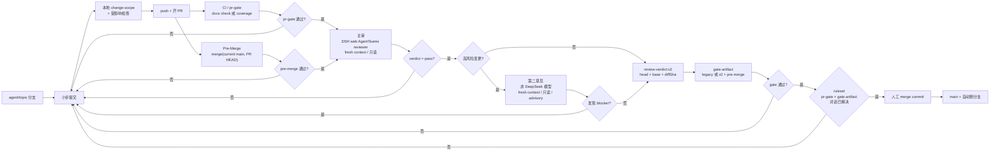

# GitHub PR 门禁与 Review 流程设计

Status: proposed implementation blocked（2026-11-17；workflow code is in PR #57, but the required-gate bootstrap is incomplete）

本文件定义从 `agent/<topic>` 到 `main` 的目标交付流程。为什么这样选、放弃了什么，见[决策记录](../../../.agents/notes/proposed/process/2026-11-17-pre-merge-derived-gate.md)。目标是唯一 publisher 以 report mode 运行：required `gate-artifact` 使用 legacy 校验，`gate-artifact-v2` 只做 advisory。当前 bootstrap 未完成，`main` 仍由旧 workflow 发布 required `gate-artifact`；block mode 后同一 publisher 改用 v2 + pre-merge 校验。

## 目标与边界

目标：把本地检查、GitHub Actions、独立 review、当前 main 的合并结果检查和人工 merge 串成一条可回退的流程。review 绑定作者 HEAD，集成测试绑定临时 merge result，两者不再要求同一个 SHA。

边界：

- 不引入第二个 GitHub 账号，不配置 required approvals；review 是程序性约束，不是 GitHub 强制审批。
- 不引入 auto-merge、merge queue 或 merge train；合并保持人工。
- 不改变单工作流分支、Conventional Commits 和现有 PR 描述技能的所有权。
- 不把 Codex 或 DSH Desktop 作为第二意见兜底；第二意见只使用当前 DSH web 会话可路由的非 DeepSeek 模型。模型确定前以 `deepseek-flash` high 档占位接线，正式启用前必须替换。
- Issue 策略 v1 不强制引用 Issue；只校验 PR 标题和正文结构。

## 流程



### 节点说明

| 节点 | 机制 |
|---|---|
| 本地检查 | `change-scope` 固定范围；按 [tools/workflow.json](../../../tools/workflow.json) 选择受影响检查；GitHub-hosted CI 负责 docs check 或 coverage，typecheck/build 与 host/browser 在 heavy lane |
| PR Gate | `.github/workflows/ci.yml` 的 `pr-gate` 聚合 job；docs lane 始终运行，unit lane 只对非 docs 改动运行 |
| Pre-Merge | `.github/workflows/pre-merge.yml`；把当前 main merge 到 PR HEAD，在临时结果上测试；不更新 PR 分支 |
| 主审 | DSH web AgentTeams reviewer；fresh context；只读 |
| 第二意见 | 仅高风险；当前 DSH web 的 AgentTeams member 或 subagent；非 DeepSeek 模型；advisory |
| 派生 gate | 唯一 publisher 发布 required `gate-artifact`；report 用 legacy 校验，block 用 review v2、pr-gate、pre-merge、metadata 和 reviewed paths。`gate-artifact-v2` 只做 report advisory |
| Base stale | `Policy Base` 在 main push 后把旧 gate 标成 `action_required`；加 `recheck` 标签重跑 pre-merge |
| 强制层 | repository ruleset 要求 `pr-gate` + gate；对话解决；迁移完成后移除 strict up-to-date |
| 合并 | 人工 merge commit；关闭 auto-merge、merge queue 和 merge train；合并后自动删分支 |

## 1. 本地阶段

从 `main` 拉一个 `agent/<topic>` 分支，按 Conventional Commits 小步提交。推送前：

```sh
npm run change-scope -- --base <verified-base>
```

范围以该报告的 committed、staged、unstaged、untracked 四组路径为准，不猜 base。按 [tools/workflow.json](../../../tools/workflow.json) 选择最小证据；不要默认重复全量测试。

本地 review 与 CI 不是串行两轮：

1. reviewer 先用 `change-scope` 对 diff 做语义和正确性 review；
2. GitHub-hosted CI 在同一个 HEAD 上产出 test、coverage 证据；typecheck/build 由 heavy lane 补充；
3. 最终 `verdict=pass` 必须在 CI 绿后、对同一个 HEAD 给出，并同时核对 diff 与 CI 结果。

`lib/` 是本地构建产物；`test:host-smoke` 前先 `npm run build`，并设置 `DSH_HOST_SMOKE_STRICT=1`，缺 `dsh` 时失败而不是 skip。

## 2. PR Gate

目标文件：`.github/workflows/ci.yml`，workflow 名 `CI`，聚合 job 名 `pr-gate`。

- 触发：`pull_request`，目标 `main`；
- 权限：`contents: read`，不接收 secret；
- 并发：同 PR 新 push 取消旧 run；
- checkout：PR head，`fetch-depth: 0`；
- `classify`：运行 `scripts/ci/classify-change.mjs`，判断是否只有 `docs/**` 和 `README.md`；
- `docs-check`：始终 `npm ci` + `npm run check`；
- `unit`：非 docs 改动才 `npm ci` + `npm run test:coverage`；
- `pr-gate`：聚合 lane、拒绝错误 skip，并上传 `review-context.json`。

`npm test` 不再在 `pr-gate` 中重复执行；`test:coverage` 已经逐文件运行全部测试。`typecheck` 和 `build` 需要 DSH source checkout 与已安装 app 的 runtime 包，GitHub-hosted runner 不具备；它们属于 heavy lane，不能在这里伪装成通过。

`pr-gate` 仍是唯一 required check（workflow 名 `CI`，GitHub UI 可能显示为 `CI / pr-gate`），不把内部 lane 逐个写进 ruleset。docs lane 只影响测试范围，不豁免 review。

## 3. Review

### 主审

- 载体：当前 DSH web 会话的 AgentTeams reviewer；fresh context；只读 tool policy；
- 模型：`deepseek-v4-pro`；
- 顺序：先 `change-scope`，再读需求、diff、调用方、测试和 CI 证据；
- 实现者不得担任主审，主审不继承实现者的对话和结论；
- finding 格式：`path:line + 严重度 + 影响 + requiredFix`；
- 输出 `review-verdict`，至少包含 `baseSha`、`headSha`、`diffSha256`、`verdict`、`findings`；
- 新 commit 后旧 verdict 失效，只对 delta 重审，最多 2–3 轮。

### 第二意见

只在高风险变更上启用，例如认证/授权、持久化或迁移、公共 API/tool schema、review/merge 流程、发布/打包、安全边界。

- 载体：当前 DSH web 会话的 AgentTeams member 或 `subagent`；fresh context；只读 tool policy；
- 模型：目标是非 DeepSeek 模型，例如 Kimi 2.7、Qwen 3.8、GLM 5.3；用户确定前用 `deepseek-flash` high 档占位，只用于接线，不满足最终的非 DeepSeek 独立性目标；实际 model id 先用 `list_subagent_models` 核实；
- 输出与主审相同的 head/base/diff 绑定字段，并标记 `advisory: true`；
- 它不进入 required checks，只作为高风险变更的附加证据；
- 无法路由非 DeepSeek 模型时记录 `not run`，不能默认通过；
- 不使用 Codex 或 DSH Desktop 兜底。

### GitHub 侧

单人账号不配置 required approvals；GitHub 原生 approval 不是硬门禁。review 的独立性由 AgentTeams 的 fresh context、独立 reviewer 和 `review-verdict` 保证，属于程序性约束。最终人工 merge 仍由人负责。

## 4. Derived gate

目标文件：`.github/workflows/gate-artifact-v2.yml`，workflow 名 `Policy V2`，job 名 `policy-gate`。

- 触发：PR 更新、review 事件、`CI` 或 `Pre-Merge` 完成；
- 权限：`contents: read`、`pull-requests: read`、`checks: write`；
- 从受信任的 base 分支检出脚本；PR head 只作为 git 数据 fetch，不执行 PR 代码；
- review marker：

```text
<!-- review-verdict:v2 head=<40-char head> base=<40-char base> diffSha=<64-char sha256> verdict=pass reviewer=agentteam model=<model> -->
```

- 校验：
  1. 当前 head 最新的有效 review marker 是 `pass`；更晚的 `needs_revision`、`reject` 或 `CHANGES_REQUESTED` 都会阻止；
  2. marker base 是 head 和当前 main 的祖先；
  3. `base..head` 的二进制 diff SHA-256 匹配；
  4. `pr-gate` 在当前 head 上成功；
  5. `pre-merge` 成功，且 base 等于当前 main；
  6. PR 标题和四个正文段落合格；
  7. main 自 review base 以来未修改 reviewed paths；否则要求 delta review；
- report mode 发布 required `gate-artifact` 的 legacy 结论，并另发 `gate-artifact-v2` success 作为 advisory；block mode 用同一个 publisher 发布 required `gate-artifact` 的 v2 + pre-merge 结论。

旧 `.github/workflows/gate-artifact.yml` 必须在 bootstrap 完成前保留；publisher 进入 `main` 后，再由后续 PR 删除它。PR #57 在 head 提前删除了旧 workflow，而 publisher 尚未进入 `main`，因此当前没有 required `gate-artifact`，保持 `BLOCKED`。唯一的 success/decision publisher 在 report/block 两种 mode 下发布 required `gate-artifact`；`Policy Base` 只发布 `action_required`，防止旧 base 成功被误合并。

## 5. Ruleset 与合并

`main` 当前使用 repository ruleset；迁移期仍保留旧 gate 和 strict up-to-date：

| 设置 | 当前值 |
|---|---|
| Require pull request | on |
| Required checks | `pr-gate`、`gate-artifact`（required context 不变；`gate-artifact-v2` 只做 report） |
| Required approvals | 0（单人项目，review 为程序性约束） |
| Require conversation resolution | on |
| Require branches up to date | on（激活 pre-merge 后移除） |
| Block force push / deletion | on |
| Bypass actors | 空 |

仓库设置：

- merge commit only；
- `allow_auto_merge=false`；
- `delete_branch_on_merge=true`；
- `allow_update_branch=true`。

不启用 required linear history，因为历史使用 merge commit。

## 6. Heavy lane

`npm run typecheck`、`npm run build`、`test:host-smoke`、`test:browser`、`test:coverage:layered` 依赖本机 DSH source/app 或 Chromium，不能直接放进 GitHub-hosted runner 的核心命令。

- 默认不在 GitHub-hosted runner 上跑。目标文件 `.github/workflows/heavy.yml`，workflow 名 `Heavy`，job 名 `heavy-gate`；第一阶段只通过 `workflow_dispatch` 由有写权限的人手动启动，使用 `runs-on: [self-hosted, heavy]`；核心 `pr-gate` 仍跑 GitHub-hosted。第二台机器作为可选扩容/兜底，不作为第一阶段前提。
- 本机准备 Node、`dsh`/DSH Desktop、Chromium；使用专用 workspace，每次 `npm ci`，安装 Chromium，依次运行 `npm run typecheck`、`npm run build`、`DSH_HOST_SMOKE_STRICT=1 npm run test:host-smoke`，最后运行 `npm run test:coverage:layered -- --base <verified-base>`（其中包含 browser lane）；heavy job 并发设为 1。workflow 从 `repo_path` 指向的本地 checkout clone 当前 commit，只依赖 runner 已安装的 Node，并用 `.node-version` 校验；运行前设置临时 repo 的 `init.defaultBranch=main` 和固定 git identity；不下载 `setup-node`/`upload-artifact`/checkout action，coverage 证据留在本机 `coverage/` 与运行日志。
- 第一阶段不接 `pull_request`/`pull_request_target`，所以任何 PR（包括 fork）都不会自动进入 self-hosted runner；标签触发要等 head-bound check publisher 落地后再评估。
- `heavy-gate` 目前不是 PR-head 的 required check。稳定后若要加入 ruleset，需要用 App token 在 PR head 发布 check run，或改用等价的可信机制；`workflow_dispatch` 的 job check 不能充当 PR head 状态。
- 稳定门槛：固定 OS、Node、`dsh`、Chromium 版本；每次 clean workspace；先做 host health 检查；重试只允许有界次数并记录；上传截图/日志/JSON 证据；连续 20 次无基础设施失败的 green 运行后，才把 heavy lane 设为 required。
- 稳定前只作为独立 workflow 或手动运行，PR 的 `Not run` 必须明确写出；稳定后按 affected paths 增加独立 required check `heavy-gate`，不能把 skipped 当绿。
- 本机休眠、离线或 runner 不可用时 job 会排队或失败；在 uptime 稳定前不要把它设为 required，否则会阻塞相关 PR。

操作步骤（连续 green 计数、publisher 检查、ruleset 更新与回滚）见 [heavy-runner.md](../../heavy-runner.md)。

## 7. PR 元数据 v1

- PR 标题使用 Conventional Commits；
- 正文按 [pr-description](../../../.agents/skills/pr-description/SKILL.md) 的 `Motivation`、`Changes`、`Testing`、`Evidence` 结构；
- 不强制 Issue 引用；
- 不新增 `.github/pull_request_template.md`；PR 结构仍由 `pr-description` 技能单点拥有。派生 gate 负责最终校验；required context 始终是 `gate-artifact`。`gate-artifact-v2` 只做 report，永不设为 required。

## 8. 失败与回环

| 事件 | 结果 | 回到 |
|---|---|---|
| 任一 hosted core 命令失败 | `pr-gate` 红 | 提交 |
| 主审 verdict 非 pass | 不生成成功 gate | 提交 |
| review 后 push 新 commit | 旧 verdict/旧 check 失效 | PR Gate |
| main 前进 | `Policy Base` 把旧 gate 标 stale | 加 `recheck` 重跑 pre-merge；若 main 改了 reviewed paths，合 main 产生新 HEAD 并 delta review |
| pre-merge 冲突 | `pre-merge` 失败，日志列出冲突路径 | 人在 merge 阶段处理 |
| 有未解决对话 | ruleset 阻止合并 | review |
| force push / 直接 push main | ruleset 拒绝 | — |

## 9. 落地顺序

1. 文档与决策记录（本次变更）。
2. `pr-gate` docs/unit 拆分和 `pre-merge` 先以 report 方式运行。
3. 接入单一 publisher 和 `gate-artifact-v2` advisory，验证 review 早于 CI、main 前进和 recheck 的行为。
4. 验证 base-recheck 能让旧绿色 gate 变 stale。
5. 设置 `MERGE_POLICY_MODE=block`，验证同一 publisher 的 required `gate-artifact` 变红/变绿后，再移除 strict up-to-date。
6. heavy lane 仍按现有稳定门槛评估；不因本次改动升级为 required。

## 10. 验收

- docs-only：只跑 `check`，review 仍存在。
- 故意失败一个测试：`pr-gate` 红，merge 不可用。
- 没有 review verdict：派生 gate 不成功，merge 被阻止；CI 完成后自动重算。
- review 后 push 新 commit：旧 verdict 和旧 check 失效，必须重新 review。
- main 前进：PR HEAD 不变；旧 gate stale；加 `recheck` 重跑 pre-merge 后 gate 重算，通常不重审。reviewed-path overlap 时合 main 产生新 HEAD，再做 delta review。
- pre-merge 冲突：检查失败，不产生合并；冲突由人处理。
- 有未解决 conversation：merge 被阻止。
- 直接 push main、force push、删除 main：全部拒绝。
- `pre-merge` summary 的 base 等于当前 main，head 等于 PR head。
- required context 始终是 `gate-artifact`，由唯一 success/decision publisher 在 report/block 两种 mode 下发布；`base-recheck` 只做 stale invalidation；`gate-artifact-v2` 只做 report。
- 合并后分支自动删除，main 上是 merge commit。
