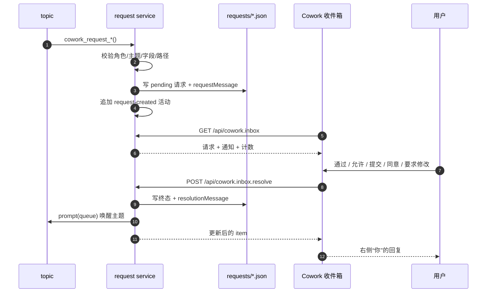

# Cowork 右侧栏收件箱设计（请求卡片与通知）

Status: implemented（2026-11-10，delivery 前代码 HEAD `a26e1c5`；实现结果与偏差见 §14）
决策记录: [2026-11-10-topic-inbox.md](../../../.agents/notes/implemented/feature/2026-11-10-topic-inbox.md)
交接: [TOPIC_INBOX_HANDOFF.md](../../handoff/TOPIC_INBOX_HANDOFF.md)

本方案把右侧栏从单列主题页扩展为“主题栏 + 收件箱”。收件箱承接评审、权限审批、ask-user 提问和 PLAN 待确认四类需要用户行动的请求，以及分配、上报、决策提案、自动评审结果、归档五类只读通知。解决后，请求卡片下方追加一条右侧用户回复。

交互稿和截图：

- [收件箱交互稿](assets/topic-reminder-demo.html)
- [默认宽侧栏](assets/topic-reminder-demo.png)
- [确认后的右侧回复](assets/topic-reminder-demo-replied.png)
- [PLAN 要求修改输入框](assets/topic-reminder-demo-plan-revise.png)
- [窄侧栏](assets/topic-reminder-demo-narrow.png)
- [按主题筛选](assets/topic-reminder-demo-filtered.png)

## 1. 目标与非目标

### 目标

- 用户不必回到主会话或主题会话，在 Cowork 右栏就能看到所有待处理请求。
- 四类请求各自有稳定的数据记录、状态和解决动作，刷新或重开后仍在。
- 请求以“左侧主题消息 + 卡片 + 右侧用户回复”的对话形态出现，解决后可直接看到用户答复。
- 通知型事件不伪装成待办：居中灰字、无按钮、无“知道了”。
- 宽侧栏下收件箱独立滚动，主题栏固定；窄侧栏只显示“需要你处理 N 项”入口。
- 不依赖宿主 A2 的 `ctx.sessionNotices`/`notice/message`，不修改自动 reviewer 流程。

### 非目标

- 不做工作项页、diff 查看器、Artifact 工作室或完整计划编辑器。
- 不替换宿主 Plan Mode、宿主 `ask_user_question` 弹窗或自动 reviewer。
- 不删除或改写旧 `.dsh-cowork/inbox.json` 的 merge-needed / review-reject / blocked / cross-topic-conflict 队列。
- 不实现宿主侧宽度设置；宿主没有该接口时使用面板内全宽收件箱降级。
- 不做多人权限、跨项目收件箱、移动端专门布局。

## 2. 已确认的设计事实

| 项目 | 决定 |
|---|---|
| 承载面 | Cowork tab 内部第二列，不新增第五个标签，不改主区域 |
| 宽侧栏 | 可用宽度 ≥ 620px；左主题栏约 318px，右收件箱独立滚动 |
| 窄侧栏 | < 620px 隐藏收件箱，顶部显示“需要你处理 N 项” |
| 主题栏 | 不随收件箱滚动；自身内容超出时只在自己的列内滚动 |
| 筛选 | 主题卡上新增筛选按钮；卡片主体点击仍打开主题会话，筛选按钮只过滤收件箱 |
| 请求卡片 | 评审 / 权限审批 / ask-user / PLAN 四类，先左侧消息、再卡片 |
| 解决后 | 卡片保留状态，右侧追加“你”的消息；主题会话被唤醒继续 |
| 通知 | 分配 / 上报 / 决策提案 / 自动评审结果 / 归档用居中灰字，不套卡片 |
| PLAN 全文 | 调宿主文件浏览器打开计划文件；不实现侧边抽屉 |
| 通知通道 | 不依赖 A2；收件箱读取请求文件、现有 notices/activity 和 review-verdict 事件 |
| 旧 inbox | `.dsh-cowork/inbox.json` 保持原语义，本次不读写它 |

## 3. 术语

- **request inbox（收件箱）**：Cowork 右栏展示待处理请求和通知的视图；UI 标签是“收件箱”，实现术语是 request inbox。它不是一个投递队列，不改变旧 master inbox。
- **request（请求）**：一条需要用户动作的记录。四种 `kind`：`user-review`、`authorization`、`question`、`plan`。
- **user review request（用户评审请求）**：请用户通过/退回的一次评审。它**不是** `cowork_review_request` 创建的自动 reviewer 请求，也不产生 reviewer verdict。
- **plan request（计划确认请求）**：请用户同意/要求修改一份计划文件。它**不是**宿主 Plan Mode。
- **notification note（通知注释）**：分配、上报、决策提案、自动评审结果、归档的只读事件，用灰字展示；自动评审结果不跳转、不需要用户交互。

> 现有术语 [review request](../../glossary.md#review-request) 继续指自动 reviewer 的评审范围；本设计中的“评审”卡一律指 user review request。旧 [inbox](../../glossary.md#inbox) 指 `.dsh-cowork/inbox.json`，与本收件箱不是同一个对象。

## 4. 布局与交互

### 4.1 宽侧栏

```text
Cowork tab（可用宽度 ≥ 620px）
┌────────────────────────────┬──────────────────────────────────────┐
│ 主题（固定）                 │ 收件箱（独立上下滚动）                 │
│ 阻塞 / 运行中 / 空闲 / 已解决│ 收件箱 · 全部类型 N                  │
│ 主题卡 + [筛选] 按钮         │  左侧主题消息                         │
│                            │  ┌──────────────────────────────┐    │
│                            │  │ 等待审批 / 等待审核 / 计划待审  │    │
│                            │  │ 卡片正文与操作                 │    │
│                            │  └──────────────────────────────┘    │
│                            │  右侧用户回复（已解决后）              │
│                            │  居中灰色通知注释                     │
└────────────────────────────┴──────────────────────────────────────┘
```

- 主题栏宽约 318px，收件箱最小约 280px，中间 12px 间距；实际以容器宽度为准。
- 主题栏 `overflow-y: auto`，但不随收件箱滚动；收件箱是独立滚动容器。
- 收件箱顶部固定标题和当前筛选标签；内容区滚动。
- 主题卡主体点击保持现有行为：打开主题会话。
- 每张主题卡新增一个筛选按钮（漏斗/“筛选”），点击切换收件箱的“只看此主题”筛选；再次点击同一按钮清除筛选。筛选按钮是主题卡主体按钮的兄弟控件，不嵌套，不触发展开会话。
- 收件箱标题显示当前筛选主题和一个清除入口；筛选按钮有 active 状态和 `aria-pressed`。

### 4.2 窄侧栏

```text
Cowork tab（< 620px）
┌──────────────────────────────┐
│ 需要你处理 5 项             → │  待授权 2 · 待审核 1 · 待回答 2
├──────────────────────────────┤
│ 主题列表（当前四组）           │
└──────────────────────────────┘
```

- 收件箱隐藏，横幅只统计 `pending` 请求，不包含通知。
- 横幅副文案按存在类型拼接，例如“待授权 2 · 待审核 1 · 待回答 2 · 待确认 1”。
- 点击横幅：
  1. 宿主若提供可调用的右栏宽度/展开接口，先调用它；
  2. 否则在当前面板内进入收件箱全宽模式，显示返回主题列表的按钮。
- 当前宿主（DSH 0.2.1-rc.2）的插件客户端契约没有右栏宽度 setter；实现前必须探针确认。不得用 DOM 操作宿主布局冒充“自动展开”。

### 4.3 计数、排序和空态

- 收件箱标题显示“全部类型 N”，N 是当前筛选下的请求 + 通知总数。
- 横幅和“需要你处理”只统计 pending 请求；细分：待授权、待审核、待回答、待确认。
- 排序：pending 请求在前，其余按 `updatedAt` 倒序；通知与已解决请求混排。
- 空态：“收件箱为空”；不是错误。加载失败保留主题列表，收件箱单独显示错误和重试。
- 主题筛选不改变主题打开行为，只过滤右侧；再次点同一主题卡的筛选按钮或清除入口恢复全部。

## 5. 请求线程与卡片

### 5.1 线程结构

每条请求渲染为一个 `RequestThread`：

```text
[题] 主题「五子棋小游戏」请求使用 danger-full-access 权限，请确认。
     ┌──────────────────────────────┐
     │ ● 等待审批                    │
     │ 正文 / 可选命令               │
     │                [拒绝] [允许一次]│
     └──────────────────────────────┘
                                      [你] 允许一次。
```

- 左侧消息：头像“题” + 服务端持久化的 `requestMessage`。
- 卡片：请求类型对应的正文和动作。
- 右侧回复：解决成功后显示“你”头像 + `resolutionMessage`；头像在气泡右侧。
- 左侧消息和右侧回复都由服务端生成并保存在请求记录中，刷新后不依赖前端拼装。
- 未解决时不显示右侧回复；解决成功后不新增卡片，只更新同一卡片状态。

### 5.2 四类卡片

#### 权限审批（authorization）

- 琥珀标题栏：“等待审批”。
- 正文：`summary`；若有 `command`，用等宽字体显示。
- 动作：“拒绝 / 允许一次”。
- 解决：`deny` / `allow`；更新原 authorization 状态、解除主题阻塞、更新通知。

#### 评审（user-review）

- 琥珀标题栏：“等待审核”。
- 正文直接展示：目的、改动摘要、验证结果摘要；**不折叠**。
- 动作：“退回 / 通过”；退回可选填写 findings 评论。
- 解决：`return` / `pass`；写回请求并唤醒主题会话。
- 与自动 reviewer 完全分开：不创建 reviewer 会话，不写 `reviews/` 的 verdict。

#### ask-user（question）

- 中性标题栏：“问题”或“多问题演示”。
- 正文：问题文本；单选用编号选项，多选用复选框；可带推荐标记和说明。
- 输入框：“输入你的答案”；分页 `1/N`。
- 动作：“跳过 / 提交”或“跳过 / 下一题”。
- 解决：`submit`（答案对象）或 `skip`；答案可为空文本 + 已选选项。

#### PLAN（plan）

- 琥珀标题栏：“计划待审”；右侧“查看全文 ›”。
- 正文：标题 + 一段计划摘要。
- 动作：“要求修改 / 同意执行”。
- “要求修改”在卡片内展开输入框（类似 ask-user），输入理由后“提交”；取消恢复原按钮。
- “查看全文”调宿主文件浏览器；不在侧栏内嵌 PLAN 阅读器。

### 5.3 通知注释

- 分配 / 上报 / 归档：居中灰字，只显示类型、主题和一行摘要；无按钮、无“知道了”。
- 决策提案：同样居中灰字，附“查看提案”链接；点击调用文件打开路由，显示提案 JSON。
- 自动评审结果：从 `review-verdict` activity 投影成居中灰字，例如“自动评审 · 通过 · 个人主页 Bio”；没有链接、没有按钮、不要求用户处理，也不生成请求卡。
- 通知不进入“需要你处理”计数，也不改变请求状态。
- authorization 的旧通知不重复进入注释流，避免和权限卡重复。

### 5.4 动作与状态

| kind | pending 动作 | 成功状态 | 右侧回复示例 |
|---|---|---|---|
| user-review | pass / return | passed / returned | 通过这次评审，可以合并。 |
| authorization | allow / deny | allowed / denied | 允许一次。 |
| question | submit / skip | answered / skipped | 已选择：15×15。 / 跳过这个问题。 |
| plan | approve / revise | approved / revise | 同意执行这个计划。 / 要求修改：把验证步骤写细。 |

- 同一条请求只接受一个终态；重复同一动作幂等，不同动作冲突。
- 解决失败不显示右侧回复，卡片保留 pending 和可操作状态，显示错误回执。
- 解决成功后按钮隐藏，卡片保留并显示状态；如果主题唤醒失败，显示“已记录，但主题会话未唤醒”的警告，不伪造回复。

## 6. 前端设计

### 6.1 模块

| 文件 | 职责 |
|---|---|
| `src/client/inbox-model.ts` | 纯视图模型：合并请求/通知、排序、筛选、计数、动作可用性、对话消息、横幅文案；React-free |
| `src/client/inbox.tsx` | `InboxPanel`、`RequestThread`、四类卡、通知注释、空/错/加载态 |
| `src/client/api.ts` | 扩展 `loadInbox`、`resolveInboxRequest`、`openInboxTarget`；沿用运行时校验和错误 envelope |
| `src/client/panel.tsx` | 加载 overview + inbox；`ResizeObserver` 宽度；宽/窄布局；主题栏固定；收件箱独立滚动；筛选状态 |
| `src/client/list.tsx` | 主题卡主按钮保持打开会话；新增兄弟筛选按钮、active 状态、`aria-pressed` 和回调 |
| `src/client/styles.ts` | 收件箱、卡片、对话、注释、窄栏样式；公开主题 token + fallback |
| `tests/inbox-model.test.mjs` | 排序、筛选、计数、动作规则、对话可见性、窄栏文案 |

### 6.2 状态

`panel.tsx` 持有：

- `overview`：主题列表，现有 `loadOverview`。
- `inbox`：请求和通知，独立加载；加载失败不阻塞主题列表。
- `selectedInboxTopicId`：主题筛选，默认 null；由主题卡筛选按钮切换，`list.tsx` 只回调 topicId。
- `pendingRequestIds`：正在提交的请求，防重复点击。
- `widthMode`：由容器宽度推导的 `wide | narrow`；不做全局布局 store。

解决流程：

1. 用户点动作；校验前端动作合法性。
2. 禁用该请求动作，设置 in-flight。
3. 调 `POST /api/cowork.inbox.resolve`。
4. 成功：用服务端返回的 item 替换原 item；计数重算；右侧回复出现。
5. 失败：恢复 pending，显示局部错误；不写右侧回复。

### 6.3 宽度与滚动

- 用 `ResizeObserver` 观察 Cowork 根节点宽度，阈值 620px。
- 宽：CSS grid `318px minmax(280px, 1fr)`；主题列 `overflow-y:auto`，收件箱列 `overflow-y:auto`，两者独立。
- 窄：只渲染主题列 + 顶部横幅；点击横幅进入 `inboxFocus` 全宽模式（主题列隐藏，收件箱占满）。
- 不使用宿主 DOM 操作改变宽度；宿主宽度接口只作为可选适配器。
- 收件箱保持滚动位置；解决请求不自动滚到底部，除非用户本来就在底部。

### 6.4 可访问性

- 卡片动作使用 `<button>`，输入有 `<label>`；单选/多选提供键盘可达的 label。
- 状态变化用 `aria-live="polite"` 提示“已提交/失败”。
- 右侧回复用普通文本，不依赖颜色区分；卡片状态同时有文字。
- “查看全文/查看提案”失败时给出文字错误，不只改颜色。

## 7. 后端设计

### 7.1 存储

```text
<repo>/.dsh-cowork/
├─ requests/<requestId>.json
├─ activity.jsonl                 # 追加 request-created / request-resolved
├─ notices.json                   # 既有通知账本，仅通知/授权使用
└─ index.json                     # authorization 阻塞状态仍在这里
```

- 请求独立目录，不改 `ProjectIndexV2` 版本，不迁移旧数据。
- 每个请求一个 JSON，0600；写入走项目锁和原子替换；读方无锁。
- 列表扫描最多 200 个请求文件，按 `updatedAt` 倒序；已解决/void 保留。
- 请求 id 为 UUID；文件名仅用 requestId，不拼用户输入。

### 7.2 `RequestRecordV1`

```ts
interface RequestRecordV1 {
  version: 1
  requestId: string
  projectId: string
  topicId: string
  kind: 'user-review' | 'authorization' | 'question' | 'plan'
  status: 'pending' | 'passed' | 'returned' | 'allowed' | 'denied'
    | 'answered' | 'skipped' | 'approved' | 'revise' | 'void'
  title: string
  summary: string
  requestMessage: string
  resolutionMessage: string | null
  payload: ReviewPayload | AuthorizationPayload | QuestionPayload | PlanPayload
  createdAt: string
  updatedAt: string
  resolvedAt: string | null
  resolvedBy: 'user' | 'master' | null
  // 解决后的完整载荷；旧记录没有该字段仍可读
  resolution?: {
    comment?: string
    answers?: { questionId: string; selected?: string[]; text?: string }[]
  }
  delivery: { promptedAt: string | null; lastError: string | null }
}
```

Payload：

```ts
interface ReviewPayload {
  purpose: string
  changedPaths?: string[]
  verification?: { command: string; exitCode: number; evidence: string }[]
  reviewRequestId?: string
}

interface AuthorizationPayload {
  summary: string
  command?: string
}

interface QuestionPayload {
  questions: {
    id: string
    prompt: string
    mode: 'single' | 'multi'
    options?: { id: string; label: string; description?: string; recommended?: boolean }[]
    allowText?: boolean
  }[]
}

interface PlanPayload {
  planPath: string   // repo-relative POSIX
  planTitle?: string
}
```

- `title`、`summary`、`requestMessage` 有长度上限；`resolutionMessage` ≤200。
- `status` 与 kind 的组合由 schema 校验；只在 pending 接受动作。
- `requestMessage` 在创建时生成，格式“主题「<topicTitle>」<kind 特定句>”；`resolutionMessage` 在解决时生成，是答案摘要 + 评论的展示文本。
- `resolution` 是解决时的完整载荷：question 的每个选项 id、自由文本和完整 comment；`resolutionMessage` 只是 ≤200 字符的展示摘要，不承担持久化事实。旧记录缺少 `resolution` 时仍可解析，主题 prompt 回退到 `resolutionMessage`。

### 7.3 工具

| 工具 | 角色 | 作用 |
|---|---|---|
| `cowork_user_review_request` | topic | 创建用户评审请求；可选关联自动评审 `reviewRequestId` |
| `cowork_request_question` | topic | 创建单/多问题请求 |
| `cowork_request_plan` | topic | 登记计划文件并创建确认请求 |
| `cowork_authorization_request` | topic | 扩展现有工具：同时写 authorization 请求记录，保留主题阻塞 |

- 所有工具先校验角色、主题存在且未归档、字段和路径；失败不写任何文件。
- 新工具不唤醒模型、不弹宿主对话框，只写请求和 activity。
- `cowork_authorization_request` 仍调用现有 `blockTopic` 和 authorization 事件；requestId 相同。
- 自动 reviewer 工具保持不变；其 `review-verdict` 活动由收件箱投影成普通灰字注释，不生成用户请求卡、不创建通知行、不提供跳转。
- 文档和工具描述都要说明两个“评审”的区别：`cowork_user_review_request` 是用户动作；reviewer 的 verdict 是只读记录。

### 7.4 解决服务

`src/request-service.ts` 是入口，实现按职责拆在 `src/request-lifecycle.ts`（创建/解决/唤醒/授权桥）、`src/authorization-decision.ts`（授权决策与旧路由结算）、`src/request-open.ts`（文件打开）和 `src/request-support.ts`（共享错误与成员守卫）。API 路由和授权路由共享同一套入口：

1. 读取请求文件，校验 `pending`。
2. 校验 caller 是 master 或该 topic 会话。
3. 按 kind 校验 action/answers/comment；`answerCoversQuestion` 是服务端与前端共用的“是否已答”判定。
4. 写请求终态、`resolutionMessage`、`resolution`、`resolvedAt`、`resolvedBy`。
5. 写 `request-resolved` activity；authorization 的解锁、通知与 `authorization-resolved` 活动在卡片写入之前的共享决策核心里完成（`deferPrompt`）。
6. 卡片进入终态之后，`sessionController.prompt({ mode:'queue' })` 才唤醒主题会话；question 的 prompt 用 `resolutionPrompt` 携带题目、选项 label、自由文本和完整 comment。
7. prompt 失败只写 `delivery.lastError`，不回滚终态；重放同一动作不会重复 prompt。

- 幂等：相同 requestId + 相同动作返回当前记录；不同动作返回 `inbox/request-resolved`。
- 并发：用请求文件锁或 compare-and-swap；两个请求同时解决，后者冲突。
- authorization 复用现有 `authorization.resolve` 核心，避免两套解锁逻辑。

### 7.5 文件打开

- `POST /api/cowork.inbox.open` 只接收 `requestId` 或 `noticeId`，不接收路径。
- 服务端解析 `planPath` / `proposalPath`，校验：
  - 仓库相对 POSIX，无 `..`、绝对路径、符号链接逃逸；
  - 是普通文件且在仓库内；
  - 大小和类型按需限制。
- 调用宿主 `sessionController.openWorkspacePath({ path, action: 'reveal' })`；文件浏览器定位到文件。
- 宿主无桌面/无该方法 → `inbox/open-unsupported`；不退回侧栏抽屉，不伪造成功。
- 浏览器不接触任意路径，也不把路径写进 query。

## 8. 读接口

新增 `src/inbox-contract.ts` 和 `src/inbox-api.ts`，避免把接近 50 KiB 的 `src/api.ts` 继续变大：

```text
GET  /api/cowork.inbox?sessionId&topicId?
POST /api/cowork.inbox.resolve
POST /api/cowork.inbox.open
```

`GET` 返回：

```ts
interface InboxResponse {
  ok: true
  items: PanelInboxItem[]
  counts: {
    pending: number
    review: number
    authorization: number
    question: number
    plan: number
  }
  truncated: boolean
}
```

`PanelInboxItem`：

```ts
type PanelInboxItem =
  | {
      kind: 'request'
      requestId: string
      requestKind: 'user-review' | 'authorization' | 'question' | 'plan'
      topicId: string
      topicTitle: string
      status: RequestStatus
      title: string
      summary: string
      requestMessage: string
      resolutionMessage: string | null
      createdAt: string
      updatedAt: string
      actions: RequestAction[]
      payload: ReviewPayload | AuthorizationPayload | QuestionPayload | PlanPayload
    }
  | {
      kind: 'notification'
      noticeId: string
      noticeKind: 'assignment' | 'report' | 'proposal' | 'review-verdict' | 'archive'
      topicId: string
      topicTitle: string
      summary: string
      createdAt: string
      updatedAt: string
      proposalPath?: string
      canOpen: boolean
    }
```

- 最多 50 项；`truncated` 表示还有更多。
- 通知来源：`noticeSummaries(events, ledger, { target: 'master' })` 过滤 authorization，并补充从 `review-verdict` 活动投影的自动评审结果；不修改账本。自动评审结果 `canOpen=false`、无动作。
- 主题名从 index 读取；找不到的主题用“已归档主题”占位。
- `GET` 只读，不写 lifecycle、不写通知、不唤醒模型。

错误码（沿用 panel envelope）：

- `inbox/request-not-found`
- `inbox/request-resolved`
- `inbox/action-not-allowed`
- `inbox/invalid-answer`
- `inbox/invalid-comment`
- `inbox/path-missing`
- `inbox/open-unsupported`
- `inbox/not-member`

## 9. 数据流



授权路径额外更新主题 `authorization`、解除阻塞并更新原通知；其他三类不改主题生命周期。归档时未决请求置 void。

## 10. 实现阶段

### 阶段 0：宿主探针

- 确认 `sessionController.openWorkspacePath({ path, action:'reveal' })` 能否从插件宿主调用，以及路径校验行为。
- 确认 `sessionController.prompt` 在 resolve 后唤醒主题的实际行为。
- 确认客户端是否有右栏宽度设置接口；没有则按面板内全宽 fallback 实现。
- 再次确认 A2 仍不可用；收件箱不依赖它。

### 阶段 1：后端存储与工具

- `request-schema.ts`、`request-store.ts`、`request-service.ts`、`request-tools.ts`。
- activity 新事件和测试。
- authorization 请求记录桥接。
- 单测：schema、store、工具、授权桥接、幂等/冲突。

### 阶段 2：只读 API 与前端

- `inbox-contract.ts`、`inbox-api.ts`、`src/index.ts` 接线。
- `client/api.ts`、`inbox-model.ts`、`inbox.tsx`。
- `panel.tsx` 宽/窄布局、主题栏固定、收件箱滚动、横幅；`list.tsx` 主题卡筛选按钮。
- 先渲染 pending 卡片和通知，不接动作。
- 单测：wire 解析、视图模型、计数/筛选/对话可见性。

### 阶段 3：动作、回复与文件打开

- resolve/open 路由与客户端。
- 四类卡动作、输入、右侧回复、错误回执。
- authorization 解锁与通知更新。
- PLAN/提案文件打开。
- 单测：动作矩阵、幂等、prompt 失败、路径守卫。

### 阶段 4：真实 GUI 与收口

- 真实 Chrome 在 648px、900px、400px 宽度验证：两列/窄栏、滚动、固定主题栏、入口 fallback。
- 全流程：创建四类请求 → 收件箱动作 → 右侧回复 → 主题唤醒。
- `npm run check`、`npm run typecheck`、`npm run build`、`npm test` 全绿。
- 更新设计/提案/交接/索引/feature-todos；关闭或登记遗留。

## 11. 测试与验收

- [D1] 四类请求都有 schema、工具、API、前端卡和动作；无落点项 — `plan-docs` + 实现期 `tests/request-*.test.mjs`
- [D2] 请求记录持久化左右消息、状态、payload；刷新后恢复 — `tests/request-store.test.mjs`
- [D3] resolve 幂等、冲突、角色校验、prompt 失败不回滚 — `tests/request-service.test.mjs`
- [D4] 收件箱宽/窄、固定主题栏、独立滚动、主题卡筛选按钮、计数 — `tests/inbox-model.test.mjs` + GUI
- [D5] PLAN/提案只按请求 id 打开仓库内文件；宿主缺失时明确失败 — `tests/inbox-api.test.mjs` + GUI
- [D6] authorization 仍阻塞/解锁、通知更新且不重复卡片 — `tests/request-tools.test.mjs` + `tests/notices.test.mjs`
- [D7] 通知注释（含自动评审结果）不进入待处理计数、无动作；旧 `.dsh-cowork/inbox.json` 不被读写 — `tests/inbox-api.test.mjs`
- [D8] `npm run check`、`typecheck`、`build`、`test` 通过；真实 GUI 证据记录 — `plan-docs` / 实现期门禁

## 12. 风险与未决

- **宿主宽度接口（已确认）。** 运行宿主 `ctx.layout` 没有宽度 setter；窄栏按设计降级为面板内全宽收件箱（[KI-42](../../KNOWN_ISSUES.md)），不操作宿主 DOM。
- **文件打开能力依赖桌面宿主（桌面已验证）。** `openWorkspacePath` 只在原生宿主可用；远端/无桌面时返回 `inbox/open-unsupported`，真实 Chrome 下桌面打开成功。
- **自动评审结果的边界。** user review request 与 reviewer verdict 是两条线；前者有请求卡和动作，后者只是灰字记录，后续不要把 verdict 做成可操作卡。
- **四类请求与主题状态的关系。** 只有 authorization 阻塞主题；其他请求 pending 时主题仍可能显示运行中，是否要统一为阻塞需后续决定。
- **重复通知。** authorization 同时存在主题记录、请求记录和通知账本；实现必须抑制通知流中的重复卡。
- **A2 仍是延期项。** 本收件箱是侧栏 fallback，不解决主会话/主题会话的 1:1 会话卡（KI-40）。

## 13. 关联

- [主题页设计](../topic/topic-page.md)
- [跨对象决策](../cross-cutting/cross-cutting-decisions.md)
- [决策记录](../../../.agents/notes/implemented/feature/2026-11-10-topic-inbox.md)
- [交接文档](../../handoff/TOPIC_INBOX_HANDOFF.md)
- [术语表](../../glossary.md)
- [收件箱交互稿](assets/topic-reminder-demo.html)

## 14. 实现结果（2026-11-10）

实现分支 `feat/topic-inbox`，delivery 前最后代码 HEAD `a26e1c5`（在 `2d1bfee` 之上；交付 PR 合并后以实际 main 为准）。四命令全绿：`npm run check`、`npm run typecheck`、`npm run build`、`npm test`（962/962）。

落点：

- 后端：`src/request-schema.ts`、`src/request-store.ts`、`src/request-service.ts`、`src/request-tools.ts`、`src/inbox-contract.ts`、`src/inbox-api.ts`、`src/activity.ts`、`src/store-schema.ts`、`src/topic-tools.ts`、`src/tool-runtime.ts`、`src/tools.ts`、`src/api.ts`、`src/api-contract.ts`、`src/index.ts`。
- 前端：`src/client/inbox-model.ts`、`src/client/inbox.tsx`、`src/client/api.ts`、`src/client/panel.tsx`、`src/client/list.tsx`、`src/client/styles.ts`。
- 测试：`tests/request-{schema,store,service,tools}.test.mjs`、`tests/inbox-api.test.mjs`、`tests/inbox-contract.test.mjs`、`tests/inbox-model.test.mjs`、`tests/open-port.test.mjs`，以及既有 `api`/`api-contract`/`activity`/`store-schema`/`dev-gate`/`project-tools`/`source-budget`/`panel-model` 的更新。

真实 GUI 证据（专用 `inboxqa` profile + 隔离 fixture repo + 真实 Chrome）：三档宽度（面板内容宽 630 / 900 / 400）下主题列固定、收件箱独立滚动、窄栏横幅与面板内全宽收件箱；四类请求由真实 cowork 工具创建并逐类解决，右侧回复出现、请求记录 `delivery.promptedAt` 非空、主题会话随后继续；主题卡筛选只过滤收件箱；刷新后左右消息、状态与筛选保留。PLAN「查看全文」在补齐宿主 `openWorkspacePath(request, AbortSignal)` 双参契约后真实桌面打开成功；修复前的 501 已记录在交接的偏差段。

与设计/初稿的偏差与修复：

- 宿主没有右栏宽度 setter → 窄栏按设计降级为面板内全宽收件箱（[KI-42](../../KNOWN_ISSUES.md)）。
- `openWorkspacePath` 原实现只传 request，真实宿主需要第二个 `AbortSignal`；已在 port 适配函数中传 `AbortSignal.timeout(10s)` 并补测试（GUI 首次验证暴露）。
- 旧 `POST /api/cowork.authorization.resolve` 决策后原先不更新请求卡；已让它收敛同 `topicId`+`requestId` 的 authorization 请求记录（响应形状不变）。
- `open` 路由补 master/主题成员校验；question 卡补“每题必答”门槛与未答提示；主题筛选按 `sessionId` 持久化到 sessionStorage；plan 解决后内联修改框收起、authorization 解决后重拉 overview。
- 未在真实 GUI 覆盖：自动评审 `review-verdict` 灰字（仅单测/API 投影与源码断言，[KI-44](../../KNOWN_ISSUES.md)）；`open` 对未知 id 与已知非成员 id 的 404/403 差异属信息级（[KI-43](../../KNOWN_ISSUES.md)）。
