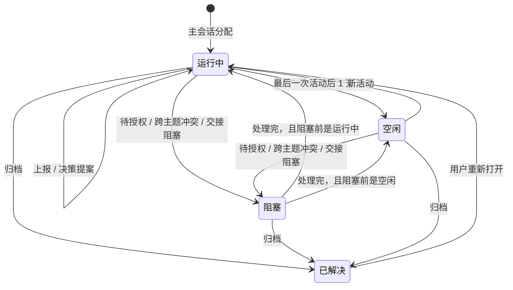

# Cowork 右侧栏主题页设计

Status: implemented（2026-11-10 确认并实现；A2 会话提醒卡按 B 延期）

> 2026-11-10 扩展：右侧栏增加收件箱列，原先的顶部“需要你处理”入口由收件箱的窄栏横幅/头部计数取代；主题卡主体仍打开会话，另加一个只过滤收件箱的筛选按钮；主题列表、状态和归档语义不变。细节见 [topic-inbox.md](../inbox/topic-inbox.md)。本文其余内容保持为主题页的实现事实。

## 实现状态

- 前端：四组列表、两行卡片、单动作 ⋯ 菜单、needsYou、已解决折叠、381px 省略已落地；列表/详情分栏、工作项/评审请求渲染和改投表单已移除。实现证据见前端决策记录与 `/tmp/topic-page-verify/GUI_EVIDENCE.json`。
- 后端：`TopicRecordV2` 增加 authorization/blockedReason/blockedFromStatus/blockedAt；idle 24h、无自动 resolved；`.dsh-cowork/notices.json` 1:1 投递账本；`cowork_topic_report`/`cowork_decision_propose`/`cowork_authorization_request`/`cowork_notices`；`authorization.resolve` 路由；resolve=归档（同时归档宿主会话）、reopen=恢复（unarchive）。实现证据见后端决策记录。
- A2/B：本阶段 B。主题页不渲染会话提醒卡；`TopicNoticePort` 用 Noop，账本保持 pending，`cowork_notices` 是 master 的唯一读取入口。宿主 A2 发布后补端口适配器、客户端 notice seat 注册和真实 GUI 探针。
- 已收口：header 不显示收件箱 chip，`刷新` 按钮固定单行（`flex:none`/`white-space:nowrap`）。主题页移除工作项/评审入口后，工作项页实现前用户暂无查看入口（[KI-41](../../KNOWN_ISSUES.md)）。

## 背景

主题页是列表：需要你处理入口、四个生命周期分组、主题卡。之后确定了主题会话模型：主会话把需求分配给主题会话；主题会话负责决策记录和跨主题交接。

本次按新的事实调整：主题页只生成并上报决策记录，不展示决策记录；分配、上报、决策提案、待授权在会话记录里出现；归档只在主会话留一条消息。

## 本次修订

1. 主题页不展示决策记录，也不展示审查状态。决策记录由主题会话生成并上报；查看和提意见在工作项，资料进 Artifact 工作室，这两处不在本设计内。
2. 分配、上报、决策提案、待授权都显示提醒卡片：主会话一条消息，主题会话一张提醒卡，事件与消息 1:1。
3. 实时、不阻塞：事件发生即写入，不等待主会话处理；主题继续执行。
4. 归档后主会话只显示“xx主题已归档”，没有其他交互；主题移入已解决。
5. 主题列表按事件更新状态；顶部“需要你处理”只统计待授权。
6. 归档入口收进主题卡的 ⋯ 菜单；菜单只保留一个状态动作，1 行，最多 2 行。
7. 空闲阈值：最后一次活动后 1 天。
8. 卡片边框按分组着色：阻塞沿用当前红色，运行中绿色，空闲黑色，已解决灰色。

## 设计目标

- 在 378px 宽度内快速看清主题、摘要和待处理标记。
- 只回答“有哪些主题、现在什么状态、要处理就去哪里”，不复制会话记录和决策记录。
- 提醒在发生的地方显示：主会话和主题会话各有一份，主题页不做第二份队列。

## 页面结构

```text
右侧栏
└─ 主题
   ├─ 需要你处理（只统计待授权）
   ├─ 阻塞（数量）
   │  └─ 主题卡
   ├─ 运行中（数量）
   │  └─ 主题卡
   ├─ 空闲（数量）
   │  └─ 主题卡
   └─ 已解决（数量，默认折叠）
```

点击主题卡进入主题会话；已解决分组展开后可以重新打开。

## 主题卡字段

主题卡只有两行文字：

| 位置 | 内容 |
|---|---|
| 第一行左 | 主题名 |
| 第一行右 | 待授权、等待主会话等标记；⋯ 菜单 |
| 第二行左 | 一行摘要 |
| 第二行右 | 更新时间 |

不进入卡片：生命周期（由分组标题表示）、工作项数、决策记录和审查状态、topic id、session id、cwd、scope、ownedPaths、aliases。

边框颜色按分组：阻塞沿用当前红色，运行中绿色，空闲黑色，已解决灰色。边框只用于区分分组，不改变卡片文字。

卡片从「标题 + 状态标记 + 摘要 + 时间 + 工作项数」收成两行；移除生命周期标记和工作项数；审查状态也不进卡片。

## 主题卡菜单

主题卡保留一个筛选按钮和一个 ⋯；筛选按钮只切换收件箱主题过滤，不打开会话；⋯ 菜单只放当前状态的一个动作，1 行，最多 2 行：

| 卡片状态 | 菜单项 |
|---|---|
| 阻塞 / 运行中 / 空闲 | 归档 |
| 已解决 | 恢复 |

- 打开会话直接点卡片，不放进菜单。
- 归档可撤回，不弹确认；归档后主会话只留一条“xx主题已归档”，列表移入已解决；未处理的待授权提醒失效。
- 恢复：卡片回到运行中，不写主会话记录；归档记录保留；归档时失效的待授权不恢复。
- 卡片样式：[topic-card-style.html](assets/topic-card-style.html)，截图 [topic-card-style.png](assets/topic-card-style.png)。已同步到完整交互稿。

## 事件与记录

| 事件 | 主会话记录 | 主题会话提醒 | 主题列表 | 主题状态 |
|---|---|---|---|---|
| 分配 | 1 条消息 | 1 张提醒卡 | 新建卡片，进入运行中 | — → 运行中 |
| 上报 | 每事件 1 条 | 每事件 1 张 | 摘要更新 | 不变 |
| 决策提案 | 1 条消息 | 1 张提醒卡 | 摘要更新 | 不变 |
| 待授权 | 1 条消息 | 1 张提醒卡 | 移入阻塞，加待授权标记 | 运行中 / 空闲 → 阻塞 |
| 归档 | 1 条消息 | 无 | 移入已解决 | → 已解决 |

规则：

- 1 个事件打印 1 条主会话消息和 1 张主题会话提醒卡，不合并、不批量。
- 同一事件只打印一次；状态变化更新原消息，不新增消息。
- 实时写入，不等待主会话当前轮次结束；主题不因为上报暂停。
- 主会话消息只放摘要，不放完整对话和敏感字段。

## 状态与转化



| 现在 | 事件 | 之后 | 说明 |
|---|---|---|---|
| — | 主会话分配 | 运行中 | 新建主题卡 |
| 运行中 | 最后一次活动后 1 天 | 空闲 | 从最后一次活动开始算 |
| 空闲 | 新活动 | 运行中 | 用户回来或主题继续 |
| 运行中 / 空闲 | 待授权、跨主题冲突、交接阻塞 | 阻塞 | 待授权是标记，不是分组 |
| 阻塞 | 问题处理完 | 回到阻塞前的状态 | 运行中或空闲 |
| 运行中 / 阻塞 / 空闲 | 归档 | 已解决 | 主会话只留一条归档消息 |
| 已解决 | 用户重新打开 | 运行中 | 沿用现有重新打开规则 |

待授权按“阻塞 + 待授权标记”处理：标记出现在卡片上，数量进入顶部“需要你处理”。已确认。

## 会话提醒卡

提醒卡通过宿主 A2 的 notice kind 渲染，由 dsh-cowork 客户端插件注册；主题页列表本身不渲染这些卡。主会话和主题会话各一张，状态更新用同一个 noticeId，不新增消息。当前运行宿主没有 A2 能力，本阶段按 B 不注册渲染器；`notice-model.ts`/`notice.tsx` 已实现并测试，宿主 A2 发布后接 seat 即可。

| 类型 | 主会话 | 主题会话 | 操作 |
|---|---|---|---|
| 分配 | 1 条消息 | 1 张提醒卡 | 无。本版隐藏接受、退回按钮 |
| 上报 | 1 条消息 | 1 张提醒卡 | 无 |
| 决策提案 | 1 条消息 | 1 张提醒卡 | 去工作项查看（导航，不在本设计内） |
| 待授权 | 1 条消息 | 1 张提醒卡 | 主会话：去主题会话处理；主题会话：允许 / 拒绝 |
| 归档 | 1 条消息 | 无 | 无 |

每张卡包含：类型、一行摘要、事件序号、时间、来源或同步标记。主会话记录里的事件卡还带“已写入主会话记录”；主题会话的卡带“已同步主会话”。

## 交互规则

- 点“需要你处理”定位到主题会话的待授权提醒；它是入口，不是队列。
- 分配、上报不可交互，只作为记录；主题会话不显示接受、退回。
- 决策提案只上报，不在主题页展示；点“去工作项查看”离开主题页。
- 待授权在主题会话处理；处理完主题回到阻塞前的状态，主会话记录不新增消息。
- 归档后主会话只显示“xx主题已归档”；主题移入已解决，未处理的待授权提醒失效。
- 列表里的决策记录和审查状态不出现；主题卡摘要是状态描述，不是记录内容。

## 分步演示

- [交互设计稿 HTML](assets/topic-demo.html)（样式在 [topic-demo.css](assets/topic-demo.css)）
- [主会话与列表截图](assets/topic-demo.png)
- [状态与规则截图](assets/topic-demo-overview.png)
- [主题卡菜单截图](assets/topic-demo-archive.png)

设计稿按六步展示，可以点顶部步骤切换，也可以在主会话和主题会话之间切换：

1. 总览：事件、记录和状态的对应关系。
2. 分配：主会话 1 条消息，主题会话 1 张提醒卡，列表新增运行中卡片。
3. 上报：两个事件打印两条消息、两张提醒卡；实时，不阻塞。
4. 决策提案：只生成并上报，主题页不展示记录。
5. 待授权：主题移入阻塞；切到主题会话点允许或拒绝，列表回到运行中。
6. 归档：点主题卡 ⋯ 里的“归档”；主会话只留一条“已归档”消息，列表移入已解决。已解决卡片的同一菜单里是“恢复”。

卡片样式和边框颜色已同步到完整交互稿和截图，见[主题卡样式](assets/topic-card-style.png)。

直接看某一步：`topic-demo.html?step=4&view=topic`。

## 范围外

- 工作项里的决策记录查看和提意见。
- Artifact 工作室里的决策提案资料。
- 审查、评审、CI 相关功能。
- 跨主题冲突的对比和裁决界面。

## 已确认

- 两行主题卡：主题名 + 一行摘要；标记在主题名右侧，时间在摘要右侧（截图 [topic-card-style.png](assets/topic-card-style.png)）。
- 边框颜色：阻塞红、运行中绿、空闲黑、已解决灰。
- 完整交互稿、列表截图和 feature 待办已同步。
- 前端实现决策与验收见 [topic-page-frontend.md](../../../.agents/notes/implemented/feature/2026-11-10-topic-page-frontend.md)。
- 后端实现决策（状态、事件通知、会话投递与迁移）见 [topic-page-backend.md](../../../.agents/notes/implemented/feature/2026-11-10-topic-page-backend.md)。
- 会话提醒卡采用宿主 A2 的设计不适用于当前运行宿主（DSH 0.2.1-rc.2 没有 `notice/message` 事件和 `ctx.sessionNotices`；`appendPluginRecord` 只授权 `packages/experimental/`）。本阶段按 **B** 落地：主题页、状态、菜单、通知账本和 `cowork_notices` 完整，主会话/主题会话的 1:1 提醒卡延期到宿主 A2 发布；偏离记录在 [KNOWN_ISSUES](../../KNOWN_ISSUES.md)。
