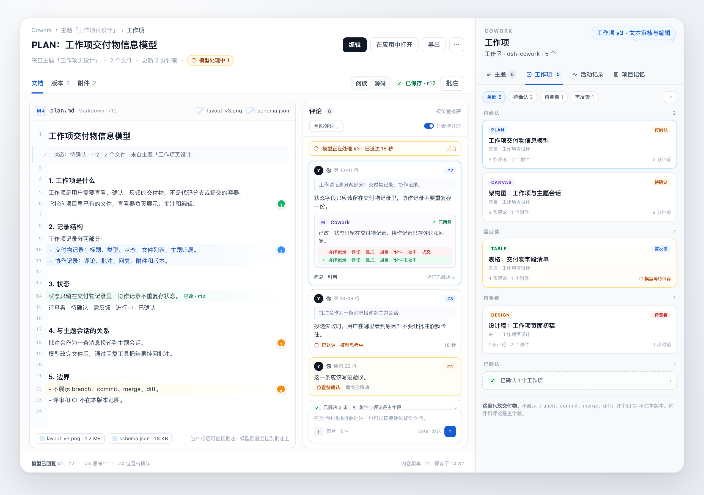
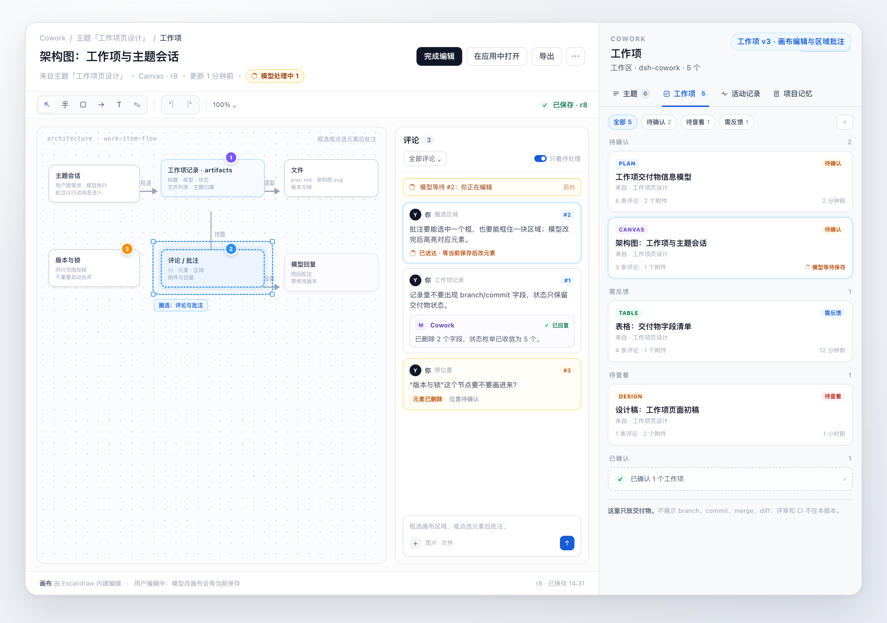
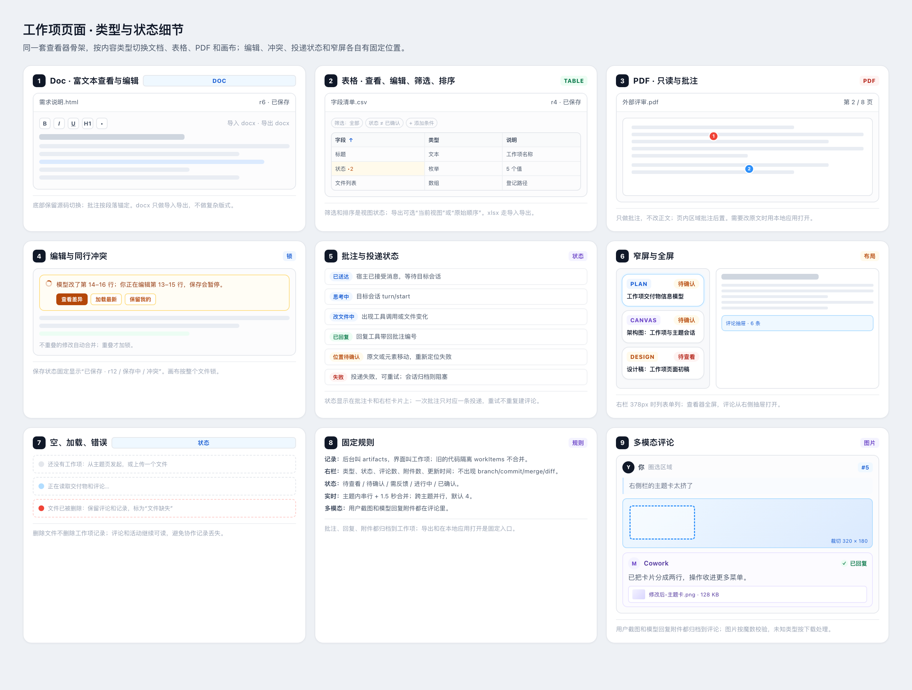

# Cowork 工作项前端设计与开发方案

Status: draft（frontend design，2026-11-10；待实现；后端设计见 [work-item-backend.md](work-item-backend.md)）

本方案把[工作项多模态交付物查看器设计](work-item-artifact-viewer.md)和[V1–V16 核实报告](work-item-artifact-verification.md)落成前端实现计划。页面结构、类型和交互以查看器设计为准；依赖体积、编辑器和限制以核实报告为准。决策和取舍见[前端开发提案](../../../.agents/notes/proposed/feature/2026-11-10-work-item-page-frontend.md)。

## 范围

做：右栏工作项列表、主区域查看器、文本/图表/表格/Doc/画布/PDF/图片的查看与编辑、批注线程、模型活动状态、保存与冲突、附件和多模态回复。

不做：旧的代码隔离 `workItems`、评审/CI 闸门、多人权限、PDF 正文编辑、复杂 Word 版式/Excel 公式保真、Artifact 工作室和活动记录页（只保留标签位置）。

## 承载面与导航

```text
Cowork 右栏（session scope）
└─ 内部标签：主题 / 工作项 / 活动记录 / 项目记忆
   └─ 工作项
      └─ WorkItemList（筛选 + 分组卡片）
           └─ 点击卡片 → openWorkItem({ sessionId, artifactId })

主区域（root scope，keyed panel）
└─ WorkItemPanel（查看器）
   ├─ 顶部：返回会话 / 标题 / 类型 / 状态 / 操作
   ├─ 工具条：文档 / 版本 / 附件；阅读 / 源码；保存状态；批注
   ├─ 内容：当前渲染器
   ├─ 右侧：CommentRail（窄屏为抽屉）
   └─ 底部：附件条 / 模型活动摘要
```

- 右栏工作项列表挂在 Cowork 面板的内部标签里；当前 `panel.tsx` 只有主题列表/详情，需要先加内部标签壳。主题内容迁入第一个标签；活动记录、项目记忆先占位或未启用。
- 查看器是 root `main` 的 keyed panel，key 用 `cowork-work-item`；从列表打开时把 `{sessionId, artifactId}` 写进客户端 store，再 `ctx.layout.selectPanel('cowork-work-item')`。
- 顶部“返回会话”调用 `selectPanel(null)`，回到当前会话；关闭查看器不清空工作项状态，也不删除未保存草稿。
- 左侧栏切换会话时，查看器自动关闭；如果宿主没有可订阅的会话切换事件，第一版在查看器可见时检查当前会话 id，不一致则关闭并提示。
- 宿主没有 `layout` 服务时，列表卡片不打开主区域，显示“当前宿主无法打开主区域”；不降级成右栏全屏查看器，避免两套布局。
- 不在 `sidebar.panellist` 再注册一个入口；工作项列表是 Cowork 面板内的标签。

## 前端模块

```text
src/client/work-item/
├─ index.tsx              注册 main panel、可选快捷键、懒加载入口
├─ panel.tsx              WorkItemPanel：数据加载、工具条、内容区、评论栏
├─ list.tsx               WorkItemList：筛选、分组、卡片
├─ model.ts               纯视图模型：筛选、分组、标签、活动/保存文案
├─ store.ts               打开上下文、选中项、订阅（useSyncExternalStore）
├─ api.ts                 列表/详情/文件/批注/保存/事件/上传
├─ contracts.ts           客户端侧 wire 类型（与 api-contract.ts 对齐）
├─ styles.ts              页面样式和 token
├─ hooks/useArtifact.ts   详情 + 文件内容 + 版本
├─ hooks/useComments.ts   线程、批注定位、状态
├─ hooks/useArtifactEvents.ts SSE/刷新、Last-Event-ID
├─ components/
│  ├─ ViewerHeader.tsx
│  ├─ ViewerToolbar.tsx
│  ├─ CommentRail.tsx
│  ├─ CommentCard.tsx
│  ├─ Composer.tsx
│  ├─ AttachmentBar.tsx
│  ├─ ActivityState.tsx
│  ├─ SaveState.tsx
│  ├─ ConflictBanner.tsx
│  └─ EmptyStates.tsx
├─ editors/
│  ├─ TextEditor.tsx      CodeMirror 6
│  ├─ RichDocEditor.tsx   TipTap + 表格扩展
│  ├─ TableEditor.tsx     自建网格 + excel 读写
│  ├─ DiagramSource.tsx   图表源码 + Pele 预览
│  ├─ CanvasEditor.tsx    Excalidraw 懒加载
│  └─ HtmlSource.tsx      HTML/CSS/JS 源码
├─ viewers/
│  ├─ PdfViewer.tsx
│  ├─ ImageViewer.tsx
│  └─ HtmlPreview.tsx
└─ lazy.ts                Excalidraw / Doc / 表格 / 图表按需加载
```

- 当前 `panel.tsx` 的 `TopicList`/`TopicDetail` 保留在主题标签；工作项列表作为兄弟标签，不修改主题列表的数据逻辑。
- `index.tsx` 在现有 client 入口中注册；`inject` 增加可选的 `layout`、`uiWorkspace`，缺失时只退化打开/返回，不阻止插件加载。
- `store.ts` 只存“打开上下文 + 当前选中项”，不引入全局状态库；跨组件用 `useSyncExternalStore`。
- 纯函数放 `model.ts`，React-free，沿用 `node --test` 的类型剥离测试方式。

## 数据契约（拟）

### 工作项记录

```ts
interface ArtifactRecord {
  artifactId: string
  sessionId: string           // 所属主题会话
  projectId: string
  title: string
  type: 'text' | 'doc' | 'table' | 'diagram' | 'canvas' | 'pdf' | 'image' | 'html' | 'other'
  status: 'pending-view' | 'pending-confirm' | 'needs-feedback' | 'in-progress' | 'confirmed'
  paths: string[]             // 项目内相对路径
  primaryPath: string
  revision: number
  createdAt: string
  updatedAt: string
  commentCount: number
  attachmentCount: number
  activeDispatch: DispatchState | null
}
```

### 列表/详情/文件/批注/保存

以下路径是拟议接口，全部走 `connection.fetch.register` 的 exact route，沿用 Host/Origin 和浏览器认证；实现时以 `src/panel/api-contract.ts` 的类型为准。

| 方法/路径 | 用途 | 关键输入/输出 |
|---|---|---|
| `GET /api/cowork.artifact.list?sessionId` | 右栏列表 | `{ items, counts }`；按 `updatedAt` 降序；上限 200 |
| `GET /api/cowork.artifact.detail?sessionId&artifactId` | 查看器元数据 | 记录、文件列表、版本、线程摘要 |
| `GET /api/cowork.artifact.file?...&path&version` | 文件内容 | 文本/二进制；支持 Range；带路径守卫 |
| `POST /api/cowork.artifact.comment` | 新增批注 | 锚点、引用原文、版本号；返回线程和事件序号 |
| `POST /api/cowork.artifact.edit` | 保存 | `baseVersion`、内容或 patch；冲突返回 409/合并结果 |
| `POST /api/cowork.artifact.upload` | 附件/截图 | 大小/类型校验；存到工作项目录 |
| `GET /api/cowork.artifact.events?...` | SSE | 评论、状态、模型活动、版本变化；支持 `Last-Event-ID` |

- 文件路径只允许项目内相对路径；拒绝 `..`、绝对路径、符号链接逃逸和未登记路径。
- 保存用版本号做乐观并发；409 先尝试按行三方合并，重叠才交给冲突 UI。
- 编辑范围上报走单独轻量 POST 或 SSE 上行，300ms 节流，5 秒 TTL；宿主工具守卫在 `write`/`edit`/`str_replace_editor` 前检查重叠。
- 归档/状态动作复用或新增 exact route；不恢复旧的 `workItems` 语义。
- 事件流断线用 `Last-Event-ID` 续传；失败退避 1s/4s/15s，最多 3 次，之后显示“实时更新中断，点击重试”。

### 模型工具与投递

- 主题会话内新增 `cowork_artifact_reply`：接收批注 id/回复文本/附件引用，写入线程并通知前端；模型回复支持图片或文件附件。
- 需要时增加只读 `cowork_artifact_comments`：让模型主动拉取未处理批注；没有该工具时，批注内容随投递消息进入回合。
- 主会话的跨主题投递由宿主 dispatcher 负责；前端只展示 `queued/sent/thinking/working/replied/failed/blocked/stale` 状态，不自己排队。
- 同一主题会话串行、1.5 秒合并、每批最多 10 条；跨主题默认并行 4（1–8）；队列上限 50/会话、200/项目；幂等键防重复投递。
- 投递前把批注和用户消息合并成一条 prompt；主题会话忙碌时用 `followup` 排队，不打断当前回合。
- 前端不直接调模型；失败可重试，重试沿用同一幂等键。

## 渲染器与编辑器

| 类型 | 组件 | 依赖 | 说明 |
|---|---|---|---|
| Markdown/源码 | `TextEditor` | CodeMirror 6 | 行号、选区、批注装饰、脏行上报；520 KB min |
| 图表 | `DiagramSource` + Pele 预览 | Pele | 六类图 301 KB min；渲染失败显示行号，保留源码 |
| 表格 | `TableEditor` | read/write-excel-file | 自建网格、筛选/排序视图；123 KB min；xlsx 只做交换 |
| Doc | `RichDocEditor` | TipTap + starter-kit + 表格扩展 | 460 KB min；表格扩展单独安装，所有 @tiptap 锁同一版本 |
| 画布 | `CanvasEditor` | Excalidraw | 懒加载 8.19 MB JS；不带 Xiaolai，中文回退；整文件锁 |
| PDF | `PdfViewer` | 宿主预览/浏览器原生 | 只读；整体/按页评论；页内区域后置 |
| 图片/SVG | `ImageViewer` | 无 | 区域/pin 批注；SVG 可切源码 |
| HTML/CSS | 静态预览 + `HtmlSource` | 净化 | 静态内联；脚本走沙箱 iframe，禁外部导航 |
| 其他 | 下载/外部打开 | 宿主 openWorkspacePath | 不做假预览 |

- 阅读/源码切换由工具条控制；只有文本类有源码视图。
- 图表先渲染后编辑：默认看 SVG，切源码改 Mermaid；保存后重新渲染。
- Doc 底部可切 HTML 源码；docx 导入用 mammoth，导出用 `docx/html` 的 `htmlToContent`；复杂版式给“在应用中打开”。
- 表格的筛选/排序是视图状态；导出可选“当前视图”或“原始顺序”；不承诺公式/样式往返。
- PDF 第一版不做页内区域批注；只做整体评论和按页评论。

## 批注与线程

锚点类型：

- 文本：`line-range`（起止行、引用原文、前后各一行、revision）。
- Doc：`block`（块 id/文本指纹 + revision）。
- 图表：`diagram-node` 或行范围；无法定位时保留区域坐标。
- 表格：`cell`/`row`/`column`。
- 画布：`element-id` 或归一化区域。
- PDF/图片：`page`/`region`/`pin`。
- 整体：`whole`。

规则：

- 批注存路径、锚点、引用原文、版本号、作者、时间、线程状态；不物理删除。
- 原文变化后先按引用文本和上下文重定位；失败标“位置待确认”，保留内容和回复，不猜位置。
- 评论栏按锚点位置排序；点批注卡定位文档，点行内 pin 选中线程；已解决线程折叠一行。
- 输入框支持文本、图片、文件；发送后先显示 `queued`，事件流推进状态；失败可重试。
- 选中行/区域后出现“批注”入口；不自动弹输入框，避免打断阅读。

## 保存、冲突与锁

- 进入编辑态后 800ms 防抖自动保存；失焦、切换工作项、关闭页面立即保存。
- 保存状态固定显示：已保存 · r12 / 保存中 / 冲突 / 保存失败。
- 用户编辑范围每 300ms 上报，5 秒过期；模型写入前由 `tools.guard` 检查重叠，重叠等待或拒绝，不重叠放行。
- 保存 409：先用 base/current/mine 做行级三方合并；不重叠自动合入并提示“已合并模型修改”；重叠弹冲突界面，提供查看差异、加载最新、保留我的。
- 画布按整文件锁：用户画布编辑未保存时，模型改画布排队；模型修改时前端禁用画布输入并显示锁。
- bash 绕过工具守卫是残余风险：主题会话提示词要求用编辑工具；保存后校验文件是否仍在登记路径内，发现越界写入时标记冲突并提示。
- 用户未保存的草稿不因模型回复丢失；切换工作项前保存或明确提示。

## 实时状态

查看器、列表卡、批注卡共享同一组状态：

```text
queued → sent → thinking → working → replied
                    ↘ failed
                    ↘ blocked
                    ↘ stale
```

- SSE 事件：`comment.created`、`comment.updated`、`dispatch.updated`、`artifact.updated`、`revision.created`、`reply.created`。
- 断线重连按 `Last-Event-ID`；重连后拉一次详情对账，避免丢事件。
- 列表卡的模型活动只显示一个摘要状态；查看器顶部显示当前活动，失败/阻塞给原因和重试。
- 网络错误不把状态改成失败；只有宿主明确回执才进入 `failed/blocked`。

## 多模态与附件

- 用户上传图片/文件走 `artifact.upload`；限制类型、大小和数量，文件名净化，存工作项目录，不覆盖已有文件。
- 图片在批注和模型回复里显示缩略图，可点开大图；附件条显示文件名、大小、类型、删除/下载。
- 模型回复带附件时，宿主保存到工作项目录并写入线程；前端只接受登记过的附件 id/path。
- 图片作为 prompt 内容时走现有 `image` content part；不支持图片的模型在发送前提示，不静默丢弃。

## 状态与错误

| 状态 | 界面 |
|---|---|
| 列表加载 | 3 张骨架卡 |
| 列表空 | “还没有工作项”+ 说明；不显示假卡片 |
| 列表错误 | 错误消息 + 重试；保留上次列表 |
| 查看器加载 | 标题骨架 + 内容骨架 |
| 文件缺失 | 显示路径和“文件不存在/已移动”，可刷新或打开所在目录 |
| 不支持类型 | 下载/外部打开，不渲染空白 |
| 只读 | 显示原因（权限/二进制/未知类型）；编辑按钮禁用 |
| 保存冲突 | 顶部冲突条 + 差异入口，不遮住正文 |
| 投递失败 | 批注卡和顶部都显示原因，可重试 |
| 会话不可用 | 显示“主题会话已归档/不可用”，保留批注 |

## 布局、响应式与无障碍

- 查看器占满主区域；评论栏 320–360px，窄屏（<900px）改为底部抽屉/浮层，内容区不被挤压。
- 工具条允许换行；标题单行省略，类型/状态不换行。
- 焦点顺序：返回 → 标题操作 → 工具条 → 正文 → 评论栏 → 输入框；打开抽屉后焦点进入抽屉，关闭后回到触发按钮。
- 行/元素/区域批注有键盘入口；颜色不是唯一状态提示；对比度满足 WCAG AA。
- 减少动态效果时不播放状态脉冲；错误和保存状态用文字。
- 图片有 alt；按钮有 aria-label；菜单支持 Escape/焦点返回。

## 性能

- 首屏只加载列表和查看器壳；CodeMirror/TipTap/Pele/表格按需加载；Excalidraw 独立 chunk，打开画布才下载。
- 大文件分块/Range 读取；超过 2 MB 的文本不整篇塞进 DOM，按需分页或只读预览。
- 列表最多 200 条，分组渲染；评论线程超过 200 条折叠“加载更多”。
- 编辑器输入不触发整页重渲染；保存状态和活动状态用局部 store。
- 图片缩略图限制尺寸；附件下载按需。

## 构建与依赖

- 依赖进 `package.json` 并提交锁文件；全部 MIT/Apache-2.0 兼容。
- 客户端构建从单文件 CJS 扩展为“主包 + 按需 chunk”：Excalidraw 独立 chunk，Doc/表格/图表可同 chunk 或独立；loader 用包内相对路径加载，不请求外部 CDN。
- Excalidraw 的 CSS、字体和资源走同源授权路由；`EXCALIDRAW_ASSET_PATH` 用绝对 URL；不带 Xiaolai，中文回退。
- TipTap 所有包锁同一版本；表格扩展不能漏。
- 客户端上限 100 MB（5 MB 不设硬门槛）；包体按 10 MB 控制。当前核心约 2.4 MB min，含 Excalidraw 约 11 MB min，符合客户端上限。

## 测试与验收

- 纯函数：列表筛选/分组、状态文案、活动状态、保存状态、锚点重定位降级；`node --test`。
- 宿主契约：列表/详情/文件/批注/保存/事件路由的认证、路径守卫、版本冲突、幂等；`node --test`。
- 前端交互：用 fixture 跑列表、查看器、批注、保存冲突、失败回滚；能跑浏览器检查就跑一次真实主题标签 + 主区域。
- 端到端：真实主题会话里投递批注 → SSE 状态 → 模型回复 → 文档定位；真实模型 E2E 单独记录。
- 画布：打开、编辑保存、模型改元素、整文件锁；单独浏览器检查。
- 工程：`npm run check`、`npm run typecheck`、`npm run build`、`npm test` 全部通过；`npm pack` 检查包体。
- 文档：设计、核实报告、提案、demo 截图互相链接。

## 开发阶段

1. **基础与只读。** 工作项记录/列表/详情/文件路由、Cowork 内部标签壳、主区域壳、`WorkItemList`、文本阅读、批注线程、fixture；不做编辑和投递。可演示：从右栏打开一份 Markdown，逐行批注。
2. **文本编辑与实时。** CodeMirror 编辑、自动保存、版本/409/三方合并、脏行上报、工具守卫；SSE、dispatcher、`cowork_artifact_reply`、多模态附件；可演示：用户改一段、模型改另一段自动合并、同行冲突被锁。
3. **图表与表格。** Pele 六类图 + 源码编辑；自建表格 + excel 导入导出 + 筛选/排序；区域/节点批注。
4. **Doc、PDF 与画布。** TipTap + docx 导入导出；PDF 查看/按页评论；Excalidraw 懒加载、元素级工具、整文件锁、导出。
5. **收口。** 窄屏/键盘/空错态/性能/包体、真实模型 E2E、文档和截图同步、旧详情入口迁移。

每阶段可独立合并；阶段 1 先证明“列表 → 主区域 → 批注”的主链路，再扩类型。

## 风险

- **跨层改动大。** 这项工作同时改客户端面板、主区域注册、宿主路由、存储、投递和工具；阶段 1 不先打通主链路，后面会被联调拖住。
- **Excalidraw 资源和 chunk 接入未原型。** 客户端上限已放宽到 100 MB，但 CJS/chunk、CSS/字体授权路由、`EXCALIDRAW_ASSET_PATH` 仍是实现期第一风险。
- **SSE/并发/模型回复未真机验证。** 源码支持不代表端到端可用；阶段 2 必须先在真实宿主跑通再扩类型。
- **同行锁可被 bash 绕过。** 工具守卫只覆盖结构化写工具；需要提示词约束 + 保存后二次校验，不能宣称完全阻止。
- **TipTap/Excalidraw 依赖版本。** TipTap 表格扩展不在 StarterKit，当前版本解析有偏差；Excalidraw 锁定 0.18.1，升级要重跑体积和字体检查。
- **主题页/活动流依赖。** 右栏内部标签壳会碰主题页；如果主题页前端并行改造，先约定标签壳接口，避免两边重写 `panel.tsx`。
- **旧 `workItems` 语义。** 新功能用 `artifacts` 记录；不复用代码隔离工作项的字段和状态，避免语义混淆。
- **附件和路径安全。** 上传、预览、HTML/ SVG 内联都必须过路径守卫和净化；沙箱 iframe 不能拿到宿主权限。

## Demo







- 交互稿：[work-item-demo.html](assets/work-item-demo.html)（`?view=text|canvas|details`）
- 设计：[work-item-artifact-viewer.md](work-item-artifact-viewer.md)
- 研究与核实：[work-item-artifact-embedding-research.md](work-item-artifact-embedding-research.md)、[work-item-artifact-verification.md](work-item-artifact-verification.md)
- 提案：[2026-11-10-work-item-page-frontend.md](../../../.agents/notes/proposed/feature/2026-11-10-work-item-page-frontend.md)
