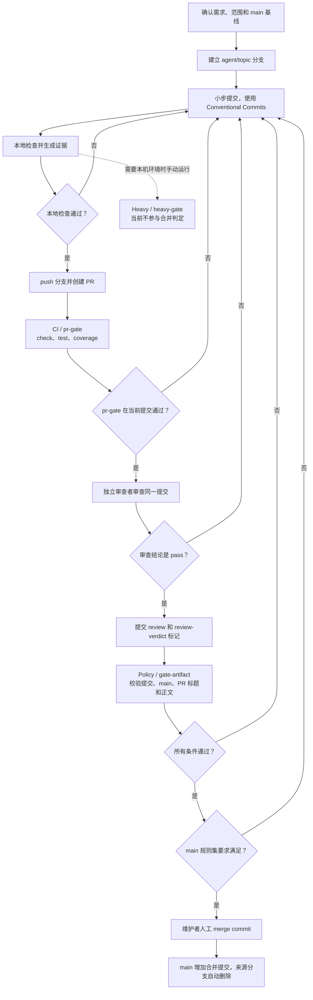
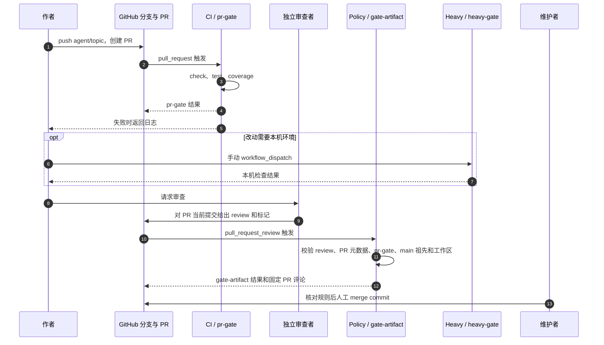
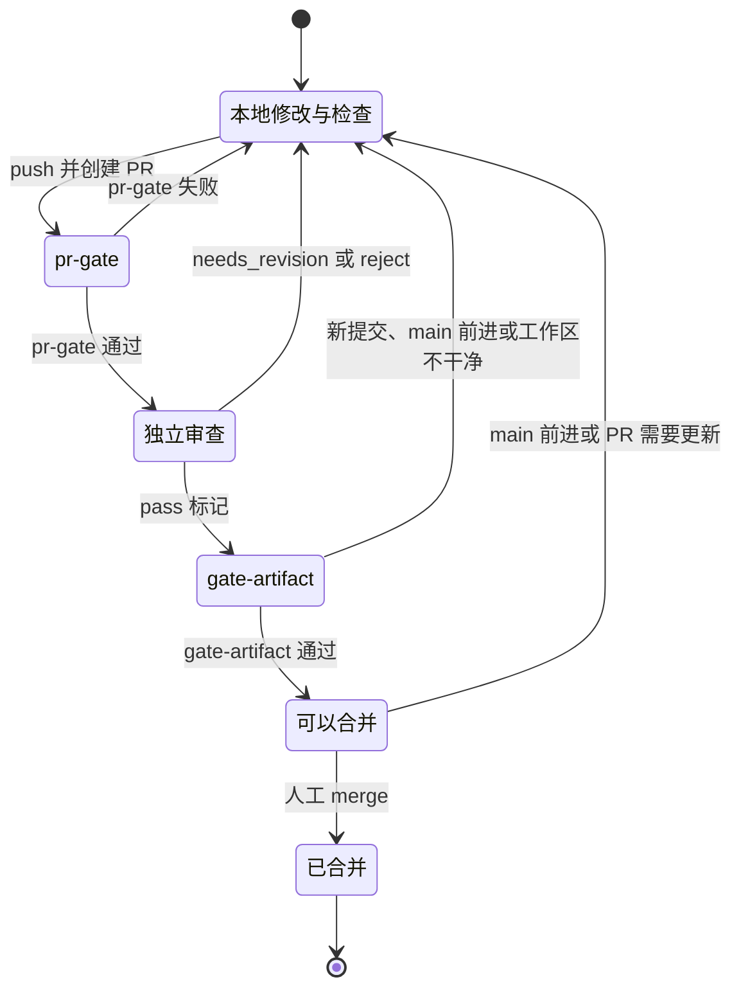

# GitHub 协作流程

本文说明一次代码改动如何从本地分支进入 `main`，以及每一步由谁执行、什么情况下会失败、失败后从哪里继续。PR（Pull Request，拉取请求）是这里的合并入口。内容以 2026-11-16 的 `origin/main` 和仓库当前 GitHub 设置为准。

本文只讲代码如何通过 GitHub 进入 `main`。插件内部的 topic、work item 与 review request 如何协作，见 [routing.md](routing.md)；测试命令和证据选择见 [testing.md](testing.md)。

## 1. 问题描述

一次改动从本地提交进入 `main`，需要同时回答四个问题：

1. 哪些检查必须通过，而且必须针对同一个提交？
2. 谁给出代码审查结论，怎样证明这个结论没有过期？
3. 哪个动作真正允许合并，失败后应该回到哪一步？
4. 哪些检查当前没有自动执行，PR 中怎样如实说明？

如果只看某一个 workflow 或某一份说明，容易把“本地跑过”“GitHub 上的检查通过”“有人评论过”和“允许合并”混成一件事。本文把当前实际流程按执行顺序连接起来，并明确自动部分与人工部分。

## 2. 适用范围与当前状态

| 项目 | 当前值 |
|---|---|
| 仓库 | `leigangzhang/dsh-cowork` |
| 默认分支 | `main` |
| 分支约定 | 一个工作流使用一个 `agent/<topic>` 分支；GitHub 不强制分支名 |
| 合并方式 | 人工合并提交（merge commit） |
| 合并前必需检查 | `pr-gate`、`gate-artifact` |
| 本机扩展检查 | `heavy-gate`，手动运行，当前不是合并前必需检查 |
| 自动发布 | 无；详见第 7 节 |

## 3. 总流程概览

图 1 从作者建立分支开始，到维护者人工合并为止。失败时通常回到提交，而不是直接改 `main`。



### 3.1 三个自动检查

| 检查 | 触发方式 | 运行位置 | 是否阻止合并 | 主要作用 |
|---|---|---|---|---|
| `CI / pr-gate` | PR 创建或更新，目标为 `main` | GitHub 提供的 Ubuntu 运行器 | 是 | 运行 `check`、`test`、`coverage` |
| `Policy / gate-artifact` | 提交或撤销 PR review | GitHub 提供的 Ubuntu 运行器 | 是 | 校验 review 标记、PR 当前提交、`pr-gate`、`main` 和工作区 |
| `Heavy / heavy-gate` | 有写权限的人手动启动 | 标记为 `self-hosted, heavy` 的本机运行器 | 否 | 运行类型检查、构建、host smoke 和分层覆盖率 |

`pr-gate` 和 `gate-artifact` 是 `main` 规则集里的必需检查。`heavy-gate` 不在必需检查中，PR 描述必须把未运行的 heavy 检查写进 `Not run`，不能把“没有运行”写成通过。

### 3.2 一次改动的时序



## 4. 分阶段流程

### 4.1 准备分支

从最新的 `main` 拉出一个 `agent/<topic>` 分支。一个已授权的工作流使用一个分支，不按提交、审查轮次或子任务重复开分支。分支名是团队约定，GitHub 当前不校验它。

开始写代码前，先读：

- 当前产品范围和验收：[PLAN-V0.2.md](PLAN-V0.2.md)；
- 改动涉及的检查：[tools/workflow.json](../tools/workflow.json)；
- 常驻工程规则：[AGENTS.md](../AGENTS.md)。

Issue 引用不是必需项。PR 的动机应当写清楚，需要上下文时再用 `Refs #N` 或 `Fixes #N`。

### 4.2 提交

提交信息使用 Conventional Commits，例如 `feat(scope): summary` 或 `docs(process): explain the flow`。PR 标题必须使用同一套类型前缀，当前允许的类型是 `feat`、`fix`、`docs`、`test`、`refactor`、`chore`、`perf`、`build`、`ci`，类型后可以带一个括号范围。

不要提交本地构建产物、`.env`、运行数据或密钥。`lib/` 是本地构建输出，已被忽略。

### 4.3 本地检查并生成证据

先从实际改动范围选择检查：

```sh
npm run change-scope -- --base origin/main
```

这个命令列出 committed、staged、unstaged、untracked 四组路径。按 [tools/workflow.json](../tools/workflow.json) 选择最小但完整的检查，不要把“跑过一次全量测试”当成所有改动的默认证据。

记录当前提交对应的证据：

```sh
npm run gate-artifact -- --base origin/main
```

输出包含目标分支当前提交、PR 当前提交、差异的 SHA-256、工作区状态和四组路径。任何一次编辑、暂存或新文件都会改变这些内容；改动后必须重新生成。具体命令选择见 [testing.md](testing.md)。

本地检查通过只证明本机运行过。它不能替代 GitHub 上的 `pr-gate`，也不能替代 `gate-artifact` 对 review 和当前提交的校验。

### 4.4 创建 PR

向 `main` 创建 PR。标题使用 Conventional Commits；正文按 [pr-description](../.agents/skills/pr-description/SKILL.md) 的结构写，至少包含四个一级标题：

- `## Motivation`
- `## Changes`
- `## Testing`
- `## Evidence`

当前没有单独的 `.github/pull_request_template.md`，PR 结构由 [pr-description](../.agents/skills/pr-description/SKILL.md) 统一说明，自动校验脚本是 [pr-metadata.mjs](../scripts/ci/pr-metadata.mjs)。脚本当前只检查标题格式和四个一级标题是否存在，正文内容是否真实仍由审查者判断。

### 4.5 `pr-gate`：GitHub 上的基础检查

PR 创建或更新后，`.github/workflows/ci.yml` 触发 `CI` workflow 的 `pr-gate` 任务（job）。它做这些事：

1. 检出（checkout）PR 当前提交；
2. 拉取目标分支；
3. 按 `.node-version` 安装 Node；
4. 执行 `npm ci`；
5. 依次执行 `npm run check`、`npm test`、`npm run test:coverage`；
6. 生成 `review-context.json` 并作为 workflow 附件上传。

这个任务有 30 分钟超时，权限只有 `contents: read`，同一 PR 有新 push 时会取消旧运行。规则集只要求一个名为 `pr-gate` 的检查，不把每个命令拆成单独的必需检查。

任一步失败，`pr-gate` 就是失败。修改后重新 push，新的提交会重新运行检查。

### 4.6 独立审查

审查在 `pr-gate` 针对当前提交通过后进行。实现者不能担任自己改动的最终审查者。项目内使用 AgentTeams 时，审查者应使用新上下文和只读方式工作；详细规则见 [agent-teams.md](agent-teams.md) 和 [code-review](../.agents/skills/code-review/SKILL.md)。

审查者至少要做这些事：

- 用 `change-scope` 固定审查范围；
- 先读需求和验收，再读代码差异、调用方和测试；
- 核对测试是否真的覆盖了所声称的行为；
- 给出 `路径:行号`、影响和修复要求；
- 在同一提交上给出结论。

审查结论通过 GitHub review 评论提交。当前使用评论形式的标记，不使用 GitHub 的批准（`Approve`）：

```text
<!-- review-verdict:v1 head=<40 位提交 SHA> verdict=pass reviewer=agentteam model=<模型名> -->
```

`reviewer` 只能是 `agentteam` 或 `human`，`model` 不能为空。审查结论不是 `pass` 时，不要写这个通过标记。新提交会让旧结论失效，需要对新提交重新审查；一个审查循环通常控制在 2–3 轮内。

### 4.7 `gate-artifact`：绑定审查和当前提交

提交或撤销 review 后，`.github/workflows/gate-artifact.yml` 触发 `Policy` workflow 的 `gate-artifact` 任务（job）。普通评论如果没有 review 标记会跳过；`changes_requested` 或 review 被撤销时会运行并失败。

这个任务从受信任的目标分支检出脚本，只把 PR 当前提交当作 git 数据读取，不执行 PR 代码。它检查：

1. review 的提交等于 PR 当前提交，状态是 `approved` 或 `commented`；
2. `review-verdict` 标记里的 head 等于 PR 当前提交，verdict 是 `pass`；
3. PR 标题符合 Conventional Commits，正文包含 `## Motivation`、`## Changes`、`## Testing`、`## Evidence`；
4. `pr-gate` 在当前提交上有成功记录；
5. 当前 `origin/main` 是 PR 当前提交的祖先；
6. 临时检出 PR 当前提交后工作区干净。

通过后生成 `gate-artifact.json` 和 `review-verdict.json`，更新同一条固定 PR 评论（sticky comment），并让 `gate-artifact` 成为当前提交上的成功检查。任何新提交、`main` 前进或工作区不干净，都会让这次检查失败或失效。

实现细节见 [gate-artifact.yml](../.github/workflows/gate-artifact.yml)、[review-verdict.mjs](../scripts/ci/review-verdict.mjs) 和 [gate-artifact.mjs](../scripts/review/gate-artifact.mjs)。

### 4.8 `main` 规则集与人工合并

`main` 使用名为 `main-pr-gate` 的 GitHub 分支保护规则集（ruleset）。当前设置如下：

| 设置 | 当前值 |
|---|---|
| 必须通过 PR | 是 |
| GitHub 要求的批准数 | 0 |
| 必需检查 | `pr-gate`、`gate-artifact` |
| 必须解决所有 review 对话（conversation） | 是 |
| 分支必须包含最新 `main` | 是 |
| 允许的合并方式 | 仅合并提交（merge commit） |
| 阻止强制推送（force push） | 是 |
| 阻止删除 `main` | 是 |
| 绕过规则的角色 | 无 |
| 自动合并 | 关闭 |
| 合并后删除来源分支 | 开启 |
| 允许更新分支 | 开启 |
| 要求线性历史 | 否 |

批准数为 0 表示 GitHub 不会用第二个账号的 `Approve` 来强制独立审查；独立审查由 `review-verdict` 和 `gate-artifact` 共同记录。维护者在确认检查、审查和对话状态后手动合并，不使用自动合并（auto-merge）或合并队列（merge queue）。

## 5. Heavy lane

`Heavy` workflow 是独立的本机检查，不会在 PR 创建或更新时自动运行。它只接受 `workflow_dispatch`，运行在标签为 `self-hosted` 和 `heavy` 的机器上，主要步骤是：

```text
npm ci
npx playwright install chromium
npm run typecheck
npm run build
DSH_HOST_SMOKE_STRICT=1 npm run test:host-smoke
npm run test:coverage:layered -- --base origin/<base>
```

workflow 会从 `repo_path` 指向的本地仓库目录克隆 `$GITHUB_SHA`，检查 Node 是否匹配 `.node-version`，并使用临时环境运行。默认 `repo_path` 是维护者本机路径，换机器时要显式传入正确路径。

当前 `heavy-gate` 不是 PR 当前提交上的必需检查，也不能拿一次在 `main` 上的运行结果证明某个 PR。它要成为必需检查，需要先满足两个条件：

1. 连续 20 次没有基础设施失败的 green 运行；
2. 有一个能在 PR 当前提交上发布 `heavy-gate` check 的受信任机制。

计数、升级和回滚步骤见 [heavy-runner.md](heavy-runner.md)。在它成为必需检查前，PR 的 `Not run` 必须如实列出没有运行的 heavy 检查。

## 6. 合并前检查清单

- [ ] PR 指向 `main`，标题符合 Conventional Commits。
- [ ] 正文包含 `## Motivation`、`## Changes`、`## Testing`、`## Evidence`。
- [ ] `pr-gate` 在 PR 当前提交上成功。
- [ ] 独立审查在同一个提交上给出 `verdict=pass`，并带有 `review-verdict` 标记。
- [ ] `gate-artifact` 在同一个提交上成功。
- [ ] 所有 review 对话（conversation）已解决。
- [ ] 分支包含当前 `origin/main`。
- [ ] heavy 检查已在该提交上运行，或在 `Not run` 中写明原因。
- [ ] 合并由维护者手动执行，不使用自动合并（auto-merge）。

## 7. 合并之后与发布

人工合并后，`main` 得到一个 merge commit，来源分支自动删除。当前没有针对 `main` push 的自动检查 workflow；`pr-gate` 和 `gate-artifact` 的结果属于合并前的 PR 提交，不是合并后新增的提交。分支必须包含最新 `main` 的规则降低了合并结果偏离已检查内容的可能，但不能替代单独的合并后检查。

合并到 `main` 不等于发布。当前仓库没有发布 tag、GitHub Release 或 npm 发布 workflow；`package.json` 是 `private: true`，README 只承诺 tarball 安装。需要构建 tarball 时，按 [README.md](../README.md) 执行：

```sh
npm run build
npm pack
```

发布流程若以后加入 GitHub Actions，应单独说明触发条件、版本来源和回滚方式，不应默认认为合并后就会自动发布。

## 8. 失败后从哪里继续

图 3 展示常见状态和返回位置。



| 情况 | 结果 | 下一步 |
|---|---|---|
| 本地检查失败 | 没有新的本地证据 | 修复后重新运行受影响检查 |
| `pr-gate` 失败 | 当前提交不能合并 | 修复并 push；新提交重新运行 |
| 审查结论为 `needs_revision` 或 `reject` | 没有通过的 review 标记 | 按 finding 修复，再审查 |
| `pr-gate` 还没通过就提交 review | `gate-artifact` 会失败，且不会因为 `pr-gate` 后来变绿而自动重跑 | 等 `pr-gate` 通过后重新提交一次 review |
| 审查后又 push 新提交 | 旧 review 和旧 `gate-artifact` 不再对应当前提交 | 重新运行 `pr-gate`，重新审查 |
| `main` 前进 | 分支不再包含最新 `main`，合并被阻止 | 更新分支，重跑检查并重新审查 |
| 有未解决的 review 对话（conversation） | 合并被阻止 | 解决对话并确认结果 |
| heavy 没运行 | 没有本机检查证据 | 在需要的提交上运行，或在 PR 写 `Not run` |
| 直接推送、强制推送或删除 `main` | 规则集拒绝 | 改用 PR 流程 |

## 9. 当前流程的优点

1. **检查和审查绑定到同一个提交。** `pr-gate`、review 标记和 `gate-artifact` 都围绕 PR 当前提交工作，新提交会让旧结论失效。
2. **`main` 不靠人工记忆保护。** 直接推送、强制推送、删除分支、未通过检查、未解决对话和落后于 `main` 的分支都会被规则集阻止。
3. **GitHub 上的基础检查可重复。** Node 版本来自 `.node-version`，依赖使用 `npm ci`，GitHub Actions 固定到具体版本，`pr-gate` 只读仓库内容且不使用 secret。
4. **人工合并保留最终决定权。** 没有自动合并、合并队列或自动改 `main` 的步骤。
5. **自动检查与本机检查分开。** 需要 DSH 源码、本机 app 或 Chromium 的检查放在 heavy lane，不伪装成 GitHub 上已经通过。
6. **PR 描述结构只有一处定义。** 结构由 `pr-description` 维护，自动脚本只校验最小的固定部分，没有单独的 PR 模板造成重复。
7. **审查结果可以回看。** review 标记带提交 SHA，`gate-artifact` 生成 JSON 并写入固定的 PR 评论，方便回看当时检查了什么。
8. **合并后自动清理来源分支。** 减少遗留分支，规则集同时阻止删除 `main`。

## 10. 可能存在的挑战

| 挑战 | 当前影响 | 可以做的处理 |
|---|---|---|
| 批准数为 0，独立审查是程序性要求 | GitHub 不会强制第二个账号批准；`gate-artifact` 只校验标记格式、提交和状态，不能证明标记确实由独立审查者写出 | 坚持实现者不担任最终审查者；审查使用新上下文和只读方式；维护者合并前读 review 内容 |
| `heavy-gate` 不是必需检查 | 类型检查、构建、host smoke 和分层覆盖率可能没有在 PR 提交上运行 | 在需要的提交上手动运行；PR 的 `Not run` 写清原因；满足 20 次 green 和 PR 提交发布检查的条件后再升级 |
| `gate-artifact` 只在 review 事件上运行 | 如果先提交 review、后等 `pr-gate` 变绿，`gate-artifact` 不会自动重跑 | 先等 `pr-gate` 通过再提交 review；已经失败时重新提交一次 review 触发检查 |
| 本地证据会过期 | 任何编辑、暂存或未跟踪文件都会改变工作区状态；旧的 `change-scope` 和 `gate-artifact` 输出不能继续使用 | 最后一次修改后重新运行；交付证据使用干净提交 |
| PR 正文校验只检查四个一级标题 | 标题存在不代表动机、测试和证据内容真实或完整 | 审查者对照 diff 和实际命令复核；`Not run` 与 `Evidence` 必须能追溯到记录 |
| heavy 运行器依赖本机环境和本地仓库 | 机器离线、本地仓库缺提交或 `repo_path` 不正确时，无法产生结果 | 保持运行器和本地仓库更新；换机器时显式传 `repo_path`；不要把未运行写成通过 |
| 规则集不在仓库文件里 | GitHub 设置和本文可能发生偏差，`npm run check` 无法发现远端规则变化 | 改规则集前先备份；定期在 GitHub Settings → Rules → `main-pr-gate` 核对，并同步本文 |
| 没有合并后自动检查 | `main` 上的 merge commit 没有对应的自动检查记录 | 依赖严格的 up-to-date 规则和人工合并；需要更强保证时新增合并后或者定时检查 |
| `npm test` 和 `npm run test:coverage` 都会执行测试 | `pr-gate` 时间更长，重复执行测试 | 先测量再决定是否合并命令；不能删除 coverage 检查来缩短时间 |
| 没有自动发布 | 合并到 `main` 不产生 tag、GitHub Release 或 npm 包 | 把发布保持为独立人工步骤；需要时按 README 构建和发布 tarball |

## 11. 如何核对和维护

本文只记录当前状态，GitHub 上的实际设置仍以远端页面为准。核对时按下面顺序看：

1. workflow 和命令：`.github/workflows/`、[tools/workflow.json](../tools/workflow.json)；
2. review 和 PR 校验：`.github/workflows/gate-artifact.yml`、[review-verdict.mjs](../scripts/ci/review-verdict.mjs)、[pr-metadata.mjs](../scripts/ci/pr-metadata.mjs)；
3. heavy lane：`.github/workflows/heavy.yml`、[heavy-runner.md](heavy-runner.md)；
4. GitHub 远端设置：仓库 Settings → Rules → `main-pr-gate`；
5. 测试策略和审查规则：[testing.md](testing.md)、[agent-teams.md](agent-teams.md)、[code-review](../.agents/skills/code-review/SKILL.md)。

workflow、脚本或 ruleset 改动后，同步更新本文，并按 [tools/workflow.json](../tools/workflow.json) 运行对应检查；只改文档时至少运行 `npm run check`。如果新流程引入了新的文档页面，还要在 [docs/README.md](README.md)、[docs/kinds.json](kinds.json) 和 [docs/publish.json](publish.json) 中登记。

## 12. 事实来源

| 事实 | 来源 |
|---|---|
| PR 基础检查 | [.github/workflows/ci.yml](../.github/workflows/ci.yml) |
| 审查和证据检查 | [.github/workflows/gate-artifact.yml](../.github/workflows/gate-artifact.yml)、[review-verdict.mjs](../scripts/ci/review-verdict.mjs) |
| PR 标题和正文结构 | [pr-metadata.mjs](../scripts/ci/pr-metadata.mjs)、[pr-description](../.agents/skills/pr-description/SKILL.md) |
| 本地证据记录 | [gate-artifact.mjs](../scripts/review/gate-artifact.mjs)、[change-scope.mjs](../scripts/review/change-scope.mjs) |
| heavy lane | [.github/workflows/heavy.yml](../.github/workflows/heavy.yml)、[heavy-runner.md](heavy-runner.md) |
| 测试分层和命令 | [testing.md](testing.md) |
| 审查流程和独立审查 | [agent-teams.md](agent-teams.md)、[code-review](../.agents/skills/code-review/SKILL.md) |
| 分支到合并的设计背景 | [pr-gate-flow.md](design/github-flow/pr-gate-flow.md) |
| 合并和发布设置 | GitHub 仓库的 Rules、General 和 Actions 页面；[README.md](../README.md) 的安装与构建说明 |
