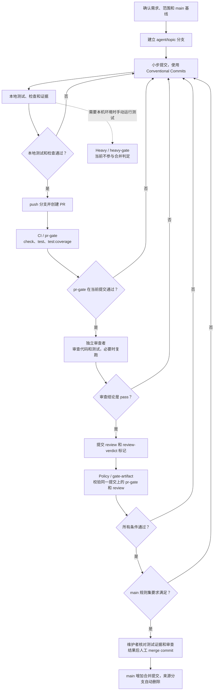
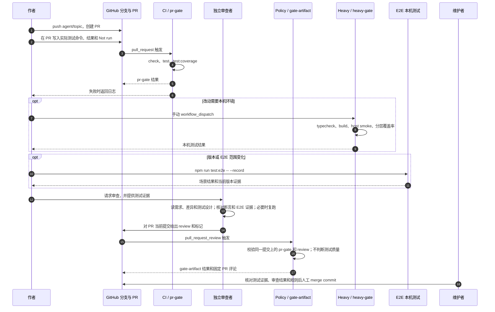
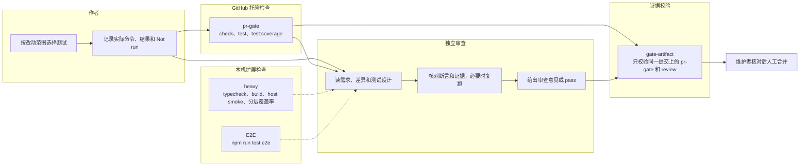
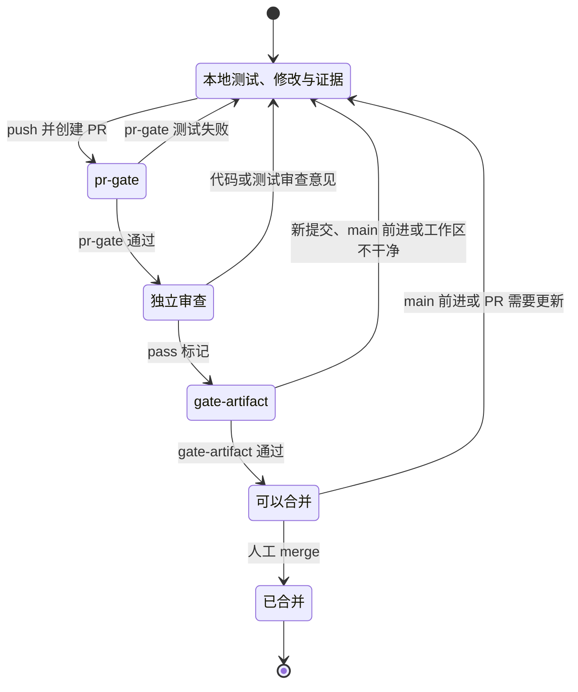

# GitHub 协作流程

本文说明一次代码改动如何从本地分支进入 `main`，以及测试、审查、证据检查和人工合并在什么时候发生、由谁执行、覆盖什么范围。PR（Pull Request，拉取请求）是这里的合并入口。内容以 2026-11-16 的 `origin/main` 和仓库当前 GitHub 设置为准。

本文只讲代码如何通过 GitHub 进入 `main`。插件内部的 topic、work item 与 review request 如何协作，见 [routing.md](routing.md)；测试命令和证据选择见 [testing.md](testing.md)；审查方法见 [code-review](../.agents/skills/code-review/SKILL.md)。

## 1. 问题描述

一次改动从本地提交进入 `main`，需要同时回答四个问题：

1. 哪些测试和检查必须通过，而且必须针对同一个提交？
2. 谁审查代码和测试，怎样证明结论没有过期？
3. 哪个动作真正允许合并，失败后应该回到哪一步？
4. 哪些测试当前没有自动执行，PR 中怎样如实说明？

测试和审查不是同一件事。测试回答“某条命令是否在当前提交上实际运行并通过”；审查回答“代码、测试设计和证据是否足以支持合并”。两者都要在当前提交上成立，不能互相替代。

如果只看某一个 workflow 或某一份说明，容易把“本地跑过”“GitHub 上的检查通过”“有人评论过”和“允许合并”混成一件事。本文把当前实际流程按执行顺序连接起来，并分别说明测试和审查的自动部分与人工部分。

## 2. 适用范围与当前状态

| 项目 | 当前值 |
|---|---|
| 仓库 | `leigangzhang/dsh-cowork` |
| 默认分支 | `main` |
| 分支约定 | 一个工作流使用一个 `agent/<topic>` 分支；GitHub 不强制分支名 |
| 合并方式 | 人工合并提交（merge commit） |
| 合并前必需检查 | `pr-gate`、`gate-artifact` |
| GitHub 自动测试 | `pr-gate` 运行 `check`、`test`、`test:coverage`；`check` 同时校验 E2E 清单和当前版本证据 |
| 本机扩展测试 | `heavy-gate` 手动运行 `typecheck`、`build`、host smoke 和分层覆盖率 |
| 本机 E2E | `npm run test:e2e` 单独运行；`test:e2e:live` 只做观测，不计入发布证据 |
| 代码审查 | 独立 review 给出 `review-verdict`，再由 `gate-artifact` 校验 |
| 自动发布 | 无；详见第 7 节 |

## 3. 总流程概览

图 1 从作者建立分支开始，到维护者人工合并为止。失败时通常回到提交，而不是直接改 `main`。



图 1 把测试和审查放在同一条提交链上。测试失败回到提交；审查发现代码或测试不足也回到提交。`gate-artifact` 只核对结果是否属于当前提交，不替审查者判断测试质量。

### 3.1 三个自动检查

| 检查 | 触发方式 | 运行位置 | 是否阻止合并 | 测试和审查范围 |
|---|---|---|---|---|
| `CI / pr-gate` | PR 创建或更新，目标为 `main` | GitHub 提供的 Ubuntu 运行器 | 是 | 运行 `check`、`test`、`test:coverage`；`check` 还校验 E2E 清单和当前版本证据，但不运行 E2E 场景；不审查代码，不运行 `typecheck`、`build`、host smoke、browser 或分层覆盖率 |
| `Policy / gate-artifact` | 提交或撤销 PR review | GitHub 提供的 Ubuntu 运行器 | 是 | 校验 review 标记、PR 当前提交、`pr-gate`、`main` 和工作区；不运行测试，也不判断测试质量 |
| `Heavy / heavy-gate` | 有写权限的人手动启动 | 标记为 `self-hosted, heavy` 的本机运行器 | 否 | 运行 `typecheck`、`build`、host smoke 和分层覆盖率；不审查代码 |

`pr-gate` 和 `gate-artifact` 是 `main` 规则集里的必需检查。`heavy-gate` 不在必需检查中，PR 描述必须把未运行的 heavy 检查写进 `Not run`，不能把“没有运行”写成通过。

`pr-gate` 变绿只表示那三条命令在当前提交上运行成功，不表示所有行为都已被测试覆盖。测试是否覆盖了目标行为、断言是否验证外部结果，仍要由审查者检查。

`npm run check` 会校验 `tests/e2e/manifest.json`、公开面覆盖和当前版本的 `tests/e2e/evidence/<version>.json`，但它不会运行 E2E 场景。E2E 由本机 `npm run test:e2e` 单独运行；`test:e2e:live` 需要 `DEEPSEEK_API_KEY`，只作为观测结果。

### 3.2 一次改动的时序

图 2 展示测试和审查分别在哪些步骤产生结果，以及 `gate-artifact` 只校验什么。



### 3.3 测试和审查的分工

测试和审查回答不同问题：

- 测试：某条命令是否在当前提交上实际运行，结果是什么。
- 审查：代码、测试设计和证据是否足以支持合并。

图 3 展示作者、GitHub 自动检查、独立审查、本机 heavy 检查和证据校验之间的关系。



| 环节 | 测试行为 | 审查行为 | 记录位置 | 当前是否自动强制 |
|---|---|---|---|---|
| 本地 | 作者按改动范围运行测试，失败先修复 | 作者自查，不是独立审查 | PR 的 `Testing`、`Evidence`、`Not run` | 否 |
| `pr-gate` | 运行 `check`、`test`、`test:coverage` | 不审查代码和测试质量 | GitHub check 结果和运行日志 | 是 |
| 独立审查 | 审查者读测试设计，核对断言和证据，并按改动范围复跑针对性检查 | 给出审查意见或 pass 结论；实现者不能做最终审查 | PR review 评论和 `review-verdict` | review 标记和对话解决是；测试是否实际复跑不是 |
| `heavy-gate` | 手动运行 `typecheck`、`build`、host smoke 和分层覆盖率 | 不审查代码 | workflow 日志；PR 的 `Not run` | 否 |
| 本机 E2E | 手动运行 `npm run test:e2e`；版本或 E2E 范围变化时重新录制证据 | 审查者核对场景清单和证据 | `tests/e2e/evidence/<version>.json`；PR 的 `Testing`、`Not run` | 否；`npm run check` 校验清单和证据 |
| `gate-artifact` | 不运行测试 | 校验 review 标记、同一提交、`pr-gate`、`main` 和工作区 | 固定 PR 评论和 JSON 文件 | 是 |

测试范围由改动路径决定。文档改动至少运行 `npm run check`；源码、测试、客户端、打包和覆盖率策略改动要按 [tools/workflow.json](../tools/workflow.json) 与 [testing.md](testing.md) 选择对应测试。版本或 E2E 范围变化还要运行 `npm run test:e2e`，并在干净工作区用 `--record` 更新当前版本的证据。E2E 证据绑定录制时的提交；之后修改任何 `tests/e2e/evidence/` 之外的文件，`npm run check` 都会要求重新录制。不要把“本地测试通过”写成 `pr-gate` 通过，也不要把 `pr-gate` 通过写成“测试范围内所有行为都已覆盖”。

审查者不需要不加选择地重跑所有 CI 命令，而要按改动范围选择针对性验证。重点是确认测试是否覆盖了 PR 声称的行为、断言是否验证外部结果、`Not run` 是否写明，以及测试结果是否属于当前提交。`review-verdict` 只记录提交、结论、审查者和模型，不记录测试命令；测试行为仍要看 PR 描述、review 内容和运行日志。

## 4. 分阶段流程

### 4.1 准备分支

从最新的 `main` 拉出一个 `agent/<topic>` 分支。一个已授权的工作流使用一个分支，不按提交、审查轮次或子任务重复开分支。分支名是团队约定，GitHub 当前不校验它。

开始写代码前，先读：

- 当前产品范围和验收：[PLAN-V0.2.md](PLAN-V0.2.md)；
- 改动涉及的检查：[tools/workflow.json](../tools/workflow.json)；
- 常驻工程规则：[AGENTS.md](../AGENTS.md)。

Issue 引用不是必需项。PR 的动机应当写清楚，需要上下文时再用 `Refs #N` 或 `Fixes #N`。

### 4.2 提交

提交信息使用 Conventional Commits，例如 `feat(scope): summary` 或 `docs(process): explain the flow`。PR 标题必须使用同一套类型前缀，当前允许的类型是 `feat`、`fix`、`docs`、`test`、`refactor`、`chore`、`perf`、`build`、`ci`，类型后可以带一个括号范围。

行为变更应同时包含对应测试。测试可以和实现放在同一个分支的多个提交里，但不能把测试留到审查通过后再补。不要提交本地构建产物、`.env`、运行数据或密钥。`lib/` 是本地构建输出，已被忽略。

### 4.3 本地测试并生成证据

本阶段由作者执行。目标是让测试覆盖当前改动，并把实际运行结果带到 PR。

先从实际改动范围选择测试：

```sh
npm run change-scope -- --base origin/main
```

这个命令列出 committed、staged、unstaged、untracked 四组路径。按 [tools/workflow.json](../tools/workflow.json) 选择最小但完整的测试范围，不要把“跑过一次全量测试”当成所有改动的默认证据。

测试范围由改动路径决定：

- 文档改动至少运行 `npm run check`；
- 源码和测试改动按 [testing.md](testing.md) 选择单元测试、覆盖率和相关检查；
- 客户端、打包、构建或 host 相关改动还要在具备环境时运行 browser、host smoke 或分层覆盖率；
- 版本或 E2E 范围变化要按 [testing.md](testing.md) 运行 `npm run test:e2e`，并在干净工作区更新当前版本的证据；
- 需要本机 DSH 环境或 Chromium 的测试，当前通过 heavy 本机测试手动运行；`test:e2e:live` 只作观测，不能替代 keyless E2E 证据。

测试失败时先修复或补测试，不要通过放宽断言、跳过测试或删除覆盖来变绿。无法运行时，要在 PR 里写明原因，不能写成通过。

记录当前提交对应的证据：

```sh
npm run gate-artifact -- --base origin/main
```

输出包含目标分支当前提交、PR 当前提交、差异的 SHA-256、工作区状态和四组路径。任何一次编辑、暂存或新文件都会改变这些内容；改动后必须重新生成。具体命令选择见 [testing.md](testing.md)。

本地测试通过只证明本机运行过。它不能替代 GitHub 上的 `pr-gate`，不能替代 heavy 本机测试，也不能替代 4.6 的独立审查。

### 4.4 创建 PR

向 `main` 创建 PR。标题使用 Conventional Commits；正文按 [pr-description](../.agents/skills/pr-description/SKILL.md) 的结构写，至少包含四个一级标题：

- `## Motivation`
- `## Changes`
- `## Testing`
- `## Evidence`

当前没有单独的 `.github/pull_request_template.md`，PR 结构由 [pr-description](../.agents/skills/pr-description/SKILL.md) 统一说明，自动校验脚本是 [pr-metadata.mjs](../scripts/ci/pr-metadata.mjs)。脚本当前只检查标题格式和四个一级标题是否存在，正文内容是否真实仍由审查者判断。

`## Testing` 要写测试设计、实际运行过的命令和结果；未运行的测试写进 `Not run` 并说明原因。`## Evidence` 要放当前提交对应的证据，不能把旧提交的结果复制过来。审查者会对照这些内容检查测试是否覆盖了 PR 声称的行为。

### 4.5 `pr-gate`：GitHub 上的基础检查

PR 创建或更新后，`.github/workflows/ci.yml` 触发 `CI` workflow 的 `pr-gate` 任务（job）。它做这些事：

1. 检出（checkout）PR 当前提交；
2. 拉取目标分支；
3. 按 `.node-version` 安装 Node；
4. 执行 `npm ci`；
5. 依次执行 `npm run check`、`npm test`、`npm run test:coverage`；
6. 生成 `review-context.json` 并作为 workflow 附件上传。

这个任务有 30 分钟超时，权限只有 `contents: read`，同一 PR 有新 push 时会取消旧运行。规则集只要求一个名为 `pr-gate` 的检查，不把每个命令拆成单独的必需检查。

`pr-gate` 的测试范围就是 `check`、`test`、`test:coverage`。它不运行 `typecheck`、`build`、host smoke、browser 或分层覆盖率，也不审查代码和测试质量。`check` 会读取 E2E 清单和证据，但不会运行 E2E 场景。托管环境和本机环境可能不同，所以 `pr-gate` 通过不等于 heavy 本机测试或 E2E 通过。

任一步失败，`pr-gate` 就是失败。修改后重新 push，新的提交会重新运行检查，旧提交上的测试结果不再对应当前改动。

### 4.6 独立审查

审查在 `pr-gate` 针对当前提交通过后进行。实现者不能担任自己改动的最终审查者。项目内使用 AgentTeams 时，审查者应使用新上下文和只读方式工作；详细规则见 [agent-teams.md](agent-teams.md) 和 [code-review](../.agents/skills/code-review/SKILL.md)。

审查的范围包括代码是否正确、失败时如何处理、状态如何变化、安全、兼容性、测试设计、断言质量和文档是否一致。审查者不直接修改代码；发现问题时提出审查意见，由作者修复。

审查者至少要做这些事：

- 用 `change-scope` 固定审查范围，确认 committed、staged、unstaged、untracked 四组路径；
- 先读需求和验收，再读代码差异、调用方和测试；
- 检查测试是否覆盖了 PR 声称的行为，断言是否验证外部结果，以及测试是否会在修复前失败；
- 核对 PR 的 `Testing`、实际测试命令、结果和 `Not run` 是否一致；
- E2E 范围或版本变化时，核对 `tests/e2e/evidence/<version>.json` 与当前版本、提交和测试清单；`test:e2e:live` 结果不能当作发布证据；
- 对必要的行为变更在隔离副本中运行针对性测试；不能运行时说明这是静态审查，不能把别人的运行结果写成自己运行；
- 检查失败场景的测试、资源清理，以及涉及打包或加载时是否走真实启动路径；
- 给出 `路径:行号`、影响和修复要求；
- 在同一提交上给出结论。

GitHub 的 review 不要求审查者把所有测试不加选择地重跑一遍。审查者按 [code-review](../.agents/skills/code-review/SKILL.md) 选择最小但完整的验证：文档改动运行 `npm run check`；行为变更运行覆盖率、构建和 host smoke；交付或浏览器变更再加分层覆盖率。AgentTeams 的独立验证任务会另外运行仓库检查，见 [agent-teams.md](agent-teams.md)。

审查结论通过 GitHub review 评论提交。当前使用评论形式的标记，不使用 GitHub 的批准（`Approve`）：

```text
<!-- review-verdict:v1 head=<40 位提交 SHA> verdict=pass reviewer=agentteam model=<模型名> -->
```

`reviewer` 只能是 `agentteam` 或 `human`，`model` 不能为空。`review-verdict` 只记录提交、结论、审查者和模型，不记录测试命令或测试结果。审查结论不是 `pass` 时，不要写这个通过标记。新提交会让旧结论失效，需要对新提交重新审查；一个审查循环通常控制在 2–3 轮内。

### 4.7 `gate-artifact`：绑定审查和当前提交

提交或撤销 review 后，`.github/workflows/gate-artifact.yml` 触发 `Policy` workflow 的 `gate-artifact` 任务（job）。普通评论如果没有 review 标记会跳过；`changes_requested` 或 review 被撤销时会运行并失败。

这个任务从受信任的目标分支检出脚本，只把 PR 当前提交当作 git 数据读取，不执行 PR 代码。它检查：

1. review 的提交等于 PR 当前提交，状态是 `approved` 或 `commented`；
2. `review-verdict` 标记里的 head 等于 PR 当前提交，verdict 是 `pass`；
3. PR 标题符合 Conventional Commits，正文包含 `## Motivation`、`## Changes`、`## Testing`、`## Evidence`；
4. `pr-gate` 在当前提交上有成功记录；
5. 当前 `origin/main` 是 PR 当前提交的祖先；
6. 临时检出 PR 当前提交后工作区干净。

`gate-artifact` 不运行测试，也不判断测试是否充分。它只确认 `pr-gate` 在当前提交上成功、review 结论属于当前提交，以及相关记录满足格式要求。E2E 也一样：它的清单和证据只由 `pr-gate` 中的 `npm run check` 读取，`gate-artifact` 不会重新运行 E2E。`review-verdict` 里没有测试命令或测试结果字段，所以“审查者是否真的运行了测试”仍属于人工审查质量，不是这个检查能证明的事实。

通过后生成 `gate-artifact.json` 和 `review-verdict.json`，更新同一条固定 PR 评论（sticky comment），并让 `gate-artifact` 成为当前提交上的成功检查。任何新提交、`main` 前进或工作区不干净，都会让这次检查失败或失效。

实现细节见 [gate-artifact.yml](../.github/workflows/gate-artifact.yml)、[review-verdict.mjs](../scripts/ci/review-verdict.mjs) 和 [gate-artifact.mjs](../scripts/review/gate-artifact.mjs)。

### 4.8 `main` 规则集与人工合并

`main` 使用名为 `main-pr-gate` 的 GitHub 分支保护规则集（ruleset）。当前设置如下：

| 设置 | 当前值 |
|---|---|
| 必须通过 PR | 是 |
| GitHub 要求的批准数 | 0 |
| 必需检查 | `pr-gate`、`gate-artifact` |
| 必须解决所有 review 对话（conversation） | 是 |
| 分支必须包含最新 `main` | 是 |
| 允许的合并方式 | 仅合并提交（merge commit） |
| 阻止强制推送（force push） | 是 |
| 阻止删除 `main` | 是 |
| 绕过规则的角色 | 无 |
| 自动合并 | 关闭 |
| 合并后删除来源分支 | 开启 |
| 允许更新分支 | 开启 |
| 要求线性历史 | 否 |

批准数为 0 表示 GitHub 不会用第二个账号的 `Approve` 来强制独立审查；独立审查由 `review-verdict` 和 `gate-artifact` 共同记录。维护者在合并前要确认测试结果、审查结论、未运行项和对话状态，然后手动合并，不使用自动合并（auto-merge）或合并队列（merge queue）。

规则集能强制 `pr-gate` 和 `gate-artifact` 通过，但不能判断测试是否覆盖了目标行为，也不能判断审查者是否认真检查了测试。下面这些内容仍要由审查者和维护者阅读：

- `## Testing` 中的测试设计和实际命令；
- `Not run` 中未运行项及原因；
- review 是否指出测试缺失、断言不足或证据不一致；
- heavy 本机测试是否在目标提交上运行。

## 5. Heavy 本机测试

`Heavy` workflow 是独立的本机测试流程，不会在 PR 创建或更新时自动运行。它只接受 `workflow_dispatch`，运行在标签为 `self-hosted` 和 `heavy` 的机器上，主要步骤是：

```text
npm ci
npx playwright install chromium
npm run typecheck
npm run build
DSH_HOST_SMOKE_STRICT=1 npm run test:host-smoke
npm run test:coverage:layered -- --base origin/<base>
```

workflow 会从 `repo_path` 指向的本地仓库目录克隆 `$GITHUB_SHA`，检查 Node 是否匹配 `.node-version`，并使用临时环境运行。默认 `repo_path` 是维护者本机路径，换机器时要显式传入正确路径。

`heavy-gate` 覆盖 `typecheck`、构建、打包后 host smoke 和分层覆盖率。它不运行 `pr-gate`，不运行 E2E，不审查代码，也不判断测试断言是否有效。它不能替代 `pr-gate`；`pr-gate` 也不能替代它。需要本机 DSH 环境或 Chromium 才能发现的构建、加载和浏览器问题，只能由 heavy 本机测试或等价的真实环境提供证据。

E2E 是另一条本机测试。它由 `npm run test:e2e` 单独运行，不包含在 `pr-gate` 或 heavy workflow 中。keyless E2E 的当前版本证据由 `npm run check` 校验；`test:e2e:live` 只作观测。

审查者可以引用在目标提交上运行的 heavy 结果，但必须核对提交、命令和日志；如果 heavy 没有在目标提交上运行，就按 `Not run` 处理，不能引用在 `main` 或其他提交上的结果。

当前 `heavy-gate` 不是 PR 当前提交上的必需检查，也不能拿一次在 `main` 上的运行结果证明某个 PR。它要成为必需检查，需要先满足两个条件：

1. 连续 20 次没有基础设施失败的 green 运行；
2. 有一个能在 PR 当前提交上发布 `heavy-gate` check 的受信任机制。

计数、升级和回滚步骤见 [heavy-runner.md](heavy-runner.md)。在它成为必需检查前，PR 的 `Not run` 必须如实列出没有运行的 heavy 检查。

## 6. 合并前检查清单

- [ ] PR 指向 `main`，标题符合 Conventional Commits。
- [ ] 正文包含 `## Motivation`、`## Changes`、`## Testing`、`## Evidence`。
- [ ] `## Testing` 记录了实际运行的测试命令和结果，`Not run` 写明了未运行项和原因。
- [ ] `pr-gate` 在 PR 当前提交上成功，失败项已经修复，而不是被跳过。
- [ ] 审查者检查了测试设计、断言和证据，而不只是看 `pr-gate` 是否通过。
- [ ] 独立审查在同一个提交上给出 `verdict=pass`，并带有 `review-verdict` 标记。
- [ ] `gate-artifact` 在同一个提交上成功。
- [ ] 所有 review 对话（conversation）已解决。
- [ ] 分支包含当前 `origin/main`。
- [ ] heavy 检查已在该提交上运行，或在 `Not run` 中写明原因。
- [ ] E2E 范围或版本变化时，`npm run test:e2e` 已通过，`tests/e2e/evidence/<version>.json` 对应当前版本和提交；最后一次非证据文件修改之后已经重新录制；`test:e2e:live` 未当作发布证据。
- [ ] 维护者核对了测试证据和审查结果，然后手动合并，不使用自动合并（auto-merge）。

## 7. 合并之后与发布

人工合并后，`main` 得到一个 merge commit，来源分支自动删除。当前没有针对 `main` push 的自动测试或审查 workflow；`pr-gate`、独立审查和 `gate-artifact` 的结果属于合并前的 PR 提交，不是合并后新增的提交。分支必须包含最新 `main` 的规则降低了合并结果偏离已检查内容的可能，但不能替代单独的合并后检查。

合并到 `main` 不等于发布。当前仓库没有发布 tag、GitHub Release 或 npm 发布 workflow；`package.json` 是 `private: true`，README 只承诺 tarball 安装。需要构建 tarball 时，按 [README.md](../README.md) 执行：

```sh
npm run build
npm pack
```

发布前还需要当前版本的 keyless E2E 证据：`tests/e2e/evidence/<version>.json` 必须由 `npm run test:e2e -- --record` 在干净工作区生成，并通过 `npm run check`。`test:e2e:live` 的真实模型结果只作观测，不作为发布证据。

发布流程若以后加入 GitHub Actions，应单独说明触发条件、版本来源和回滚方式，不应默认认为合并后就会自动发布。

## 8. 失败后从哪里继续

图 4 展示常见状态和返回位置。



| 情况 | 结果 | 下一步 |
|---|---|---|
| 本地测试失败 | 没有新的本地测试证据 | 修复后重新运行受影响测试 |
| `pr-gate` 失败 | 当前提交不能合并 | 修复并 push；新提交重新运行 |
| 审查发现测试不足或断言不验证行为 | 没有通过的 review 标记 | 补测试或改断言，重新运行 `pr-gate` 后再审查 |
| 审查结论为 `needs_revision` 或 `reject` | 没有通过的 review 标记 | 按审查意见修复，再审查 |
| PR 描述中的测试结果与日志不一致 | 审查应提出问题，`gate-artifact` 不会自动发现 | 重新运行命令，修正 `Testing`、`Evidence` 或 `Not run`，再审查 |
| 审查者没有运行测试却给出 pass | `gate-artifact` 仍可能通过 | 这是审查质量问题；维护者要读 review 内容，必要时要求重新审查 |
| `pr-gate` 还没通过就提交 review | `gate-artifact` 会失败，且不会因为 `pr-gate` 后来变绿而自动重跑 | 等 `pr-gate` 通过后重新提交一次 review |
| 审查后又 push 新提交 | 旧 review 和旧 `gate-artifact` 不再对应当前提交 | 重新运行 `pr-gate`，重新审查 |
| `main` 前进 | 分支不再包含最新 `main`，合并被阻止 | 更新分支，重跑测试并重新审查 |
| 有未解决的 review 对话（conversation） | 合并被阻止 | 解决对话并确认结果 |
| heavy 没运行 | 没有本机测试证据 | 在需要的提交上运行，或在 PR 写 `Not run` |
| `npm run test:e2e` 失败 | E2E 范围没有通过 | 修复后重新运行；从干净工作区重新录制证据 |
| E2E 证据与当前版本、清单或提交不一致 | `npm run check` 失败，`pr-gate` 也会失败 | 重新运行 `npm run test:e2e -- --record`，确认证据对应当前版本和干净提交 |
| 直接推送、强制推送或删除 `main` | 规则集拒绝 | 改用 PR 流程 |

## 9. 当前流程的优点

1. **测试和审查绑定到同一个提交。** `pr-gate`、review 标记和 `gate-artifact` 都围绕 PR 当前提交工作，新提交会让旧测试结果、旧审查结论和旧证据失效。
2. **测试分层清楚。** 作者在本地运行受影响测试，`pr-gate` 在 GitHub 上运行基础自动化检查，heavy 本机测试补充真实环境和真实浏览器测试；三种结果不会被写成同一种“通过”。
3. **审查范围包含测试本身。** 审查者不只看实现，还检查测试设计、断言、失败场景测试和 `Not run`，因此可以发现“代码能跑但测试没有验证目标行为”的问题。
4. **`main` 不靠人工记忆保护。** 直接推送、强制推送、删除分支、未通过测试、未解决对话和落后于 `main` 的分支都会被规则集阻止。
5. **GitHub 上的基础测试可重复。** Node 版本来自 `.node-version`，依赖使用 `npm ci`，GitHub Actions 固定到具体版本，`pr-gate` 只读仓库内容且不使用 secret。
6. **人工合并保留最终决定权。** 没有自动合并、合并队列或自动改 `main` 的步骤，维护者可以检查测试证据和审查内容。
7. **测试证据有固定位置。** 实际命令、结果和未运行项写在 PR 的 `Testing`、`Evidence` 和 `Not run` 中；`review-verdict` 绑定审查结论；`gate-artifact` 保存同一提交的 JSON 记录。
8. **E2E 证据绑定版本和清单。** `npm run check` 会拒绝版本不符、场景缺失或录制后关键文件变化的 keyless E2E 证据；`test:e2e:live` 不会被当成发布证据。
9. **合并后自动清理来源分支。** 减少遗留分支，规则集同时阻止删除 `main`。

## 10. 可能存在的挑战

| 挑战 | 当前影响 | 可以做的处理 |
|---|---|---|
| 批准数为 0，独立审查是程序性要求 | GitHub 不会强制第二个账号批准；`gate-artifact` 只校验标记格式、提交和状态，不能证明审查者确实独立，也不能证明审查者运行了测试 | 坚持实现者不担任最终审查者；审查使用新上下文和只读方式；维护者合并前读 review 内容；对高风险改动增加独立验证 |
| `pr-gate` 只运行 `check`、`test`、`test:coverage` | 类型检查、构建、host smoke、browser 和分层覆盖率可能没有在 PR 提交上运行 | 在需要的提交上手动运行 heavy 本机测试；PR 的 `Not run` 写清原因；满足稳定性条件后再把 heavy 检查升级为必需检查 |
| 测试通过不等于行为被覆盖 | 逐文件行覆盖率可以通过，但断言可能只检查实现细节，或者没有覆盖用户可见结果 | 审查者检查测试是否会在修复前失败、是否验证外部结果；维护者不要把覆盖率当成行为覆盖率的替代品 |
| `review-verdict` 没有测试记录字段 | 审查标记只记录提交、结论、审查者和模型，`gate-artifact` 无法判断审查者是否运行过测试，也无法判断审查意见是否检查了测试质量 | 审查者在 review 正文写实际运行命令和结论；维护者阅读 review；高风险改动使用 AgentTeams 独立验证；需要更强保证时再增加机器可校验的测试证据 |
| PR 正文校验只检查四个一级标题 | `Testing` 和 `Evidence` 可能内容缺失或与当前提交不一致，`gate-artifact` 不会判断文字是否真实 | 审查者对照实际命令和日志检查；维护者合并前阅读 PR；需要更强保证时增加可执行的内容校验 |
| `heavy-gate` 不是必需检查 | 类型检查、构建、host smoke 和分层覆盖率可能在合并前没有运行 | 在需要的提交上手动运行；PR 的 `Not run` 写清原因；满足 20 次 green 和 PR 提交发布检查的条件后再升级 |
| E2E 不在 GitHub 自动运行 | `pr-gate` 只读取 E2E 清单和证据，不重新运行场景；本地录制环境、DSH 版本和证据文件仍可能和审查者预期不同 | E2E 变化或版本变化时在目标提交上运行 `npm run test:e2e`；审查者核对证据；`test:e2e:live` 只作观测 |
| E2E 证据绑定录制提交 | 在证据提交之后修改任何 `tests/e2e/evidence/` 之外的文件，`npm run check` 都会失败并要求重新录制；即使是文档改动，也可能需要额外跑一遍 E2E | 把 E2E 录制放在最后；任何非证据修改后重新运行 `npm run test:e2e -- --record`；不要手工修改证据头部来绕过检查 |
| 本地测试和 CI 测试的环境不同 | 本地通过可能在 GitHub 托管环境中失败，或者 CI 通过但本机打包和浏览器路径没有运行 | 以 `pr-gate` 作为 GitHub 环境的测试结果；需要真实 host 或浏览器的行为用 heavy 本机测试补证据；不要互相替代 |
| PR 描述中的测试证据会过期 | 任何编辑、暂存或未跟踪文件都会改变工作区状态；旧的 `Testing`、`change-scope` 和 `gate-artifact` 输出不能继续使用 | 最后一次修改后重新运行并更新 PR；审查者对照当前提交检查命令和结果 |
| `gate-artifact` 只在 review 事件上运行 | 如果先提交 review、后等 `pr-gate` 变绿，`gate-artifact` 不会自动重跑 | 先等 `pr-gate` 通过再提交 review；已经失败时重新提交一次 review 触发检查 |
| 没有合并后自动测试或审查 | `main` 上的 merge commit 没有对应的自动测试、审查或证据记录 | 依赖严格的 up-to-date 规则和人工合并；需要更强保证时新增合并后或者定时测试 |
| `npm test` 和 `npm run test:coverage` 都会执行测试 | `pr-gate` 时间更长，重复执行测试 | 先测量再决定是否合并命令；不能删除覆盖率检查来缩短时间 |
| 规则集不在仓库文件里 | GitHub 设置和本文可能发生偏差，`npm run check` 无法发现远端规则变化 | 改规则集前先备份；定期在 GitHub Settings → Rules → `main-pr-gate` 核对，并同步本文 |
| 没有自动发布 | 合并到 `main` 不产生 tag、GitHub Release 或 npm 包 | 把发布保持为独立人工步骤；需要时按 README 构建和发布 tarball |

## 11. 如何核对和维护

本文只记录当前状态，GitHub 上的实际设置仍以远端页面为准。核对时按下面顺序看：

1. workflow 和命令：`.github/workflows/`、[tools/workflow.json](../tools/workflow.json)；
2. review 和 PR 校验：`.github/workflows/gate-artifact.yml`、[review-verdict.mjs](../scripts/ci/review-verdict.mjs)、[pr-metadata.mjs](../scripts/ci/pr-metadata.mjs)；
3. heavy 本机测试：`.github/workflows/heavy.yml`、[heavy-runner.md](heavy-runner.md)；
4. E2E：`tests/e2e/manifest.json`、`tests/e2e/evidence/<version>.json`、[testing.md](testing.md)；
5. GitHub 远端设置：仓库 Settings → Rules → `main-pr-gate`；
6. 测试策略和审查规则：[testing.md](testing.md)、[agent-teams.md](agent-teams.md)、[code-review](../.agents/skills/code-review/SKILL.md)。

workflow、脚本或 ruleset 改动后，同步更新本文，并按 [tools/workflow.json](../tools/workflow.json) 运行对应检查；只改文档时至少运行 `npm run check`。测试分层或审查要求变化时，先更新 [testing.md](testing.md) 或 [code-review](../.agents/skills/code-review/SKILL.md)，再同步本文。如果新流程引入了新的文档页面，还要在 [docs/README.md](README.md)、[docs/kinds.json](kinds.json) 和 [docs/publish.json](publish.json) 中登记。

## 12. 事实来源

| 事实 | 来源 |
|---|---|
| PR 基础检查 | [.github/workflows/ci.yml](../.github/workflows/ci.yml) |
| 审查和证据检查 | [.github/workflows/gate-artifact.yml](../.github/workflows/gate-artifact.yml)、[review-verdict.mjs](../scripts/ci/review-verdict.mjs) |
| PR 标题和正文结构 | [pr-metadata.mjs](../scripts/ci/pr-metadata.mjs)、[pr-description](../.agents/skills/pr-description/SKILL.md) |
| 本地证据记录 | [gate-artifact.mjs](../scripts/review/gate-artifact.mjs)、[change-scope.mjs](../scripts/review/change-scope.mjs) |
| heavy 本机测试 | [.github/workflows/heavy.yml](../.github/workflows/heavy.yml)、[heavy-runner.md](heavy-runner.md) |
| 版本化 E2E | [tests/e2e/manifest.json](../tests/e2e/manifest.json)、`tests/e2e/evidence/<version>.json`、[testing.md](testing.md) |
| 测试分层和命令 | [testing.md](testing.md) |
| 审查流程和独立审查 | [agent-teams.md](agent-teams.md)、[code-review](../.agents/skills/code-review/SKILL.md) |
| 分支到合并的设计背景 | [pr-gate-flow.md](design/github-flow/pr-gate-flow.md) |
| 合并和发布设置 | GitHub 仓库的 Rules、General 和 Actions 页面；[README.md](../README.md) 的安装与构建说明 |
