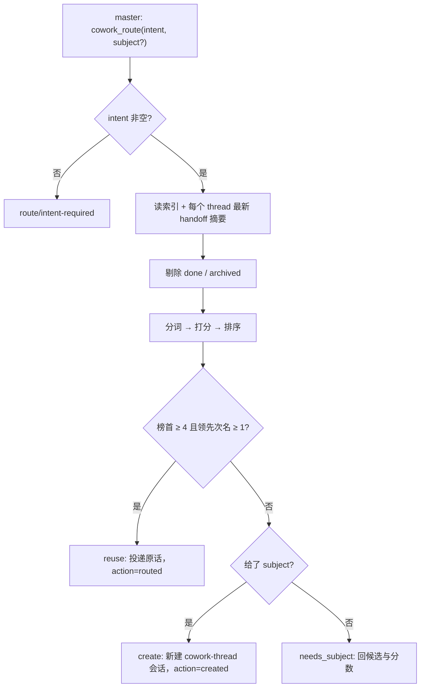
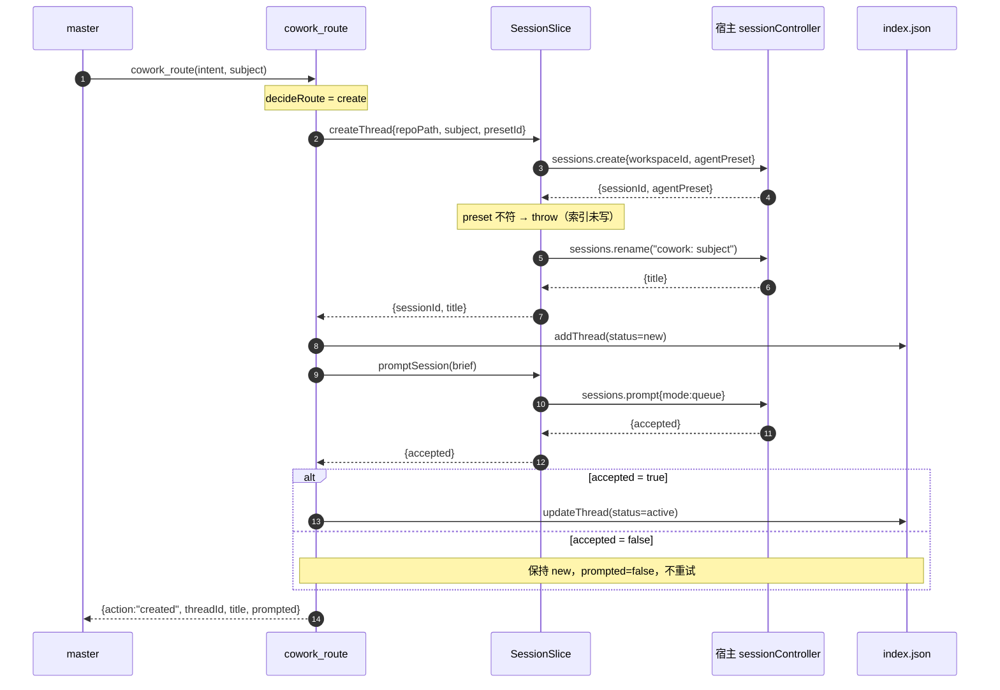
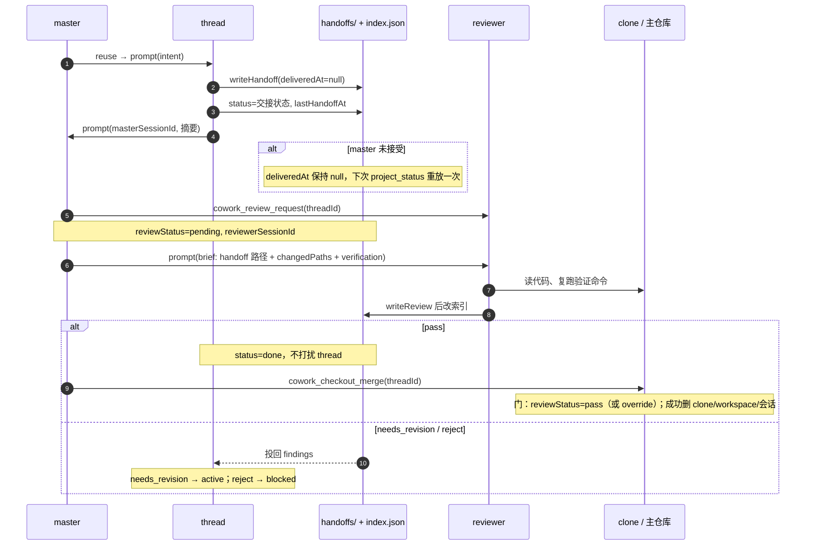

# 路由与 thread 生命周期

一个需求从主会话进入、被某个 thread 接走、交回结果、经独立 review 决定能否合并。本文只画**顺序、状态归属与失败处置**，不重复规则文本：判定规则住在 [`src/router.ts`](../src/router.ts)，副作用顺序住在 [`src/tools.ts`](../src/tools.ts)、[`src/handoff.ts`](../src/handoff.ts)、[`src/review-tools.ts`](../src/review-tools.ts)，产品意图见 [PLAN.md](PLAN.md) §2.2 与 §2.3。

图里的分数常量是当前常量的快照；改常量时在同一个提交里改图。

## 1. 一个意图落到哪个 thread

```
 master: cowork_route(intent, subject?)                ← 仅 master 可调
   │  intent 去空白后为空 → route/intent-required
   ▼
 读索引 + 每个 thread 的最新 handoff 摘要
   │
   ▼
 剔除 status ∈ {done, archived}
   │
   ▼
 分词 → 打分 → 排序（分数降序，同分 threadId 升序）
   │
   ├─ 榜首 ≥ 4 分且领先次名 ≥ 1 分 → reuse
   │     把用户原话投给该 thread，action="routed"，索引不变
   │
   └─ 否则（分数不够或近平局）
         ├─ 有 subject → create（见 §2），action="created"
         └─ 无 subject → needs_subject，回候选与分数，由 master 决定
```

两道门同时成立才复用：**分数 ≥ 阈值** 且 **领先第二名 ≥ 1 分**。第二道门是故意加的——近平局意味着意图不明，猜错的代价高于新建一个 thread。`done` 与 `archived` 在排序前就被剔除；时间无法解析的 thread 拿不到时效加分，但仍然参与比较。



## 2. 新建 thread 的时序（create 路径）

```
 master
   │ cowork_route(intent, subject)
   ▼
 cowork_route: decideRoute(...) = create
   ▼
 SessionSlice.createThread({ repoPath, subject, presetId: "cowork-thread" })
   │
   ├─▶ 宿主 sessions.create({ workspaceId, agentPreset })
   │      ◀─ { sessionId, agentPreset }
   │      ✗ agentPreset ≠ 请求值 ⇒ throw（此刻索引还没写，fail closed）
   │
   └─▶ 宿主 sessions.rename({ sessionId, title: "cowork: <subject>" })
          ◀─ { title }
   ◀─ { sessionId, workspaceId, title }
   ▼
 cowork_route: 写索引 addThread(status = "new")
   ▼
 cowork_route: promptSession(sessionId, buildThreadBrief(repoPath, subject, threadId, intent))
   ▼
 SessionSlice: 宿主 sessions.prompt({ requestId, mode: "queue", text })   ⏱ 超时保护
   ◀─ { accepted, requestId }        ← 入队成功，不是“活干完了”
   ▼
 cowork_route: accepted ?
   ├─ true  → 索引 status = "active"      ← 全链路唯一把 new 抬成 active 的地方
   └─ false → 保持 "new"，返回 prompted:false（不重试、不抛错、不回滚会话）
   ▼
 master 收到 { action: "created", threadId, subject, title, prompted, thread }
```

`isolated: true` 时顺序不同，因为 threadId 同时是 clone 目录名和分支名：

```
 cowork_route 先铸 threadId = session-<uuid>
   ├─▶ createCheckout    → git clone 到 .dsh-cowork/threads/<id>，分支 cowork/<id>
   ├─▶ createCheckoutThread({ checkoutPath, threadId, ... })
   │      = workspaces.create(checkoutPath) → sessions.create({ sessionId: threadId })
   │        ✗ 宿主回的 sessionId ≠ threadId ⇒ throw
   │        ✗ preset 不符 ⇒ throw
   │        两个检查都在 rename 之前，失败不留半成品
   ├─▶ 写索引（checkoutPath = clone 路径）→ brief（含 checkoutPath）→ promptSession
   └─ 任一步抛错 ⇒ 补偿：删索引项、删 clone、删本次创建的 workspace
                  清理本身失败写进 details，不掩盖原始错误
```

三个容易看漏的点：`accepted` 只表示 prompt 入队；索引在 brief 之前写，所以投递失败会留下一条 `new` 的 thread；普通路径失败最多留一个孤立会话，isolated 路径失败必须删掉 clone 与 workspace。



## 3. 复用之后的闭环：干活 → 交接 → 审查 → 合并

```
 master: cowork_route = reuse → promptSession(threadId, 用户原话)；索引不变
   ▼
 thread（唯一写代码的会话）
   │ cowork_handoff({ status, summary, verification, decisions?, changedPaths?, … })
   │   仅 thread 可调；status ∈ awaiting_review | blocked | done
   ├─ 校验失败 → handoff/invalid，什么都不写
   ├─ 写 handoffs/<threadId>-<ts>.json（deliveredAt: null）
   ├─ 写索引：status = 交接状态、lastHandoffAt、updatedAt
   └─ prompt master（摘要 + handoff 路径）
        ◀ 未被接受 → deliveredAt 保持 null
          下次 cowork_project_status 重放一次，不阻塞其它 thread
   ▼
 master
   │ status 不是 awaiting_review？→ 到此为止（blocked / done）
   │ cowork_review_request(threadId)          ← master 或 thread 均可调
   │   门：仅 awaiting_review；reviewStatus = pending 时拒绝
   ├─ 新建 cowork-reviewer 会话（无 tool-fs，物理只读）
   ├─ 写索引：reviewStatus=pending、reviewerSessionId、reviewRequestedAt、reviewedAt=null
   ├─ brief = 最新 handoff 路径 + changedPaths + verification + checkoutPath
   └─ prompt reviewer
        ◀ 未被接受 → 回滚 pending 并归档 reviewer，返回失败
   ▼
 reviewer（独立会话）
   │ 自己读代码、复跑验证命令：thread 的 self-report 只是证据
   │ cowork_review_verdict({ threadId, verdict, findings?, verification? })
   │   门：调用者必须是索引里登记的 reviewer；master 与 thread 本人被拒（review/self-review）
   ├─ 先写 reviews/<threadId>-<ts>.json
   └─ 再改索引：status ← pass:done / needs_revision:active / reject:blocked
                 reviewStatus = verdict、reviewedAt、latestReviewPath
                 needs_revision 与 reject 还把 findings 投回 thread
   ▼
 master
   │ pass → cowork_checkout_merge(threadId)     ← 只有 isolated thread 才有 clone
   │   门：reviewStatus = pass；或 allowUnreviewed + overrideReason
   │   门：checkoutPath 非空，且 status ∈ {awaiting_review, done}
   ├─ 合并冲突 → 索引 status=blocked、clone 保留，thread 解决后再合
   └─ 成功 → 删 clone、删 workspace、归档会话
             索引 checkoutPath=null、status=done
             清理失败只进 cleanupErrors，合并结果仍是成功
   ▼
 需求闭环。非 isolated thread 没有 clone，到 done 为止
```

判决定到哪里，由 verdict 唯一决定：

| verdict | `thread.status` 变成 | 是否把 findings 投回 thread |
|---|---|---|
| `pass` | `done` | 否 |
| `needs_revision` | `active` | 是 |
| `reject` | `blocked` | 是 |

## 4. 谁在什么时候写哪个字段

| 写者 | 字段 | 时机 |
|---|---|---|
| `cowork_route` | `status`（`new` → `active`） | brief 入队之后 |
| `cowork_handoff` | `status`（=交接状态）、`lastHandoffAt`、`updatedAt`；handoff 文件的 `deliveredAt` | 先写文件，再改索引，最后投递 |
| `cowork_review_request` | `reviewStatus="pending"`、`reviewerSessionId`、`reviewRequestedAt` | 建出 reviewer 会话之后 |
| `cowork_review_verdict` | `status`、`reviewStatus`、`reviewedAt`、`latestReviewPath` | 先写 review 文件，再改索引 |
| `cowork_checkout_merge` | `status`（`done` / 冲突时 `blocked`）、`checkoutPath`（成功置 `null`） | 合并动作之后 |


