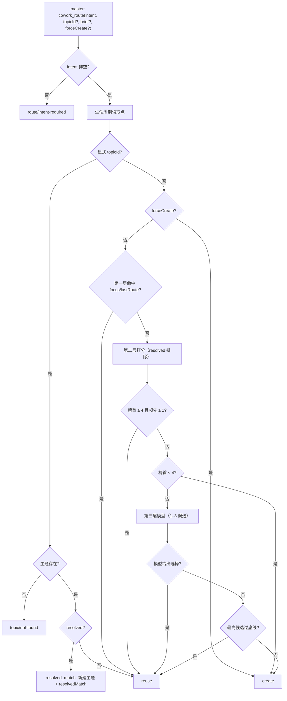
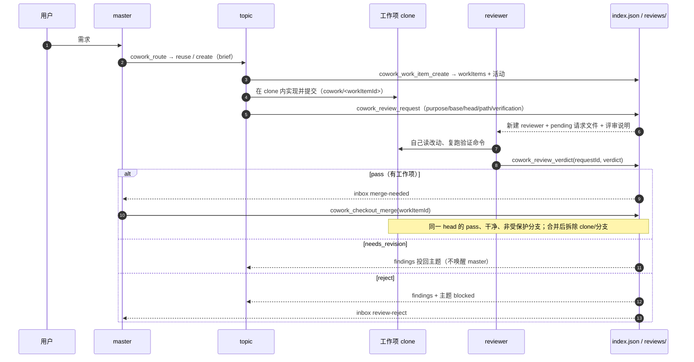

# 路由、工作项与评审请求

一个需求从 master 进入、被某个主题会话接走、在隔离工作项里完成、经独立评审请求决定能否合并，最后按生命周期标记已解决。本文只写**顺序、状态归属与失败处置**；判定规则住在 [src/routing.ts](../src/routing.ts) 与 [src/route-tools.ts](../src/route-tools.ts)，评审与合并的契约住在 [src/review-request.ts](../src/review-request.ts)，产品意图见 [PLAN-V0.2 §5.3–§5.6](PLAN-V0.2.md#53-路由)。

## 1. 一个意图落到哪个主题

`cowork_route` 只由 master 调用。它先执行一次生命周期读取点（把空闲/已解决状态结算掉），再做三层判断。

```
 master: cowork_route({ intent, topicId?, brief?, forceCreate? })
   │  intent 去空白后为空 → route/intent-required
   ▼
 生命周期读取点（idle / active 结算）
   ▼
 ├─ topicId 明确指定
 │    ├─ 不存在 → topic/not-found
 │    ├─ 已解决 → resolved_match：新建主题并返回 resolvedMatch，不向旧主题发消息
 │    └─ 其他 → reuse（跳过打分与新建信号）
 ├─ forceCreate（不能与 topicId 同用）→ create
 └─ 否则
      ├─ 第一层：意图带“新建/另开”等信号 → 跳过；否则 focusTopicId → lastRouteTopicId
      │    （只接受 active/idle；resolved 不参与）
      ├─ 第二层：对非 resolved 主题打分
      │    ownedPaths / aliases 命中 +3，title / scope 命中 +2，digest 命中 +1，最近活动 +0.5
      │    ├─ 榜首 ≥ 4 且领先次名 ≥ 1 → reuse
      │    ├─ 榜首 < 4 → create
      │    └─ 其他（近平局）→ needs_model
      └─ 第三层：只把 1–3 个候选交给模型
           ├─ 模型可用 → reuse/create（选择即执行，不弹窗）
           └─ 关闭/超时/失败 → 最高结构化候选过底线则 reuse，否则 create
   ▼
 create: 新建 cowork-topic 会话 + 索引主题 + brief
 reuse : 把意图（与可选 brief）投给主题会话
```

- 三层与常量：第一层是会话局部性，第二层是结构化匹配，第三层是模型兜底（[src/routing.ts](../src/routing.ts#L29-L52)、[decideRoute](../src/routing.ts#L305)）。模型参数默认超时 2 秒、`maxTokens` 256、尽量关闭推理；`routing.enabled=false` 时直接走结构化回退（[PLAN-V0.2 §5.3](PLAN-V0.2.md#53-路由)）。
- 新建标题取意图前 24 个字符；主题 id 就是新会话的 session id。新主题写两条活动：`topic-created` 与 `route-created`。
- `resolved_match` 的语义是“旧主题不再接收”：插件为意图新建主题并返回 `resolvedMatch`，不 prompt 旧主题。
- 选错由面板“移动到其他主题”纠正：把原意图的 token 追加到目标主题的 `aliases`，写 `route-corrected` 活动；不是删除或重写已有别名（见 §6）。



## 2. 工作项、评审请求、verdict 与合并



### 2.1 工作项

- 主题用 `cowork_work_item_create` 为**自己**创建隔离工作项；master 调用时必须显式给 `topicId`。记录包含 `workItemId / topicId / path / branch / baseCommit`。
- 目录是 `<repo>/.dsh-cowork/workitems/<workItemId>`，分支是 `cowork/<workItemId>`，基于创建时的仓库 HEAD（[checkout.ts](../src/checkout.ts#L45-L58)、[workItemCheckoutPaths](../src/checkout.ts#L152)）。
- 执行单元在各自目录里工作并提交；主题是集成分支负责人。多个工作项可并行，合并串行（[checkout-tools.ts](../src/checkout-tools.ts#L574)）。
- 隔离提供方当前只实现 clone；`isolation.provider` 传其他值会在创建前失败（[KI-27](KNOWN_ISSUES.md)）。

### 2.2 评审请求

- 只有 topic 能调用 `cowork_review_request`；master 调用被拒绝。每次请求定义**一个**评审范围，必须带 `purpose`、`baseCommit`、`headCommit`、`path`、`verification`。
- 校验（全部通过才写任何状态）：`base` 是 `head` 的祖先；`path` 精确等于仓库根（共享工作区）或该主题的某个工作项 clone；clone 工作区干净；范围内确有改动；`changedPaths` 若提供必须等于 `git diff --name-only base..head`；同一主题/工作项同时只能有一个 pending 请求。
- 通过后按顺序：新建 `cowork-reviewer` 会话 → 写 `reviews/<topicId>-<requestId>.json`（`pending`）→ 更新索引（`awaitingReview=true`、`reviewStatus=pending`、`latestReviewRequestId`、`reviewerSessionId`；有工作项时置 `reviewing`）→ 投递评审说明 → 写 `review-requested` 活动。
- 任一步失败会回滚请求文件与索引改动，并归档半成品 reviewer；不会留下“pending 但没有 reviewer”的状态。
- 请求记录的权威定义在 [review-request.ts](../src/review-request.ts#L121-L140)，文件路径规则在 [reviewRequestFilePath](../src/review-request.ts#L879)。

### 2.3 verdict

- 只有该请求登记的 reviewer 会话能调用 `cowork_review_verdict`，且一个请求只接受一个 verdict。先写请求文件的终态，再改索引；请求文件是评审事实的第一落点。
- `needs_revision` / `reject` 必须给出具体 findings（id、severity、problem、requiredFix，可选 file/line），`pass` 不要求 findings。
- 判决定到哪里：

| verdict | 主题 | 工作项 | 是否通知 | master 收件箱 |
|---|---|---|---|---|
| `pass` | `reviewStatus=pass`、`awaitingReview=false`、`reviewerSessionId=null` | `reviewing` | 不投回主题 | 有工作项时写 `merge-needed` |
| `needs_revision` | `reviewStatus=needs_revision`、`awaitingReview=false` | `active` | findings 投回主题 | 不写 |
| `reject` | `blocked=true`、`reviewStatus=reject` | `active` | findings 投回主题 | 写 `review-reject` |

- verdict 后归档 reviewer；归档失败记录在 `archiveError` 与活动里，不把 verdict 改成失败（[session-visibility.ts](../src/platform/session-visibility.ts#L94)）。
- 索引或活动写失败会作为 `indexError` / `activityError` 返回；请求文件已经是终态，不假装回滚。

### 2.4 合并

- `cowork_checkout_merge` 只由 master 调用，按 `workItemId` 合并（`threadId` 仅兼容旧 clone）。
- 门：工作项必须是 `reviewing`；clone 存在且干净；存在**同一 headCommit** 的 `pass` 请求；`baseCommit` 是当前 head 的祖先。head 在评审后移动会被拒绝，需要重新评审。
- 合并到仓库当前分支，`main` / `master` 受保护、插件拒绝；`main` 引用永远不动，默认分支由人收口。
- 冲突：中止合并（主仓不留下冲突状态）并保留 clone，冲突文件清单随结果返回；主题解决后重新评审/合并（[KI-4](KNOWN_ISSUES.md)）。
- 成功：`merge --no-ff` 提交 → 删除 clone 与 `cowork/<workItemId>` 分支 → 工作项置 `merged` → 写 `work-item-merged` 活动。清理失败只进 `cleanupErrors`，合并结果仍是成功。
- 合并串行只在单进程内保证（[KI-26](KNOWN_ISSUES.md)）。

## 3. 状态归属

| 写者 | 写入 |
|---|---|
| `cowork_route` | `lastRouteTopicId`；create 时新增主题行、`topic-created` + `route-created` 活动 |
| `cowork_topic_create` | 主题行、`topic-created` 活动 |
| `cowork_work_item_create` | 工作项行、clone、`work-item-created` 活动 |
| `cowork_review_request` | 请求文件（pending）、主题 `awaitingReview/reviewStatus/latestReviewRequestId/reviewerSessionId`、工作项 `reviewing`、`review-requested` 活动 |
| `cowork_review_verdict` | 请求文件（终态）、主题 `reviewStatus/awaitingReview/reviewerSessionId/blocked`、工作项状态、收件箱、`review-verdict` 活动；归档 reviewer |
| `cowork_handoff` | handoff 文件、主题 `digest/lastDeliveryConfirmedAt/blocked`；写 `topic-reported` 活动与通知账本（每个目标一行），不写收件箱 |
| `cowork_checkout_merge` | 工作项 `merged`、clone/分支清理、`work-item-merged` 活动 |
| 生命周期读取点 | 主题 `active/idle`、`status-changed` 活动；不会写 `resolved` |
| 面板写路由 | `resolve`/`reopen` 清或置 resolved 字段；`route.move` 追加 `aliases` 并写 `route-corrected` |

所有状态写入都尽量落一条活动；活动写失败不回滚状态，只在结果的 `activityError` / `activityErrors` 里报告。

## 4. 已解决与重开

- 三态：`active ↔ idle`，`active|idle → resolved`，`resolved → active`（用户重开）。`awaitingReview`、`blocked`、`authorization` 是标记，不是状态。
- `active ↔ idle`：`lastActiveAt` 超过 `idleAfterMs`（2026-11-10 起默认 24 小时）且没有 `awaitingReview`、`blocked` 或待授权时为 `idle`；有新活动或 `turn/end` 时回到 `active`。评估发生在 `project_status`、`route`、面板 overview 等读取点；没有后台定时器（[topic.ts](../src/topic.ts#L62-L78)、[evaluateProjectLifecycle](../src/platform/tool-runtime.ts#L569)、[topic-events.ts](../src/platform/topic-events.ts#L95-L125)）。
- 没有自动 resolved：`resolveAfterMs` 保留但弃用并忽略。除一次性 v1 迁移把旧的 done/archived 映射为 resolved 外，进入 `resolved` 的唯一路径是用户归档：面板主题卡菜单或 `cowork_topic_resolve` / `resolve` 路由。
- 归档：清空 block 和待授权，写只给主会话的 `topic-archived` 通知，并归档宿主主题会话；重复归档幂等，`resolvedBy` 记为 `user`（[archiveTopicRecord](../src/topic.ts#L154)、[archiveTopic](../src/platform/tool-runtime.ts#L280)）。
- 重开：用户打开已解决主题并发送消息（`user/message`），或使用面板 `POST /api/cowork.topic.reopen`；状态置回 `active`，清空 `resolvedAt/resolvedBy`，保留摘要与交付确认，写 `topic-reopened`，不写通知。面板路由同时 unarchive 宿主会话（[reopenResolvedTopic](../src/topic.ts#L181)、[topic-events.ts](../src/platform/topic-events.ts#L126-L168)）。
- 已解决主题不参与自动路由；新需求会新建主题并返回 `resolvedMatch`，由用户决定是否打开旧主题。

## 5. 活动流、收件箱与通知账本

- 所有状态、路由、评审、合并、上报、提案、待授权、归档与错误都写 `activity.jsonl`；它是证据流，不是状态源。面板 activity 路由默认读 50 条、最多 200；`cowork_project_status` 只带最近 20 条（超出标 `truncated`）。
- 只有 master 必须决定的事才进 `inbox.json` 并唤醒 master：当前评审流程写 `merge-needed` 和 `review-reject`；`blocked` 与 `cross-topic-conflict` 保留为旧记录可读的 kind。多条待办合并成一次投递（≤5 条、每条 ≤200 字）。
- 投递成功后写 `deliveredAt`；失败保留，下一次 `cowork_project_status` 重放。投递是 at-least-once，崩溃窗口可能重复提示但不会丢事件（[KI-23](KNOWN_ISSUES.md)）。
- `pass` 的 verdict 本身不直接 prompt master；master 只通过 `merge-needed` 收件箱得知“可以合并”。`needs_revision` 只回主题，不唤醒 master。
- 主题上报、决策提案、待授权与 handoff 的通知写 `notices.json`，不唤醒 master；读取入口与当前 B 模式的行为见 [decision-and-handoff.md](decision-and-handoff.md)。

## 6. 改投与重复提交

- 面板“移动到其他主题”调用 `POST /api/cowork.route.move`：`fromTopicId`、`toTopicId`、`intent` 必填，目标不能是 resolved；把意图 token 追加到目标主题的 `aliases`（每次最多 8 个、总数最多 50、单条 2–32 字符），有变化才写并记录 `route-corrected`，返回 `changed/added/aliases`（[applyRouteCorrection](../src/routing.ts#L382)）。
- 重复提交同一 intent 不是严格幂等：不会产生重复别名，但会继续追加剩余 token；结果里的 `changed/added` 让这一点可见（[KI-32](KNOWN_ISSUES.md)）。
- 改投只影响后续路由，不改写历史活动或已有主题的摘要。
